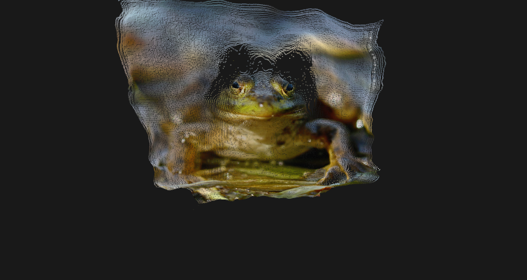
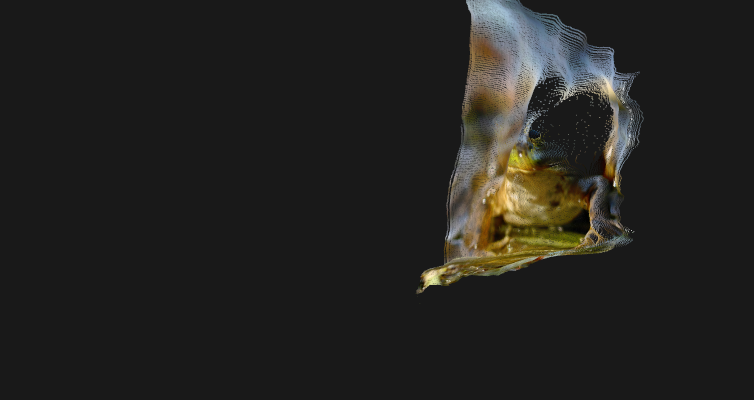

# Depth Splat Example

> **Requires the Vulkan backend.** The D3D11 backend does not draw compute-written point buffers, so this chain
> renders black there even though `PointCount` shows the points exist. Launch with `TIXL_BACKEND=vulkan`.

Turns a still image or video into an orbitable 2.5D splat: DepthAnything estimates depth, `DepthToPoints` unprojects every pixel into a camera-space point, and `DrawPoints` billboards the points as soft sprites.





## Composition Structure

```
[LoadImage / Video] ──> [DepthAnything] ──> [DepthToPoints] ──> [TransformPoints] ──> [DrawPoints] ──> [Output]
                             │                     ▲
                             ├── DepthTexture ─────┤
                             ├── OutputTexture ────┤
                             ├── VerticalFov ──────┤
                             └── ConfidenceTexture ┘
```

## Node Configuration

### DepthAnything
- **ModelSize**: V3 Small
- **ExecutionProvider**: CUDA (or DirectML)
- **Smoothing**: 0.2 for video, 0 for stills to avoid pulsing

### DepthToPoints
- **DepthTexture**: `DepthAnything.DepthTexture`
- **ColorTexture**: `DepthAnything.OutputTexture`
- **FieldOfView**: `DepthAnything.VerticalFov` (the operator falls back to 50° when the model reports 0)
- **ConfidenceTexture**: `DepthAnything.ConfidenceTexture` (optional; with the V3 Base model, set `ConfidenceThreshold` to about 1.0)
- **PixelStride**: 2 for 518x518 input
- **MaxPoints**: 262144
- **SplatSizePixels**: 2
- **Opacity**: 1
- **TemporalSmoothing**: 0.7-0.9 for a still webcam; 0-0.3 for a moving camera

### TransformPoints
- **Points**: `DepthToPoints.Points`
- **Rotation**: `{ 0, 35, 0 }` to see the depth relief
- Optional: translate so the cloud pivots around its center

### DrawPoints
- **GPoints**: `TransformPoints.Output`
- **UsePointsScale**: true
- **PointSize**: 5 (makes `SplatSizePixels` map 1:1)
- **EnableZWrite**: false
- **EnableZTest**: true
- **AlphaCutOff**: 0.01

## Expected Results

- A colored, billboarded point cloud that reveals the depth relief when rotated.
- `PointCount` reports the buffer size: 518x518 with stride 2 gives 67,081 points.
- No CPU readback: points are written by one compute dispatch and drawn by `DrawPoints`.

## Stabilizing a Still Camera

A stationary webcam still gets per-frame depth noise, so the point cloud crawls. Three independent knobs, cheapest first:

1. `DepthAnything.Smoothing` blends the depth map and its range across frames.
2. `DepthToPoints.TemporalSmoothing` blends the resulting 3D points; 0.8-0.9 works well for a still camera and adds a second point buffer.
3. `DepthFilter` between the depth output and `DepthToPoints` is a spatial bilateral filter; it removes speckle at the cost of some edge detail.

The V3 Base export also has a confidence output; connect `ConfidenceTexture` and raise `ConfidenceThreshold` to about 1.0. That drops the low-confidence flying pixels that otherwise stretch into long spikes at depth edges. The value is model-dependent; check the point count and the image before raising it further.

## Camera Reference

With the V3 Base model, `DepthAnything.CamReference` publishes the estimated camera (pose from extrinsics, FOV from intrinsics). Connect it to `ApplyCamTransform.CamReference` or `SortPoints.CameraReference`. The object follows DA3's image frame; the splat is y-up, so a render camera driven directly by it needs a Y flip.

## Performance Tips

1. Raise `PixelStride` to 3 or 4 for cheaper previews; the stride also grows automatically when `MaxPoints` would be exceeded.
2. Use `DrawPoints.EnableZWrite=false`; transparent splats should not occlude each other.
3. Connect the white dot texture from `Lib:images/basic/white-dot-256px.png` to `DrawPoints.Texture_` for round splats instead of squares.
4. When the source aspect differs from the model's square input, scale the point object's X axis to the source aspect.
5. For V2 models, enable `DepthIsDisparity` on `DepthToPoints`.
