# AI video — depth and diffusion

Two independent ONNX Runtime pipelines. `DepthAnything` estimates depth from any image and feeds
three small, fast post-processors; `StreamDiffusion` generates or transforms images from text prompts.
Both need their model files installed locally — the operators load them from the package `Assets`
folder, and the packages ship download scripts for exactly that.

## DepthAnything

Estimates a depth map from an image with **Depth Anything V2**. The operator runs the model on a
background worker and publishes three textures: the input unchanged (`OutputTexture`), the raw float
depth (`DepthTexture`) and a normalized, optionally colorized depth image
(`NormalizedDepthTexture`). `UpdateCount`, `MinDepth`, `MaxDepth` and `Status` expose the worker's
state, so you can build graphs that wait for the first result or react to the depth range.

- `InputTexture` is any Texture2D — a webcam, an image loader, a render.
- `Enabled` pauses/resumes inference; when off, `OutputTexture` passes the input through and the depth
  outputs are cleared.
- `ModelSizeParam` selects Small (fp16), Small fp32, Small int8, Base or Large. Smaller models are
  much faster; the small fp16 model is the default choice for live input.
- `InputResolution` fixes the model's input size (Auto, 196, 280, 392, 518); `MatchInputResolution`
  keeps the input image's aspect instead.
- `ExecutionProviderParam` selects CPU, DirectML or CUDA. CUDA is the fastest on an NVIDIA GPU;
  DirectML is the Windows fallback for other GPUs.
- `OutputFormat` chooses grayscale or a colorized depth ramp; `EnhanceContrast` and `InvertDepth`
  adjust the normalized output.
- `Debug` logs model loading and inference details.

**Outputs:** `OutputTexture` (input passthrough), `DepthTexture` (raw float), `NormalizedDepthTexture`
(0..1, visualized), `UpdateCount`, `MinDepth`, `MaxDepth`, `Status`.

*Models:* put `depth-anything-v2-small-fp16.onnx` (and optionally base/large) into
`Operators/DepthAnything/Assets`, or run `Operators/DepthAnything/Scripts/download_models.py`. The
operator resolves the file through the package's asset registry, so a restart is needed after adding
it.

*Tip:* inference is asynchronous. The depth outputs trail the input by a frame or more, and
`UpdateCount` only advances when a new frame has been processed — don't expect one update per graph
frame.

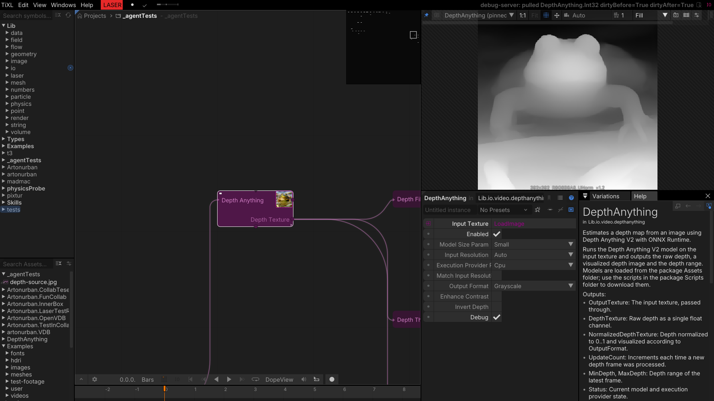
*The depth map on the frog example image, with provider and format settings.*

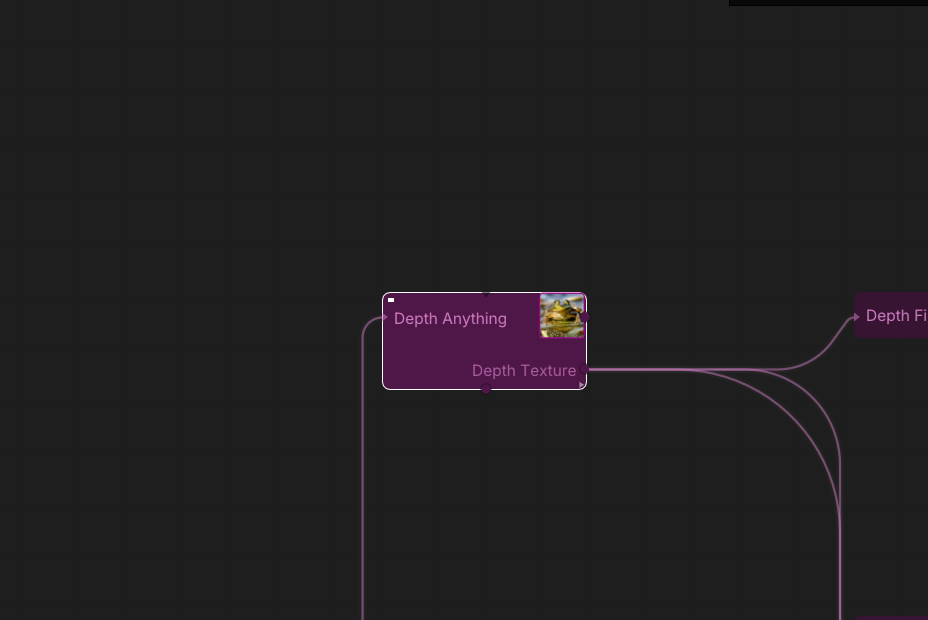
*`LoadImage` → `DepthAnything` → the three post-processing operators.*

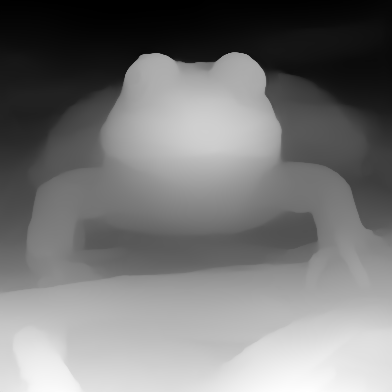
*The normalized depth of the frog image (small fp16 model, CPU).*

## DepthFilter

Edge-aware bilateral smoothing of a depth map. `SigmaSpace` sets the spatial radius, `SigmaColor` how
strongly depth differences are preserved; the filter averages neighbors only when their depth is
close, so silhouettes stay crisp while sensor noise and stepped bands disappear. It is the usual
cleanup before thresholding or normal generation.

- `DepthTexture` is the raw or normalized depth to filter.
- `SigmaSpace` is the spatial kernel radius in pixels.
- `SigmaColor` is the depth tolerance; larger values smooth across larger depth jumps.
- `Enabled` bypasses the filter.

**Output:** `FilteredDepth` (float depth).

*Note:* the raw float depth is displayed in the red channel — a red image is the depth, not an error.

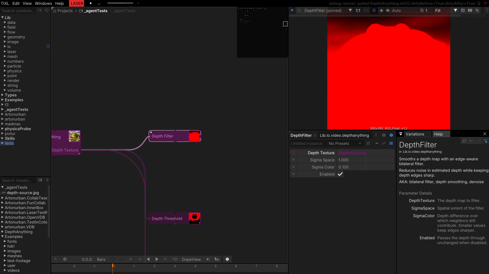
*Bilateral parameters next to the filtered output.*

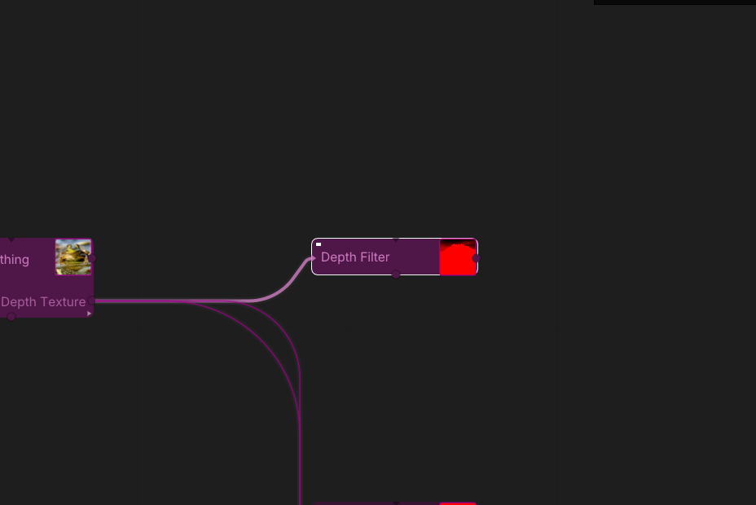
*The raw depth fed through the filter.*

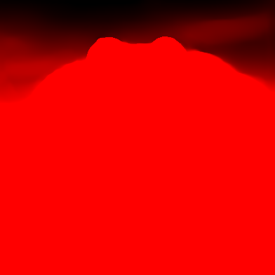
*The filtered float depth (shown in the red channel, as float textures are).*

## DepthThreshold

Turns a depth range into a binary mask. With `UseNormalized` on, the thresholds refer to the frame's
depth range (0 = nearest, 1 = farthest), so the same values keep working as the scene changes. The
mask is the standard way to separate a foreground subject from the background.

- `DepthTexture` is the depth map (raw or filtered).
- `MinThreshold` / `MaxThreshold` select the kept depth band.
- `Invert` flips the mask (keep the background instead).
- `UseNormalized` interprets the thresholds relative to the frame's depth range instead of absolute
  depth values.

**Outputs:** `MaskTexture` (binary mask) and `PixelRatio` (the fraction of the image that is masked).

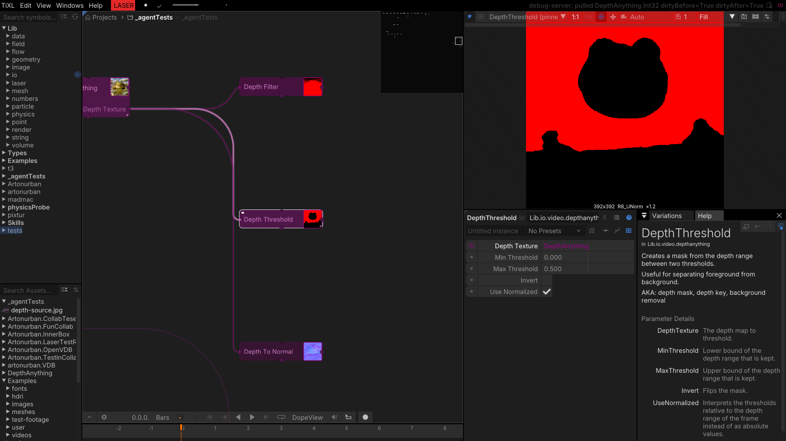
*The mask range and the resulting silhouette.*

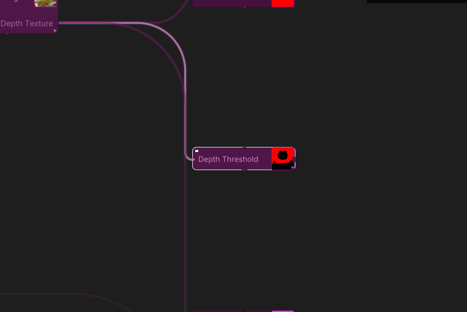
*The threshold branch of the chain.*

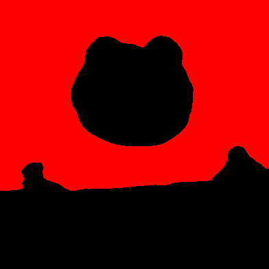
*The frog separated from the background.*

## DepthToNormal

Reconstructs a normal map from a depth map with Sobel edge detection. `Strength` scales the surface
slope and `Invert` flips the handedness, so the result can feed lighting, relighting or shading
setups that expect world- or view-space normals.

- `DepthTexture` is the depth map.
- `Strength` scales the normal slope.
- `Invert` flips the normal direction/convention.

**Output:** `NormalTexture`.

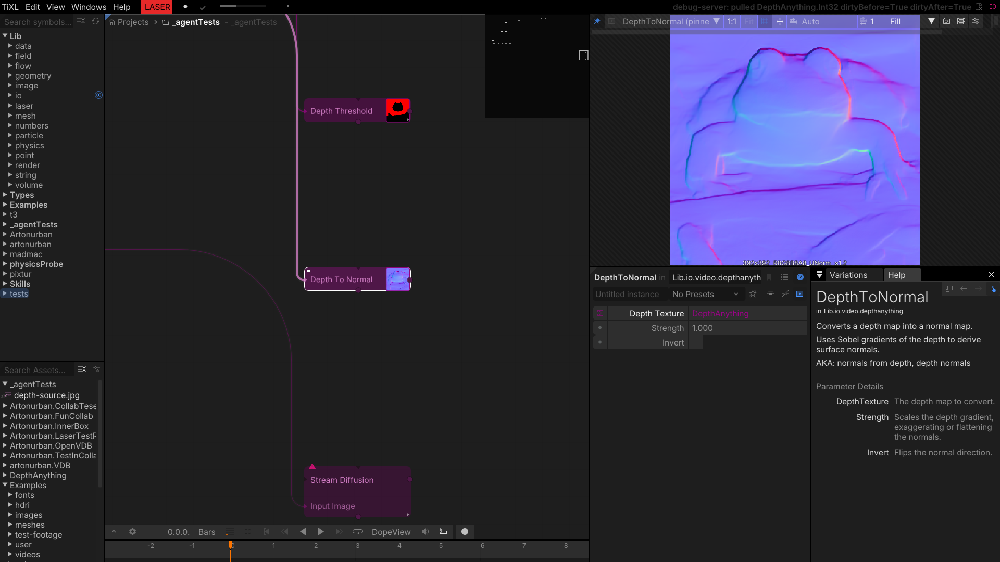
*Normal reconstruction parameters.*

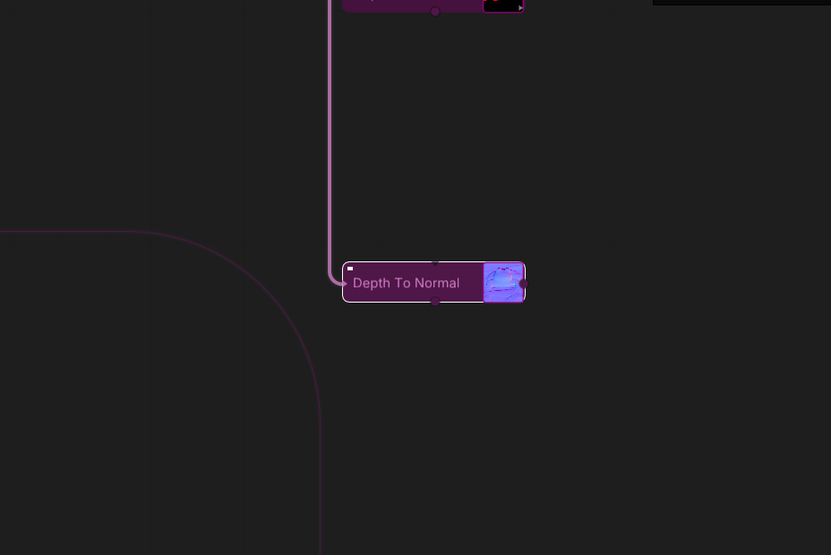
*The last branch of the depth chain.*

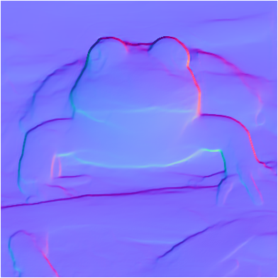
*Normals reconstructed from the depth map.*

## StreamDiffusion

Image generation with **Stable Diffusion 1.x / SD-Turbo** through ONNX Runtime, in text-to-image and
image-to-image modes. The operator runs a streamed pipeline: the UNet, VAE and text encoder are
separate ONNX files in `EnginePath`, the tokenizer files sit next to them, and `vae_encoder.onnx` is
needed for image-to-image. `TriggerGenerate` renders one frame; `AutoGenerate` keeps generating for a
live output.

- `EnginePath` points at a folder containing `unet.onnx`, `vae_decoder.onnx`, `text_encoder.onnx`,
  the tokenizer files, and `vae_encoder.onnx` for img2img.
- `Mode` selects text-to-image or image-to-image.
- `Prompt` / `NegativePrompt` drive the generation; `Seed` makes it repeatable (-1 = random).
- `Width` / `Height` are the generation size; `MatchInputSize` follows the input image instead.
- `Guidance` is the classifier-free guidance scale; `Strength` how much an img2img pass changes the
  input; `Steps` the number of denoising steps (1 is the SD-Turbo default).
- `InputImage` is required for img2img mode.
- `ModelType` selects SD 1.x or SD-Turbo; `CudaDevice` and `ExecutionProviderParam` choose the GPU.
- `TriggerGenerate` renders one frame on a flank; `AutoGenerate` runs continuously.

**Outputs:** `Output` (the generated texture), `OutputSize`, `GenerationTime` (seconds for the last
frame).

> The ONNX engine files are not installed on this machine, so the screenshots document the operator
> and its inputs rather than a generated frame. Put the engine folder in place and point
> `EnginePath` at it to enable generation.

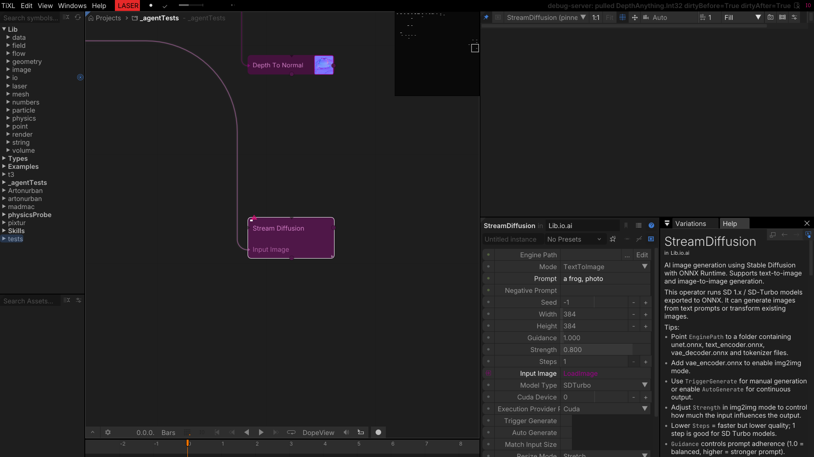
*Prompt, mode and sampling parameters with the operator help.*

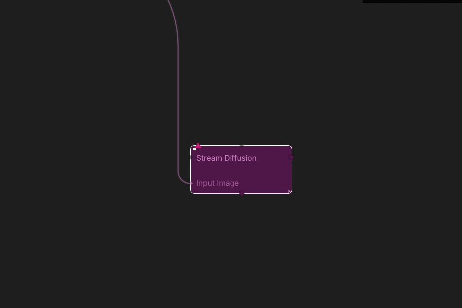
*The image input wired from the example image.*
