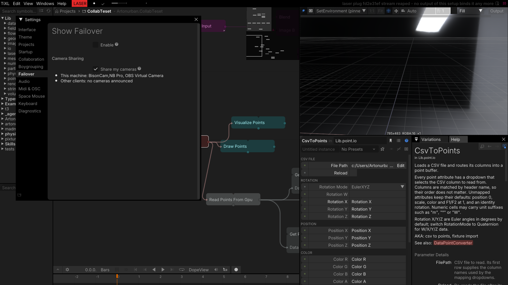
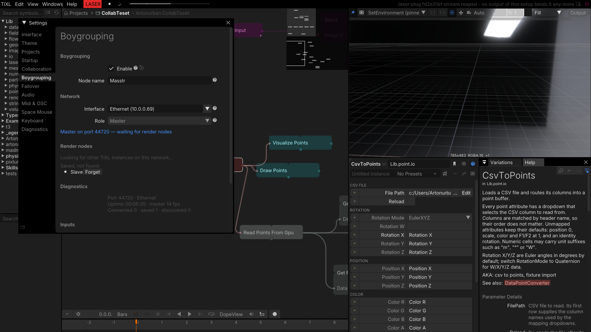
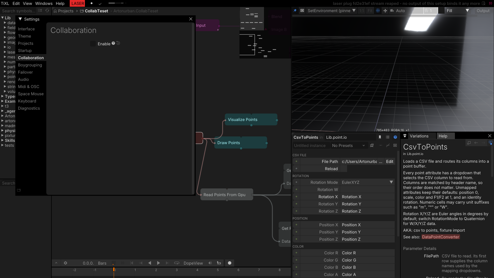

# Feature panels

The week also added UI around the operators. These panels live in the editor settings and in the
output setup; they are what makes the new network features usable without editing config files.

## Camera sharing — Show Failover → Camera Sharing

The failover panel gained a camera-sharing section. **Share my cameras** publishes this machine's
cameras to the other TiXL clients in the session; the panel lists the local devices and whether other
clients announced cameras. Together with the peer entries in `VideoDeviceInput`'s device dropdown,
this is how a camera plugged into one machine becomes selectable on the others — the render node can
capture it as if it were local.

*Sharing enabled: the local BisonCam and OBS Virtual Camera are listed; no peer cameras are online.*

## Boygrouping

Enable, node name, network interface, role (master/slave) and the render-node table, including saved
nodes, per-node diagnostics (port, uptime, fps, connected/saved/discovered counts) and the input relay
(MIDI/OSC replay and remote camera sources). In a boygroup the master's timeline drives playback on
all render nodes; there are no Play/Stop/Deploy buttons in this panel.

*This editor acting as the boygroup master, waiting for render nodes.*

## Collaboration

The collaboration settings panel is the entry point for hosting or joining sessions, with the project
picker, password and participant management. In this capture collaboration is off, so the panel only
shows the master enable switch; the participant table, spectate/follow and kick actions appear once a
session is running.

*Collaboration master switch.*
