# New operators and functions — week of Oct 25 – Nov 1, 2026

A visual changelog of the operators added to the `tixl-multi-allin` branch in the last week. Each
operator has two or three screenshots:

1. **Editor** — the operator selected, with its parameter window and the built-in operator help.
2. **Graph** — a close-up of the node and its wiring.
3. **Output** — where the operator produces something visible, the render or texture it makes.

The screenshots were captured from the running Debug editor through its TCP debug bridge, from the
built-in example compositions and from the branch's test projects. Images live in [`shots/`](shots).
The same content is also split into one page per area for review: [Volumes](volume.md),
[Physics](physics.md), [AI video](depth-ai.md), [Laser](laser.md), [OMT](omt.md),
[Video input](video-input.md), [Utilities](utilities.md), [Feature panels](feature-panels.md).

## At a glance

| Area | Operators |
| --- | --- |
| Volumes — generate | `VolumePrimitive`, `VolumeFromMesh`, `VolumeFromPoints`, `FieldToVolume` |
| Volumes — modify | `VolumeCsg`, `VolumeFilter`, `VolumeMath`, `VolumeMorphology`, `VolumeNoise`, `VolumeResample` |
| Volumes — convert | `VolumeToMesh`, `VolumeToPoints`, `VolumeToField`, `VolumeToTexture3D`, `VolumeToNanoVdb` |
| Volumes — render | `NanoVdbRender`, `VolumeField` |
| Volumes — I/O and analysis | `LoadVdb`, `SaveVdb`, `SaveNanoVdb`, `VolumeInfo` |
| Physics | `PhysicsWorld`, `RigidBody`, `RigidJoint` |
| AI video | `DepthAnything`, `DepthFilter`, `DepthThreshold`, `DepthToNormal`, `StreamDiffusion` |
| Laser | `LaserCamera`, `LaserPointsToBuffer`, `PONKInput` |
| OMT | `OmtInput`, `OmtOutput` |
| Video input | `VideoDeviceInput` (peer cameras) |
| Utilities | `CsvToPoints`, `MeshToSDF` |
| Feature panels | camera sharing, boygrouping, collaboration |

---

## Volumes — OpenVDB and NanoVDB

The volume package builds sparse, OpenVDB-style grids on the CPU and gives them two GPU paths:

- **NanoVDB path** — `VolumeToNanoVdb` flattens the grid into the linear NanoVDB buffer layout, and
  `NanoVdbRender` ray-marches up to three of those buffers (liquid, smoke, fire) in one shader.
- **Field path** — `VolumeToTexture3D` bakes the grid into a dense 3D texture, `VolumeField` exposes
  it as a field, and `RaymarchField` renders it with TiXL's existing field pipeline.

Everything else is the CPU toolset around those paths: generate a grid, modify it, convert it to a
mesh, points or a field, and read or write it on disk.

Two conventions matter throughout. Level sets store **signed distances in world units** (negative
inside, positive outside); fog volumes store density. And the exact values only exist inside a
**narrow band** around the surface (`BandWidth` voxels) — deeper voxels keep only their sign. Smaller
voxels sharpen everything and cost memory quadratically; larger voxels are cheap and soft.

**Generate**

### VolumePrimitive

Builds an analytic primitive — sphere, box, rounded box, torus, capsule, cylinder, cone, octahedron
or plane — directly as a narrow-band level set, the way OpenVDB's `LevelSetSphere` and friends do.
The result is an exact signed distance field near the surface, with no meshing or sampling step
before you combine, noise or mesh it.

- `Shape` selects the primitive; planes and boxes use their full extents.
- `Size` is the full extent in world units — a sphere reads only its X component as the diameter.
- `Center` moves the whole grid, so a primitive's index space is tied to its position.
- `VoxelSize` is the edge length of one voxel; it drives sharpness, memory and simulation cost.
- `BandWidth` is the half-width of the narrow band in voxels (1–64). Values deeper than the band keep
  only their sign, which is enough for meshing and CSG.

**Output:** `Volume` — a level set ready for `VolumeCsg`, `VolumeNoise`, `VolumeMorphology` and
`VolumeToMesh`.

*Tip:* two primitives with different centers live in different index spaces. CSG and resample
convert them into a common grid, which is why combining a coarse and a fine primitive costs a
resample.

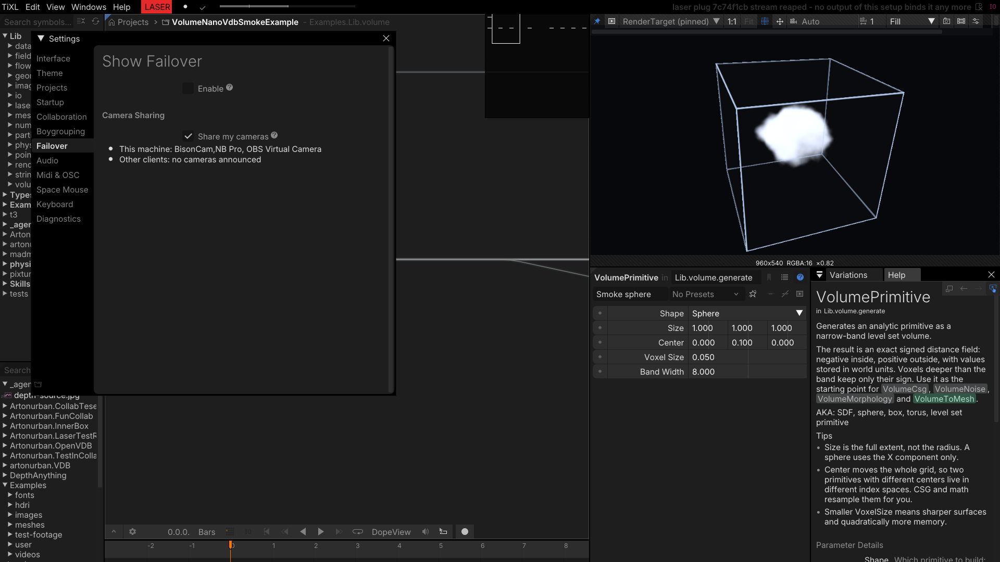
*The parameter window, operator help and the smoke example's live render behind it.*

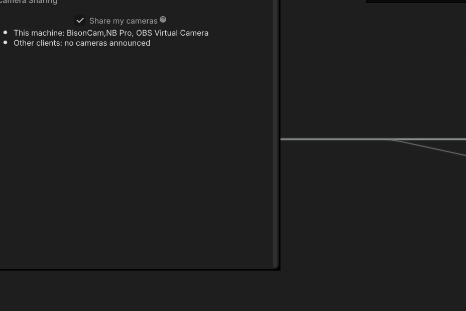
*The sphere primitive feeding `VolumeNoise` and `VolumeToNanoVdb`.*

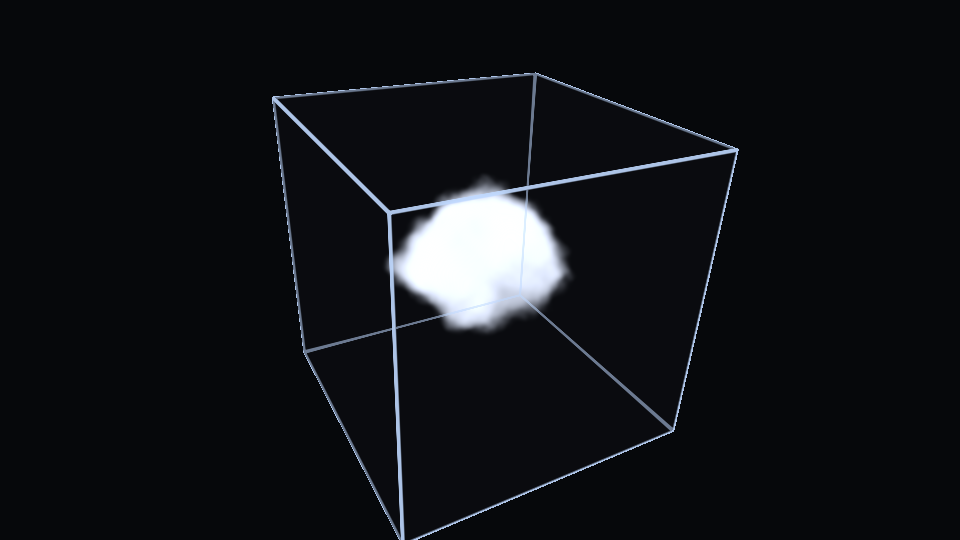
*The example's raymarched result after noise displacement.*

### VolumeFromMesh

Converts a triangle mesh into a sparse volume. Mesh mode produces a **signed distance field**
(negative inside the surface), or a **fog volume** whose density falls off from the surface, depending
on `Mode`. Distances are exact within the narrow band; the interior is only signed.

- `Geometry` is the source mesh (connect `GeometryToMesh` output).
- `VoxelSize` sets the grid resolution; the mesh's smallest feature should be at least a few voxels.
- `BandWidth` controls how far the exact distances extend; increase it for heavy morphology.
- `Mode` switches between surface SDF and fog density.

**Output:** `Volume`. Convert it back with `VolumeToMesh`, raymarch it through `VolumeToTexture3D` +
`VolumeField`, or export it with `SaveVdb`.

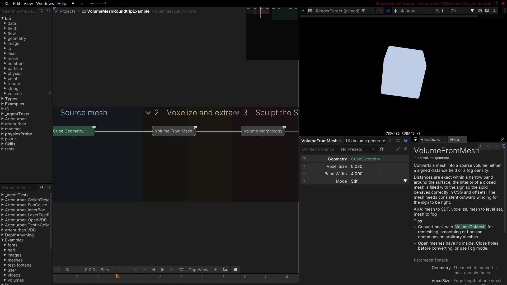
*Mesh → SDF → morphology → mesh roundtrip.*

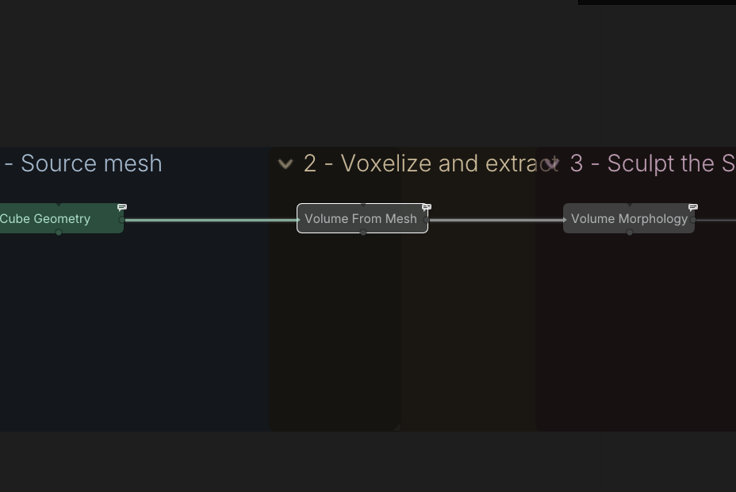
*The cube geometry is converted to a level set, smoothed and meshed again.*

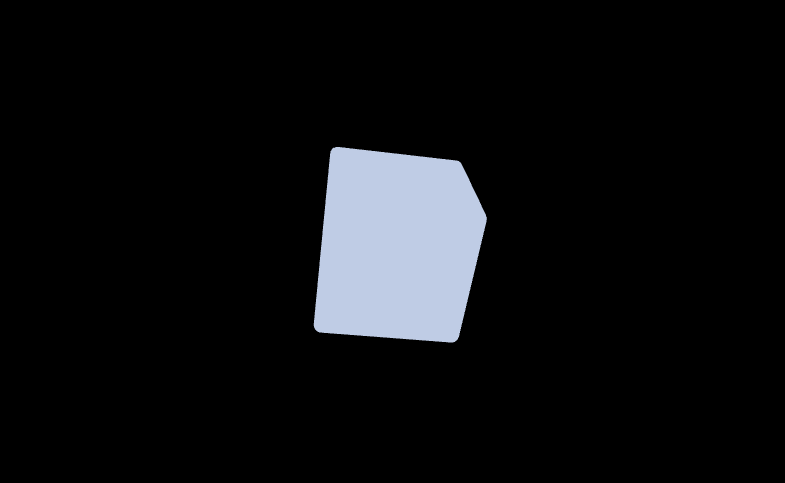
*The extracted isosurface of the converted mesh.*

### VolumeFromPoints

Splats a point list into a sparse density volume — OpenVDB's particles-to-volume. Every point
contributes a normalized falloff kernel over its radius, so the result is a fog volume rather than a
level set. It is the way to volumize particle simulations, point clouds or points scattered from
geometry.

- `Points` accepts a CPU `StructuredList` (the `Points` output of `VolumeToPoints`, `CsvToPoints`, or
  a point/particle buffer).
- `VoxelSize` sets the grid resolution; `Radius` how far each point reaches.
- `Density` scales the accumulated density; `Falloff` selects the kernel shape.

**Output:** `Volume` (density). Feed it to `VolumeToMesh` with a density isovalue, or to the fog/
texture path for clouds.

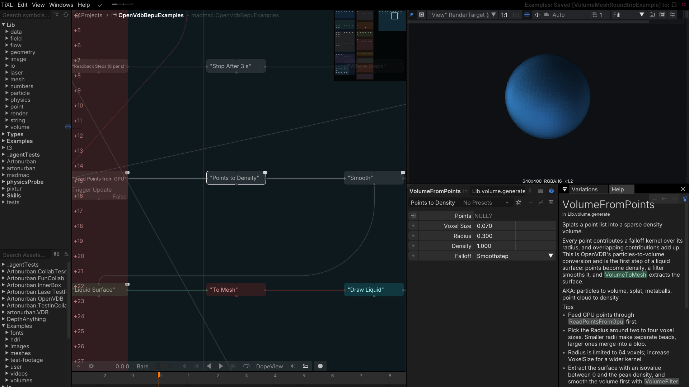
*"Points to Density" in `OpenVdbBepuExamples`.*

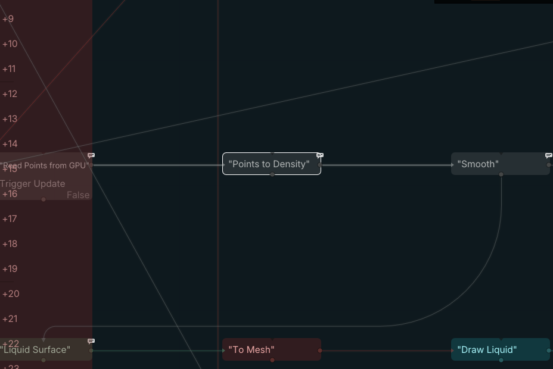
*Points to density feeding the liquid rendering branch.*

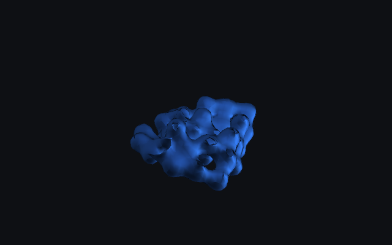
*The density volume turned into a blue liquid surface.*

### FieldToVolume

Samples a CPU scalar field into a sparse grid over a box region — the inverse of `VolumeToField`.
With a signed-distance field you get a valid level set; with any other scalar you get a fog volume.
`CustomScalarField`, noise fields, image-derived fields or a volume wrapped by `VolumeToField` all
work as the source.

- `Field` is the scalar field to sample.
- `Center` and `Size` place the box in world space.
- `VoxelSize` sets the sample spacing; it is the resolution of the resulting grid.
- `Mode` interprets the values as a level set (signed distance) or as density.

**Output:** `Volume`.

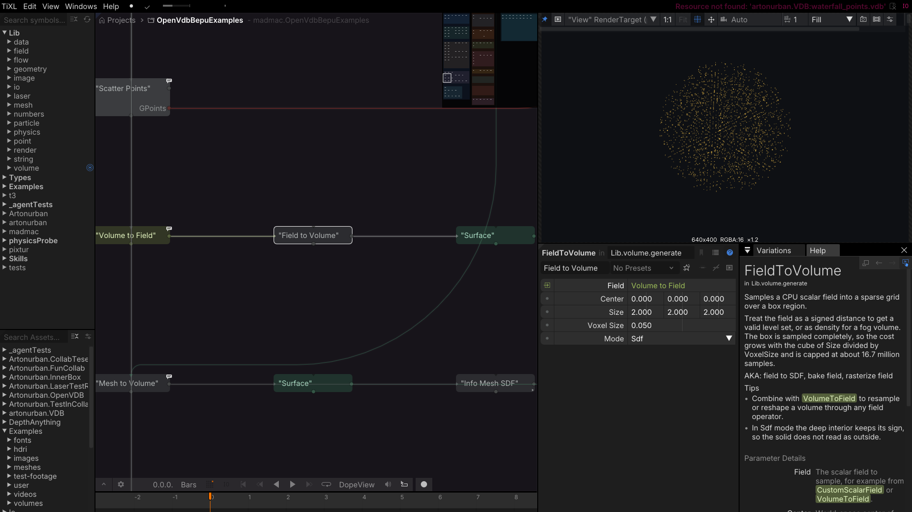
*The field-to-volume half of the volume/field bridge.*

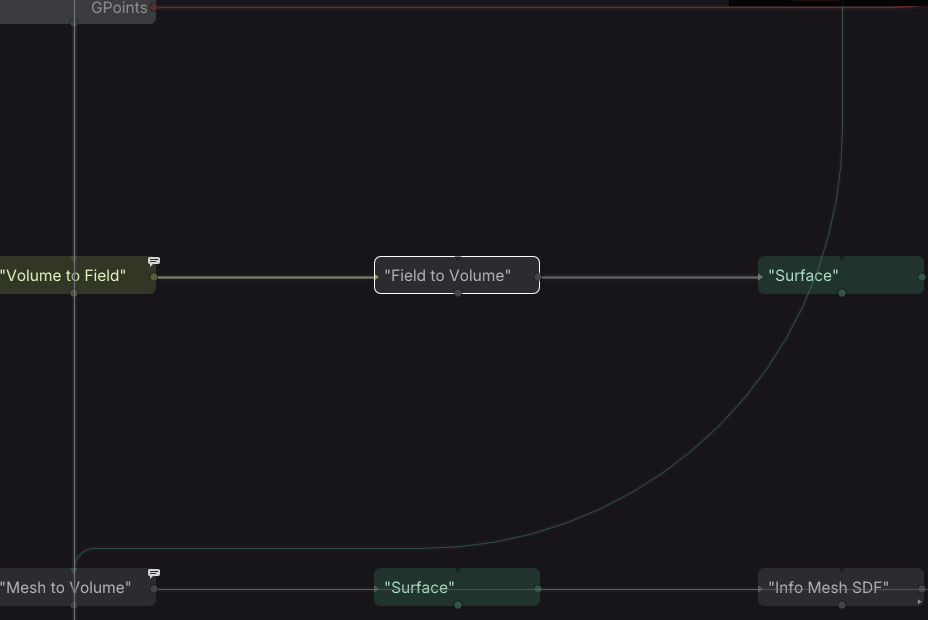
*The inverse of `VolumeToField`, closing the roundtrip.*

**Modify**

### VolumeCsg

Constructive solid geometry on level sets, matching OpenVDB's `csgUnion`, `csgIntersection` and
`csgDifference`. **Union** merges both solids, **Intersection** keeps only the overlap, **Difference**
carves B out of A. The result is a fresh level set, so it can be meshed immediately or fed into
another CSG.

- `VolumeA` is the first operand; for Difference it is the solid that is carved.
- `VolumeB` is the second operand; for Difference it is the tool that is removed.
- `Operation` selects Union, Intersection or Difference.

**Output:** `Volume`. Volumes with different voxel sizes or centers are combined into the finer grid,
so a fine operand makes the result more expensive.

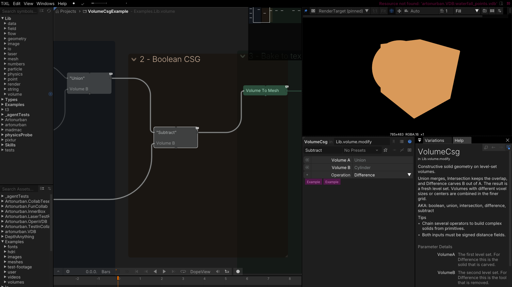
*A sphere with a cutting box subtracted, with the example's live mesh render.*

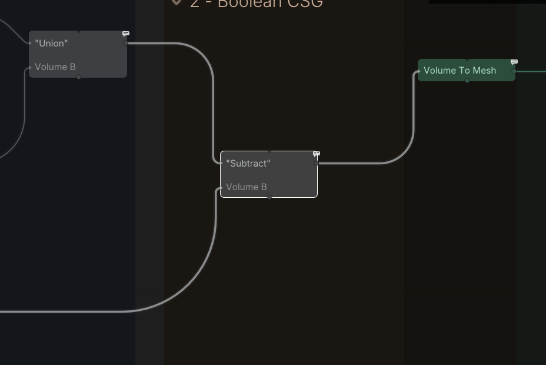
*The two operands and the resulting volume downstream.*

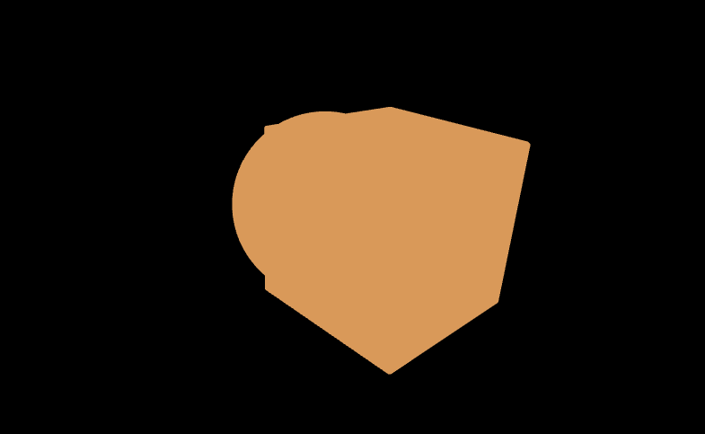
*The example meshes the boolean result and draws it unlit.*

### VolumeFilter

Smooths and adjusts the voxel values themselves — not the extracted surface. **Gaussian** and **Box**
blur noise (the classic cloud/smoke smoothing), **Median** removes outlier voxels, and **Offset**
shifts every value, which moves a level set's surface inward or outward.

- `Volume` is the grid to filter.
- `FilterType` chooses Gaussian, Box, Median or Offset.
- `Radius` is the stencil radius in voxels; larger radii are slower but smoother.
- `Iterations` repeats the filter, compounding the smoothing.
- `Offset` is the value shift for the Offset mode (world units on a level set).

**Output:** `Result`. On level sets the surface moves; on fog volumes the density changes.

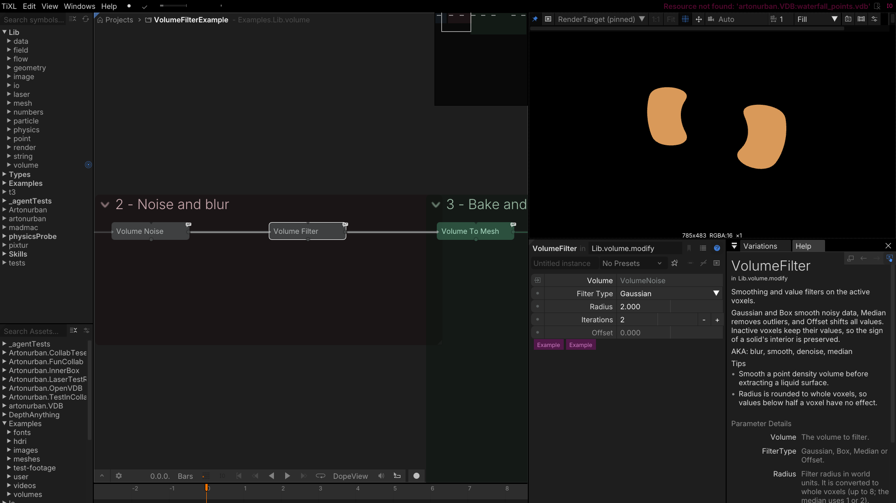
*Smoothing a noisy torus before meshing.*

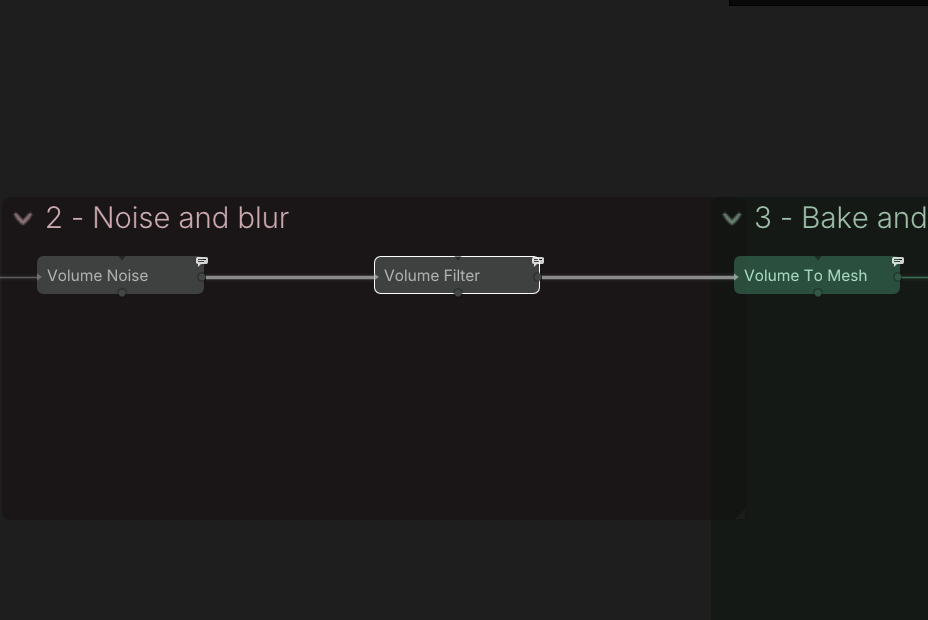
*Noise → filter → mesh → draw.*

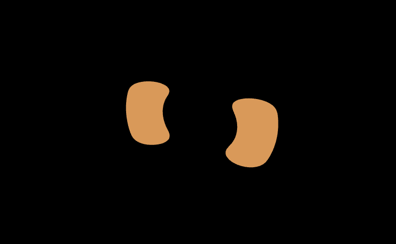
*The smoothed surface extracted from the filtered volume.*

### VolumeMath

Arithmetic between two volumes or between a volume and a constant: **Add**, **Subtract**, **Multiply**,
**Divide**, **Min** and **Max**. With `UseConstant` off, the second operand participates; voxels
missing from either volume read as background, so the operation is sparse-grid aware.

- `VolumeA` / `VolumeB` are the operands.
- `Operation` selects the arithmetic.
- `UseConstant` disables B and uses `Constant` instead.
- `Constant` is the scalar for the constant modes.

**Output:** `Result`. On level sets, adding a constant offsets the isosurface; `Max`/`Min` give
intersection/union-like combinations without a full CSG.

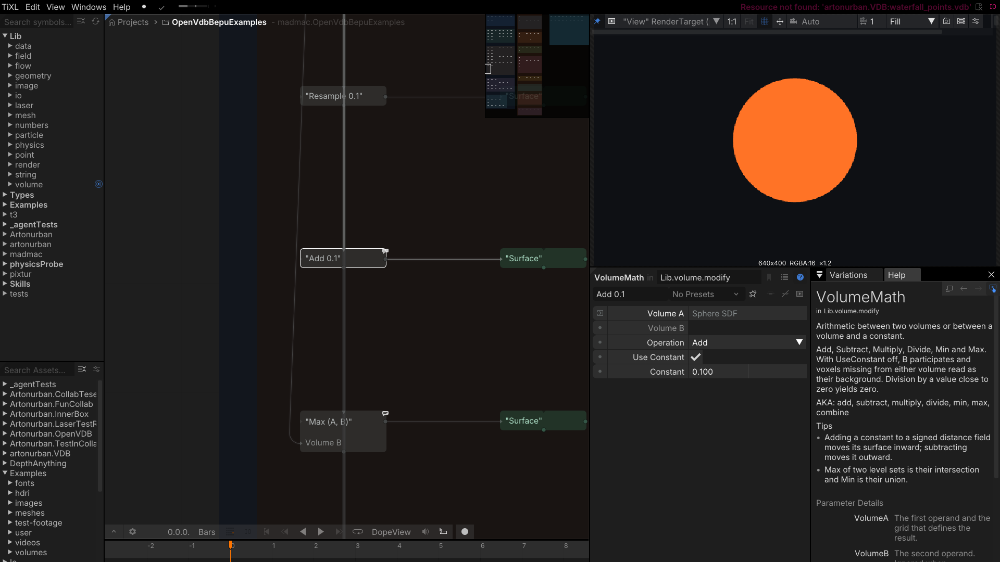
*"Add 0.1" — adding a constant shifts the level-set surface inward or outward.*

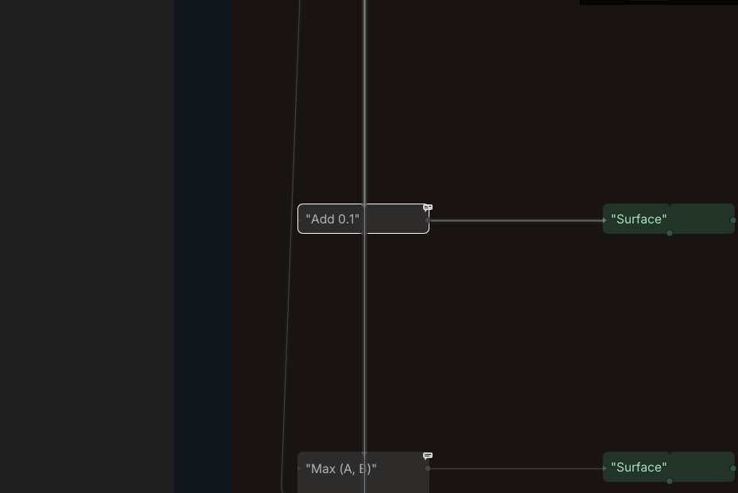
*The arithmetic branch of the test project.*

### VolumeMorphology

Morphological operations on volumes. On level sets, **Dilate** offsets the surface outward and
**Erode** inward; **Open** (erode then dilate) removes small features, **Close** (dilate then erode)
fills pinholes. Fog volumes use min/max stencil filtering instead.

- `Volume` is the grid to modify.
- `Operation` selects Dilate, Erode, Open or Close.
- `Radius` is the distance in voxels for the offset.

**Output:** `Result`. Morphology changes the topology, so you can break a thin shell into pieces or
fuse nearby blobs.

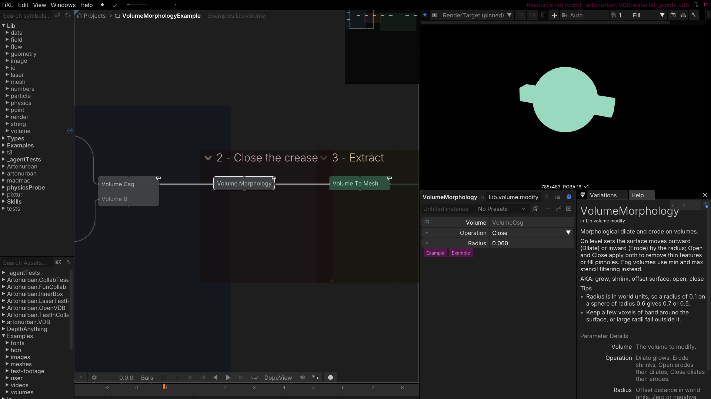
*Growing and shrinking a level set before meshing.*

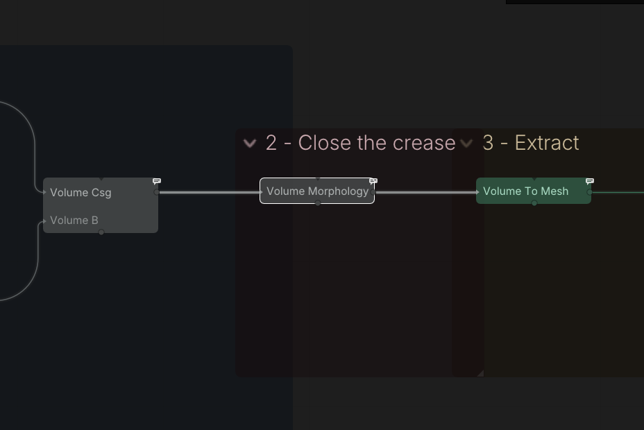
*The morphology step in the example chain.*

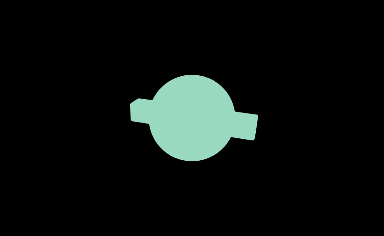
*The modified surface extracted as a mesh.*

### VolumeNoise

Adds procedural fractal noise to a volume. **Perlin**, **Simplex** or **Worley** noise can be
combined with **fBm**, **Ridged** or **Billow** fractals. **Add** and **Multiply** modulate values;
**Replace** overwrites them; **Displace** pushes level-set surfaces along the noise, which is the
organic-shape workhorse.

- `Volume` is the input grid.
- `Seed` makes the pattern repeatable.
- `NoiseType` and `Fractal` choose the base noise and the octave combination.
- `Octaves` is the number of detail layers; `Frequency` the scale in space.
- `Amplitude` is the strength. In Displace mode it is measured in voxels, so an amplitude of 2 moves
  the surface by about two voxels.
- `Offset` shifts the noise field; animate it to make the noise flow.
- `Mode` selects Add, Multiply, Replace or Displace.

**Output:** `Result`.

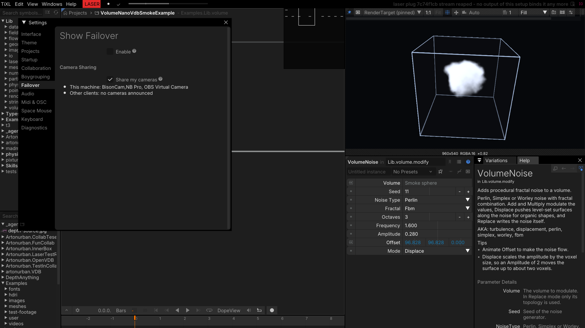
*Noise parameters with the live smoke render.*

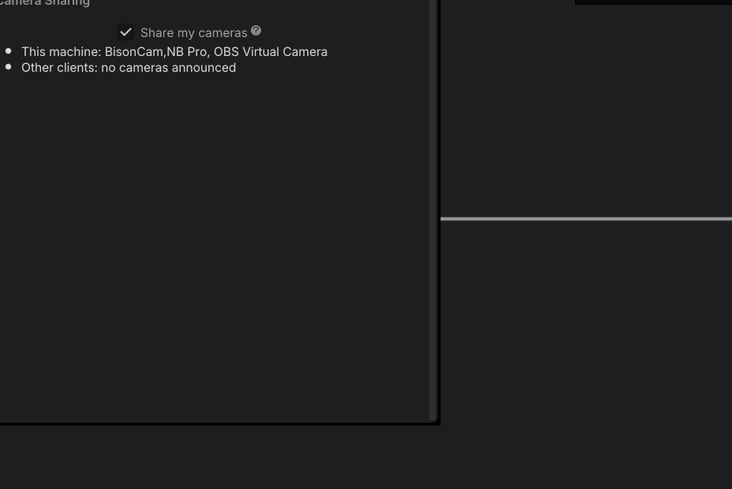
*Animating `Offset` makes the noise flow.*

*Displaced level set rendered through NanoVDB.*

### VolumeResample

Changes a volume's voxel size, resampling the values trilinearly (OpenVDB's `resampleToMatch`).
Smaller voxels add detail and memory; larger voxels are cheaper and smoother. Resampling is also how
volumes with different index spaces are brought into a common grid.

- `Volume` is the source grid.
- `VoxelSize` is the target edge length.

**Output:** `Result`, in the new grid.

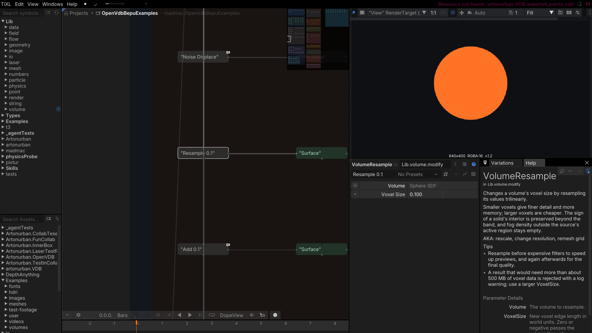
*"Resample 0.1" changing the grid resolution.*

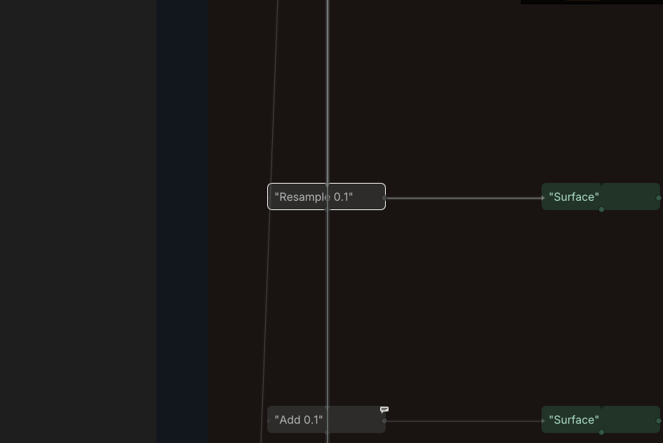
*Resampling before surface extraction.*

**Convert**

### VolumeToMesh

Extracts an isosurface from a volume as a triangle mesh with marching cubes, sharing vertices and
using gradient normals. Isovalue 0 extracts a level set's surface; for fog volumes pick a density
cutoff. The mesh is watertight unless the volume was clipped or corrupted.

- `Volume` is the grid to extract.
- `Isovalue` is the surface value; 0 for level sets, a density threshold for fog.

**Output:** `Geometry` — convert with `GeometryToMesh` and draw with `DrawMesh`/`DrawMeshUnlit`.

*Tip:* small voxels give detailed but heavy meshes; morphology before extraction is cheaper than
extracting at a very fine voxel size.

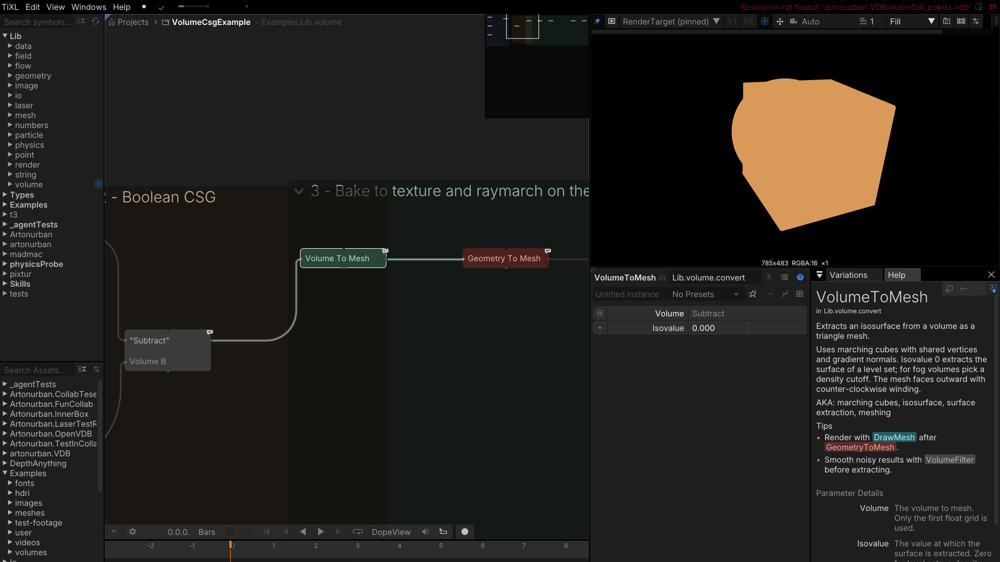
*Surface extraction from a CSG result.*

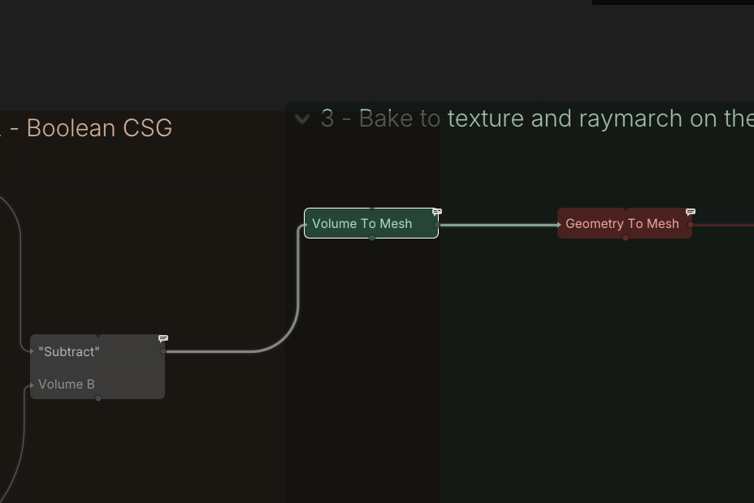
*Mesh → `GeometryToMesh` → `DrawMeshUnlit`.*

*The boolean result meshed and drawn.*

### VolumeToPoints

Converts volume voxels into a point list, either the active voxels above a threshold (highest values
first) or a uniform random subset of them. Points feed the point and particle operators, or
`VolumeFromPoints` again after editing.

- `Volume` is the source grid.
- `Mode` selects thresholded active voxels or random scattering.
- `Isovalue` is the threshold for the thresholded mode.
- `MaxPoints` caps the output; the highest values win.
- `Seed` makes the random subset repeatable.

**Outputs:** `Points` (CPU `StructuredList`) and `GPoints` (the same points on a GPU structured buffer
for point renderers such as `DrawBillboards`).

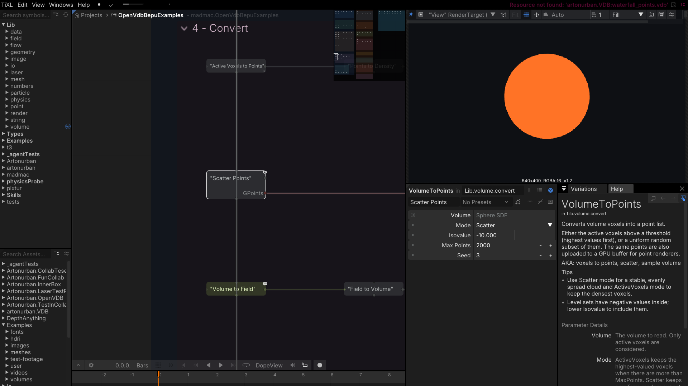
*"Scatter Points" with the point render downstream.*

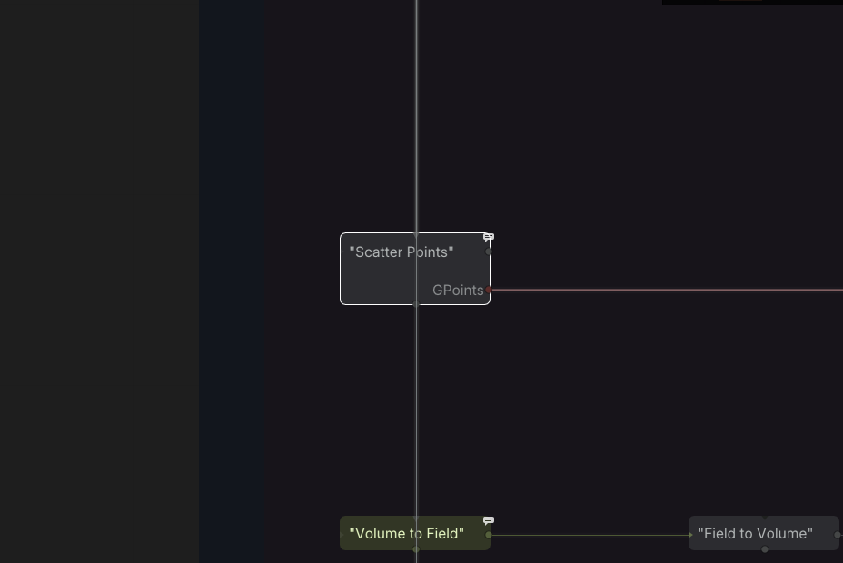
*The point cloud branch of the test project.*

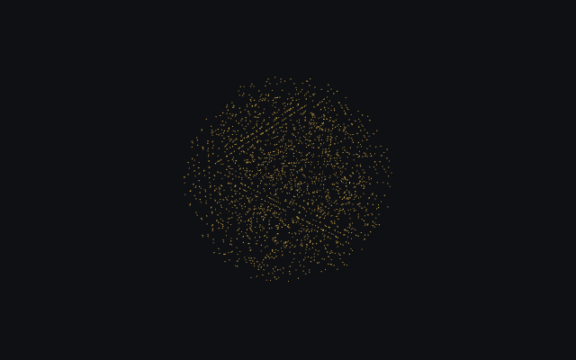
*The active voxels drawn as a point sphere.*

### VolumeToField

Wraps a volume in a CPU scalar field that samples it trilinearly in world space. The field plugs into
everything that consumes scalar fields: `DisplaceGeometry`, `ScatterPointsInVolume` density and field
SDF combinations. This is the bridge from sparse volumes to TiXL's field operators.

- `Volume` is the grid to wrap.
- `Scale` and `Offset` remap the sampled values.
- `OutsideValue` is returned where the volume has no data.

**Output:** `Field`.

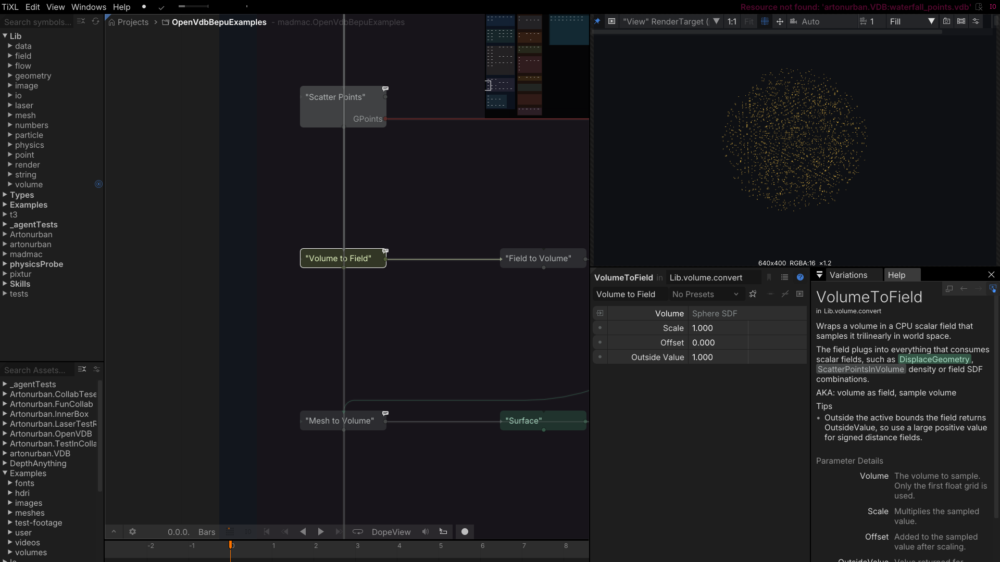
*The volume → field direction of the bridge.*

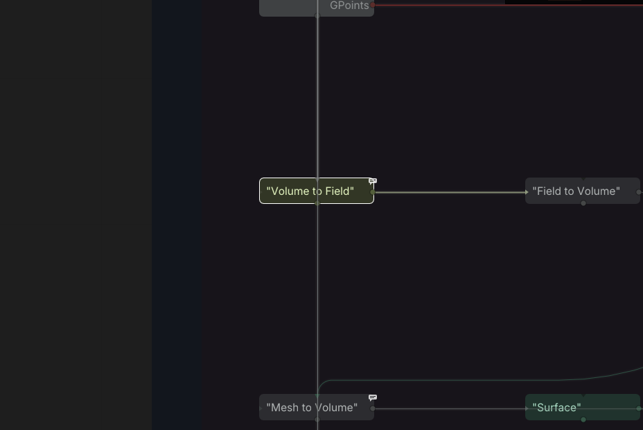
*The field consumed by `FieldToVolume` in the same test branch.*

### VolumeToTexture3D

Bakes a volume into a dense R32Float 3D texture plus its world-space bounds — the GPU bridge for
raymarching. Connect the texture to `VolumeField` and feed that into `RaymarchField`. The bake
density is capped by `MaxResolution`, so huge volumes are downsampled rather than exhausting memory.

- `Volume` is the source grid.
- `MaxResolution` caps the voxel count along the largest axis.

**Outputs:** `Texture`, `BoundsMin`, `BoundsMax`. Pass both bounds outputs 1:1 to `VolumeField`.

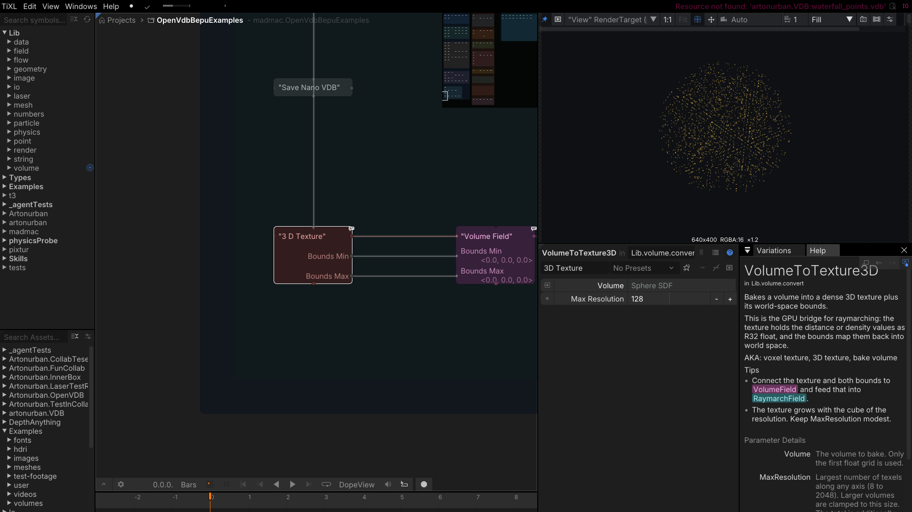
*"3D Texture" baking the volume.*

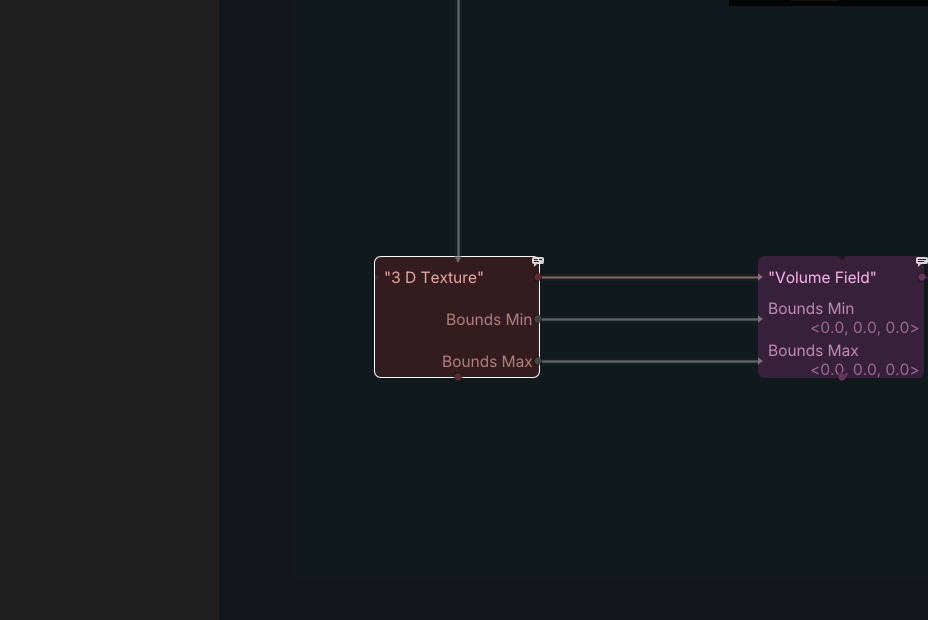
*Texture and bounds feeding `VolumeField` and `RaymarchField`.*

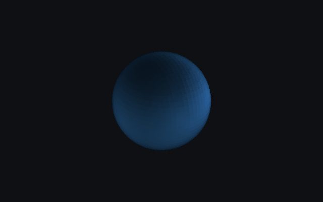
*The blue sphere rendered through the field pipeline.*

### VolumeToNanoVdb

Flattens the volume into a NanoVDB buffer — the GPU-ready linear grid layout — and uploads it as a
structured uint buffer for custom HLSL traversal. `TreeOffsets`, `VoxelCount` and `VoxelSize`
describe the grid; the `ShaderResourceView` is what `NanoVdbRender` samples. The CPU flattening is
the expensive part, so keep voxel sizes moderate for animated volumes.

- `Volume` is the source grid.

**Outputs:** `Buffer`, `ShaderResourceView`, `TreeOffsets`, `VoxelCount`, `VoxelSize`.

*Tip:* `NanoVdbRender` expects all three grid inputs (liquid, smoke, fire) connected so the shader's
register order is stable; use the amount inputs to hide the grids you do not need.

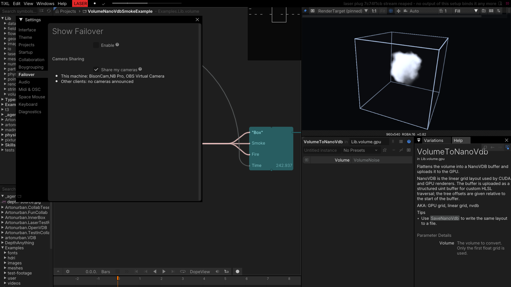
*Liquid, smoke and fire grids uploaded to the GPU.*

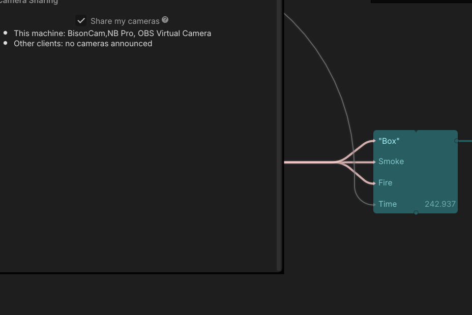
*Three grid inputs on the renderer must be connected so the shader registers stay in order.*

*The NanoVDB buffer raymarched in the example.*

**Render**

### NanoVdbRender

Ray-marches up to three NanoVDB grids — a liquid level set, smoke and fire — inside a glass box,
straight from the GPU buffers of `VolumeToNanoVdb`. The shader treats the liquid grid as a reflective
surface, and the smoke/fire grids as volumes whose density comes from the depth below their zero
level plus a procedural-noise breakup. The output is a draw command; place the operator inside a
camera's scene.

- `Liquid`, `Smoke`, `Fire` take the `ShaderResourceView` of three `VolumeToNanoVdb` ops.
- `LiquidAmount`, `SmokeDensity` and `FireIntensity` switch the contributions on and off.
- `BoxMin` / `BoxMax` define the world-space glass box; rays are clipped to it.
- `StepCount` is the raymarch resolution; `Time` animates the noise.
- `LiquidColor`, `SmokeColor`, `SmokeSoftness`, `FireSoftness`, `NoiseAmount` and `EdgeColor` shape
  the look.
- `LightDirection` lights the liquid and the volume.

**Output:** `DrawCommand`. Then add an `OrbitCamera` or use the scene's camera.

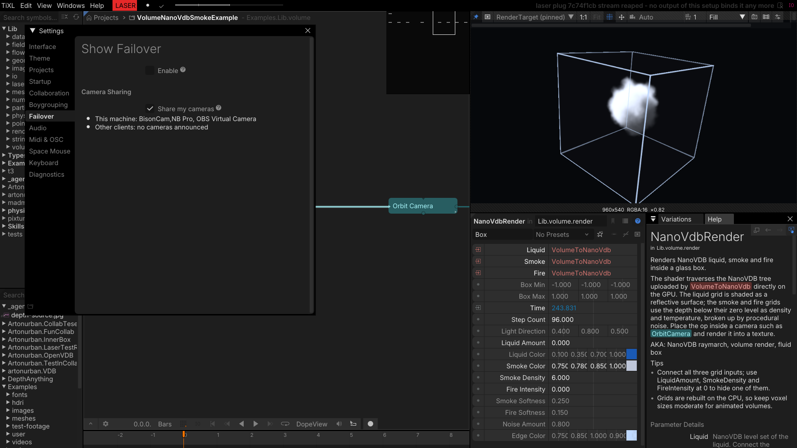
*The three grid inputs, box bounds and shading parameters.*

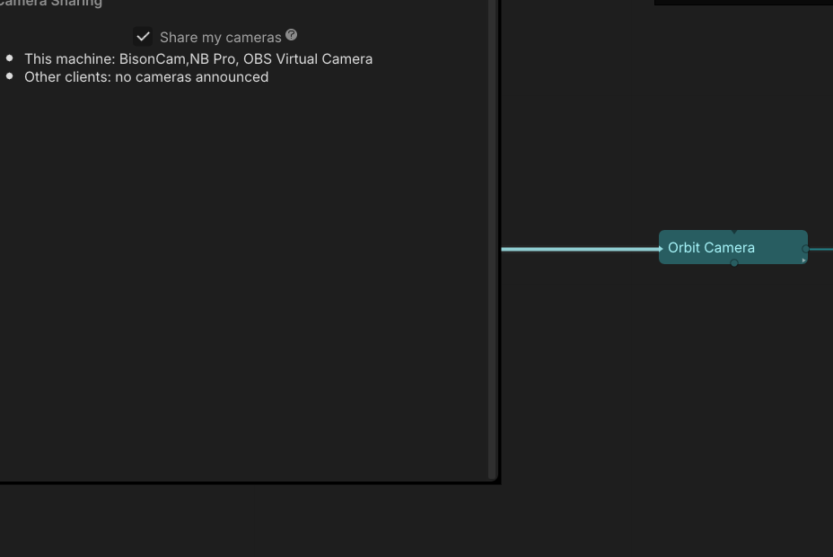
*Liquid, smoke and fire from `VolumeToNanoVdb`.*

*Smoke in the glass box.*

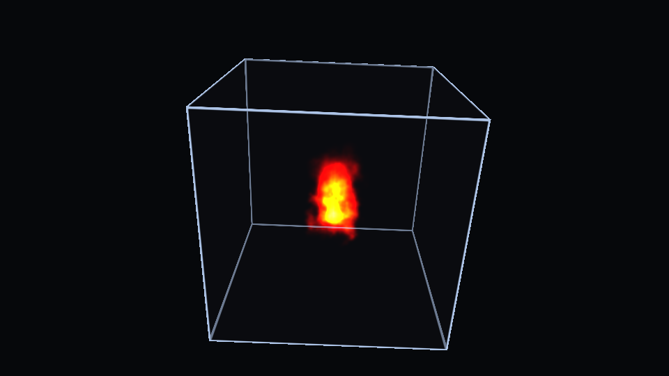
*The same renderer with fire intensity driven up.*

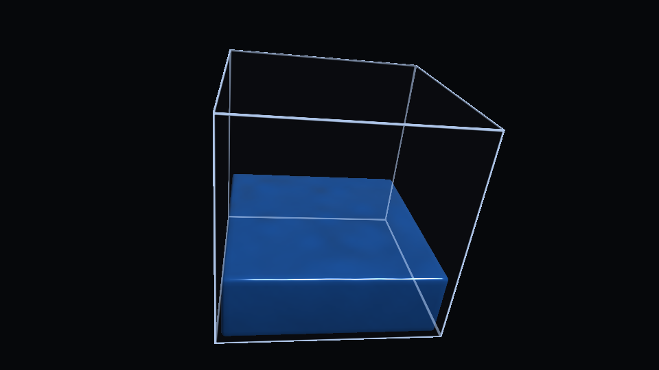
*Liquid mode with a reflective surface.*

### VolumeField

Samples a 3D texture baked from a volume (`VolumeToTexture3D`) as a field for `RaymarchField` — this
is how volumes get raymarched with TiXL's existing field pipeline. Map the bounds outputs 1:1 from
`VolumeToTexture3D`; the field is then a normal field and combines with other SDF fields.

- `Texture` is the baked 3D texture.
- `BoundsMin` / `BoundsMax` are the world-space bounds of the bake.
- `ValueScale` / `ValueOffset` remap the sampled values.
- `OutsideValue` is returned outside the bounds.

**Output:** `Result` (shader-graph field). Feed it into `RaymarchField`.

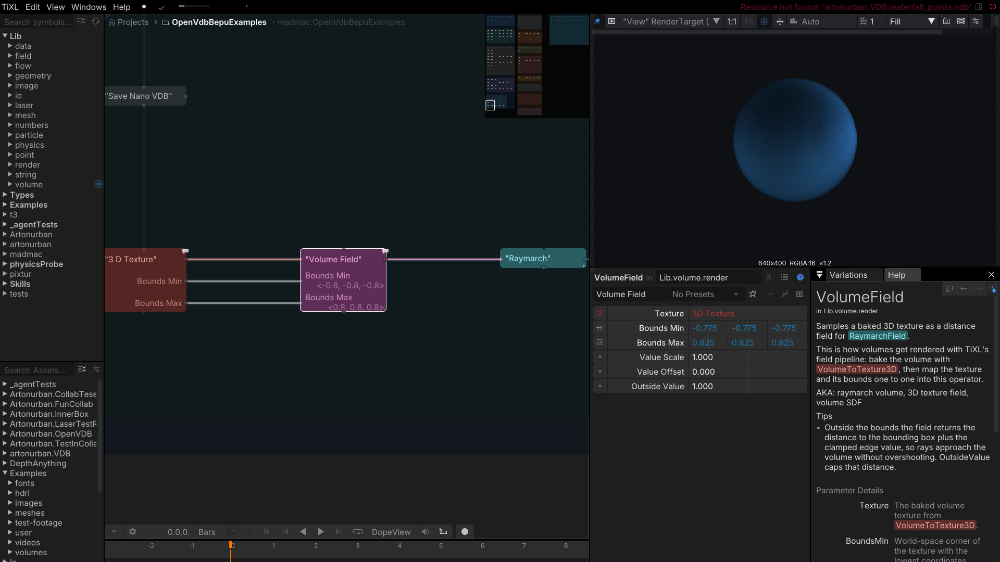
*The field wrapper for the baked 3D texture.*

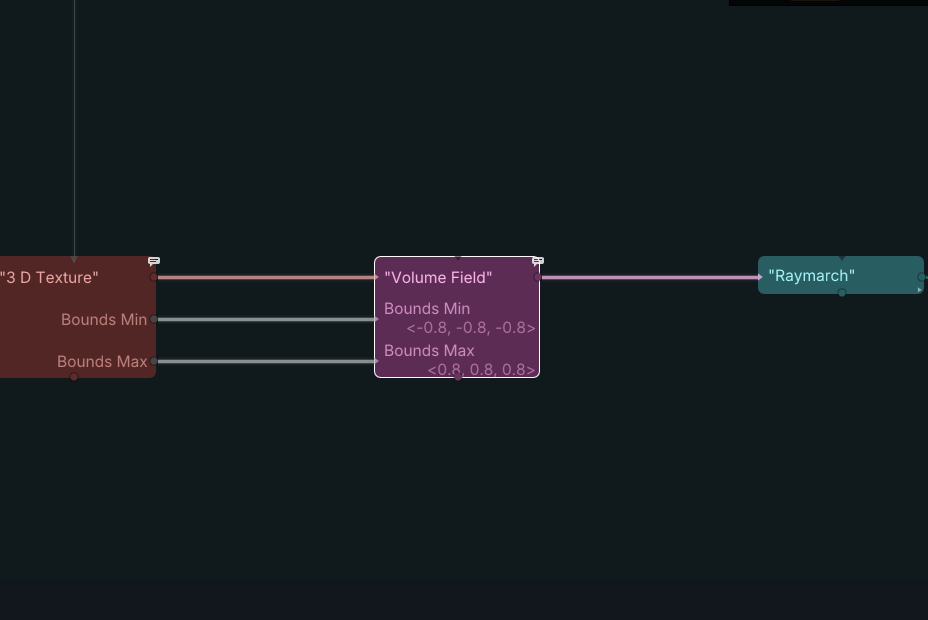
*Texture and bounds wired from `VolumeToTexture3D`.*

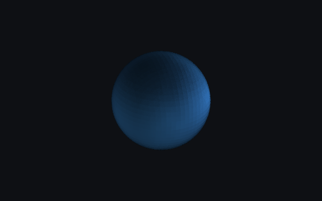
*The volume rendered through the field pipeline.*

**I/O and analysis**

### LoadVdb

Loads grids from an OpenVDB `.vdb` file — uncompressed, zip- or blosc-compressed data as written by
Houdini, Blender, Maya or TiXL. Float grids become the primary volume data; vector grids (velocity,
color) ride along in the same set. The file is watched and reloaded when it changes.

- `Path` is the `.vdb` file.
- `GridName` selects a grid when the file contains several; leave empty for the first.

**Output:** `Volume`.

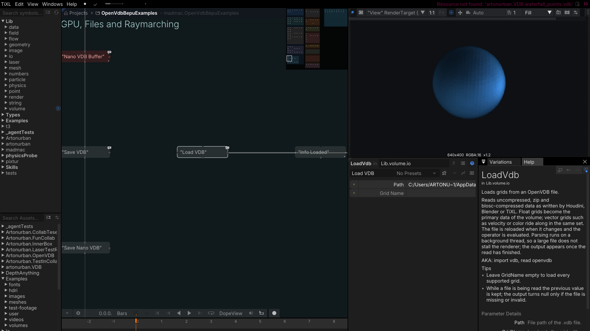
*"Load VDB" with the grid name and file path.*

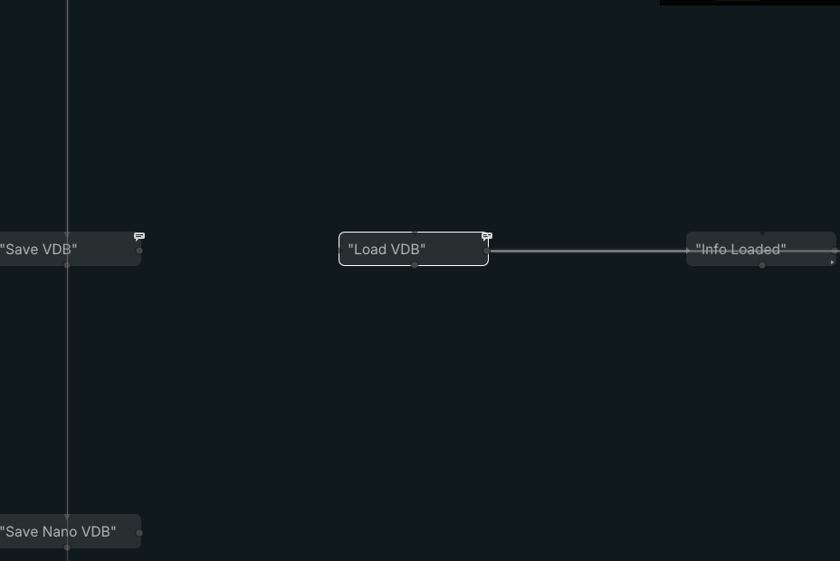
*Loaded volume feeding `VolumeToMesh` and `VolumeInfo`.*

### SaveVdb

Writes the volume's grids to an OpenVDB `.vdb` file readable by Houdini, Blender, Maya and TiXL. It
saves once whenever `Save` switches from off to on, not every frame.

- `Volume` is the grid set to write.
- `Save` is the trigger (false → true).
- `ZipCompression` enables zip compression; blosc check the file size against load time.

**Output:** `Saved` — true after a successful write.

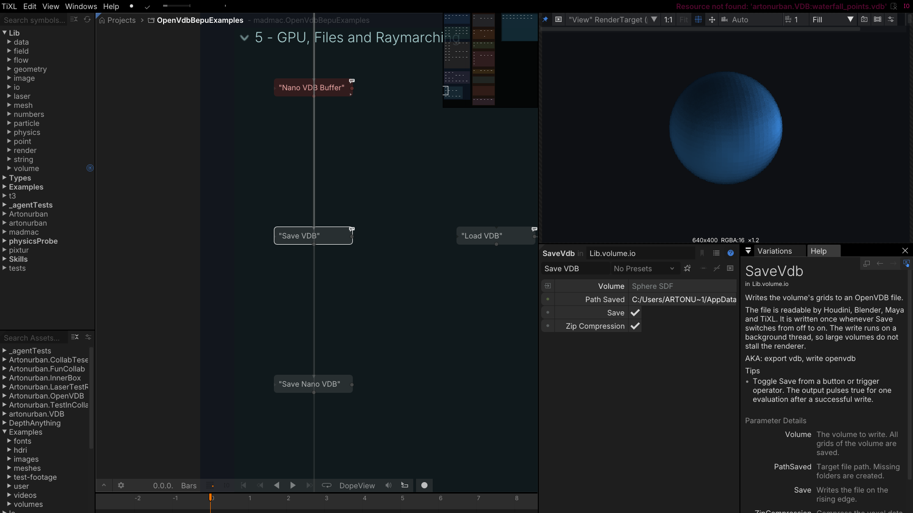
*The save controls and zip-compression option.*

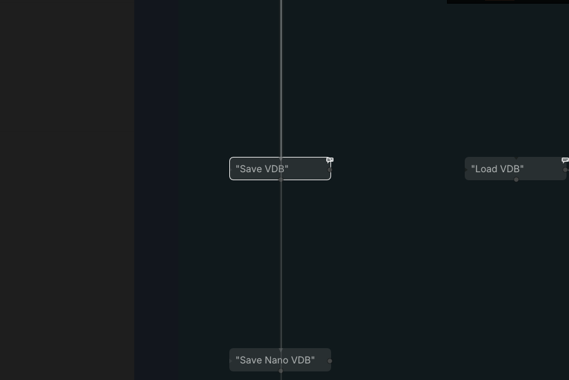
*The file-output branch of the test graph.*

### SaveNanoVdb

Writes the volume as a NanoVDB `.nvdb` file: the GPU-flattened grid format used by CUDA renderers and
the reference NanoVDB library. Like `SaveVdb`, it writes on the off→on flank of `Save`.

- `Volume` is the grid to write.
- `Save` triggers the export.

**Output:** `Saved`.

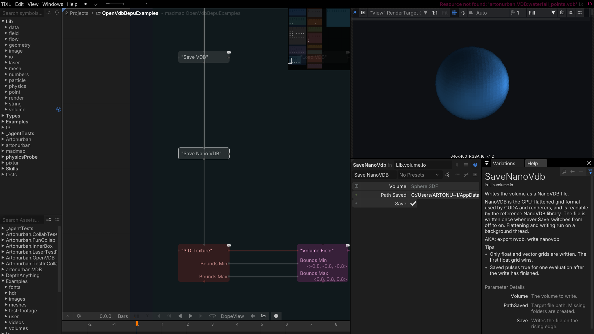
*The NanoVDB export trigger.*

*Exporting the same volume that the GPU renderer uses.*

### VolumeInfo

Reports volume statistics as OpenVDB diagnostics: active voxel count, memory footprint, value range
and NaN/Inf corruption counts. Put it on any branch to catch broken volumes early — a NaN or an
unexpected voxel count usually explains a mesh or render that looks wrong.

- `Volume` is the grid to inspect.
- `LogToConsole` prints the report when enabled.

**Outputs:** `ActiveVoxels`, `MemoryMB`, `HasNaN`, `Min`, `Max`, `Average` — all pullable as values,
so you can drive warnings or clamps from them.

*"Info Union" reporting the statistics of a CSG result.*

*The diagnostics branch of the test graph.*

## Physics

The physics package is three operators and nothing else: bodies and joints are **pure data
producers**, and one `PhysicsWorld` operator owns the actual Bepu simulation. The world collects the
descriptions from the surrounding graph, creates/updates/removes the Bepu bodies and constraints,
steps them at a fixed rate, interpolates the poses for rendering and publishes everything as a point
buffer.

That split is why `RigidBody` and `RigidJoint` have no simulation state of their own: a body's id is
fixed for the lifetime of the operator instance, which is how the world recognises the same body
across evaluations and only rebuilds what actually changed. Kinematic islands (bodies connected by
joints) are merged into one rigid body for the solver; a static body cannot be a joint anchor, so use
a kinematic body as the fixed point instead.

### PhysicsWorld

Owns the Bepu simulation for the whole graph. It gathers the `RigidBody` and `RigidJoint`
descriptions, builds or updates the world, advances it at `FixedRate` with optional substepping, and
publishes the resulting poses as a point buffer that `DrawMeshAtPoints` instances can render. `SimTime`
is the simulated seconds since the last rebuild, useful for syncing or debugging.

- `Gravity` is the world gravity vector (default is Earth-like).
- `FixedRate` is the simulation step rate in Hz; `Substeps` splits each step for stability.
- `SolverIterations` trades solver quality against cost.
- `TimeScale` slows or speeds the simulation without changing the graph time.
- `Interpolate` smooths rendered poses between fixed steps.
- `IncludeStatics` includes static bodies in the published buffer.
- `Multithreaded` and `Deterministic` control the solver's threading/determinism.
- `ContactStiffness` tunes contact softness.
- `Reset` rebuilds the simulation state; `Paused` freezes stepping while keeping the graph running.

**Outputs:** `OutBuffer` (per-body pose data for the mesh renderers), `BodyCount`, `SimTime`.

*Tip:* the simulation advances with `context.Playback.FxTimeInBars`, so it runs while playback is
stopped — pump frames to see motion.

*Gravity, solver and stepping parameters with the live example.*

*The world collects the bodies and feeds the draw operator.*

*Five dynamic bodies above a static floor.*

### RigidBody

Describes one Bepu body: shape, kind, transform, size, mass and material parameters. The operator
publishes the description; `PhysicsWorld` turns it into a Bepu body and keeps it in sync. The body id
is fixed for the lifetime of this instance, so the world recognises the same body across evaluations.

- `Shape` selects box, sphere, capsule, cylinder and the other supported primitives.
- `Kind` is dynamic, kinematic or static.
- `Position`, `Rotation` place the body; `Size`, `Radius`, `Length` dimension it.
- `Mass` sets the dynamic mass (kinematic/static ignore it).
- `LinearVelocity` / `AngularVelocity` give it an initial push.
- `Friction` and `Bounciness` are the contact material.
- `LinearDamping` / `AngularDamping` bleed off motion.
- `GravityScale` scales gravity for this body (0 = floaty, negative = inverted).
- `Enabled` removes it from the simulation without deleting the operator.

**Output:** `OutBody` — the description consumed by `PhysicsWorld` and by joints.

*Tip:* render the bodies by connecting instances of the same mesh through `TransformMesh` to
`DrawMeshAtPoints`, or draw a single mesh and let the buffer place it per body.

*One of the five ball descriptions.*

*A body wired into `PhysicsWorld`.*

*Bodies rendered at the world's published poses.*

### RigidJoint

Declares a constraint between two bodies: **BallSocket**, **Hinge**, **Weld** or **DistanceServo**.
Like `RigidBody` it is pure data — `PhysicsWorld` creates, updates and removes the Bepu constraint.
Both bodies must be dynamic or kinematic; a static body cannot be an anchor, so use a kinematic body
as the fixed point.

- `BodyA` / `BodyB` are the two constrained bodies.
- `JointType` selects the constraint.
- `LocalOffsetA` / `LocalOffsetB` are the anchor points in each body's local space; for a ball socket
  they are the same world point seen from each body.
- `HingeAxisA` / `HingeAxisB` are the hinge axes in each body's local space.
- `Frequency` / `DampingRatio` tune the servo's spring.
- `TargetDistance` is the rest length for the distance servo.
- `Enabled` removes the constraint without deleting the operator.

**Output:** `OutJoint`. Chain several joints to build ropes, bridges, ragdolls and mechanisms.

*A hinge constraint between two bridge planks.*

*Joints linking the bridge segments.*

*The constraint chain holding the sagging bridge.*

## AI video — depth and diffusion

Two independent ONNX Runtime pipelines. `DepthAnything` estimates depth from any image and feeds
three small, fast post-processors; `StreamDiffusion` generates or transforms images from text prompts.
Both need their model files installed locally — the operators load them from the package `Assets`
folder, and the packages ship download scripts for exactly that.

### DepthAnything

Estimates a depth map from an image with **Depth Anything V2**. The operator runs the model on a
background worker and publishes three textures: the input unchanged (`OutputTexture`), the raw float
depth (`DepthTexture`) and a normalized, optionally colorized depth image
(`NormalizedDepthTexture`). `UpdateCount`, `MinDepth`, `MaxDepth` and `Status` expose the worker's
state, so you can build graphs that wait for the first result or react to the depth range.

- `InputTexture` is any Texture2D — a webcam, an image loader, a render.
- `Enabled` pauses/resumes inference; when off, `OutputTexture` passes the input through and the depth
  outputs are cleared.
- `ModelSizeParam` selects Small (fp16), Small fp32, Small int8, Base or Large. Smaller models are
  much faster; the small fp16 model is the default choice for live input.
- `InputResolution` fixes the model's input size (Auto, 196, 280, 392, 518); `MatchInputResolution`
  keeps the input image's aspect instead.
- `ExecutionProviderParam` selects CPU, DirectML or CUDA. CUDA is the fastest on an NVIDIA GPU;
  DirectML is the Windows fallback for other GPUs.
- `OutputFormat` chooses grayscale or a colorized depth ramp; `EnhanceContrast` and `InvertDepth`
  adjust the normalized output.
- `Debug` logs model loading and inference details.

**Outputs:** `OutputTexture` (input passthrough), `DepthTexture` (raw float), `NormalizedDepthTexture`
(0..1, visualized), `UpdateCount`, `MinDepth`, `MaxDepth`, `Status`.

*Models:* put `depth-anything-v2-small-fp16.onnx` (and optionally base/large) into
`Operators/DepthAnything/Assets`, or run `Operators/DepthAnything/Scripts/download_models.py`. The
operator resolves the file through the package's asset registry, so a restart is needed after adding
it.

*Tip:* inference is asynchronous. The depth outputs trail the input by a frame or more, and
`UpdateCount` only advances when a new frame has been processed — don't expect one update per graph
frame.

*The depth map on the frog example image, with provider and format settings.*

*`LoadImage` → `DepthAnything` → the three post-processing operators.*

*The normalized depth of the frog image (small fp16 model, CPU).*

### DepthFilter

Edge-aware bilateral smoothing of a depth map. `SigmaSpace` sets the spatial radius, `SigmaColor` how
strongly depth differences are preserved; the filter averages neighbors only when their depth is
close, so silhouettes stay crisp while sensor noise and stepped bands disappear. It is the usual
cleanup before thresholding or normal generation.

- `DepthTexture` is the raw or normalized depth to filter.
- `SigmaSpace` is the spatial kernel radius in pixels.
- `SigmaColor` is the depth tolerance; larger values smooth across larger depth jumps.
- `Enabled` bypasses the filter.

**Output:** `FilteredDepth` (float depth).

*Note:* the raw float depth is displayed in the red channel — a red image is the depth, not an error.

*Bilateral parameters next to the filtered output.*

*The raw depth fed through the filter.*

*The filtered float depth (shown in the red channel, as float textures are).*

### DepthThreshold

Turns a depth range into a binary mask. With `UseNormalized` on, the thresholds refer to the frame's
depth range (0 = nearest, 1 = farthest), so the same values keep working as the scene changes. The
mask is the standard way to separate a foreground subject from the background.

- `DepthTexture` is the depth map (raw or filtered).
- `MinThreshold` / `MaxThreshold` select the kept depth band.
- `Invert` flips the mask (keep the background instead).
- `UseNormalized` interprets the thresholds relative to the frame's depth range instead of absolute
  depth values.

**Outputs:** `MaskTexture` (binary mask) and `PixelRatio` (the fraction of the image that is masked).

*The mask range and the resulting silhouette.*

*The threshold branch of the chain.*

*The frog separated from the background.*

### DepthToNormal

Reconstructs a normal map from a depth map with Sobel edge detection. `Strength` scales the surface
slope and `Invert` flips the handedness, so the result can feed lighting, relighting or shading
setups that expect world- or view-space normals.

- `DepthTexture` is the depth map.
- `Strength` scales the normal slope.
- `Invert` flips the normal direction/convention.

**Output:** `NormalTexture`.

*Normal reconstruction parameters.*

*The last branch of the depth chain.*

*Normals reconstructed from the depth map.*

### StreamDiffusion

Image generation with **Stable Diffusion 1.x / SD-Turbo** through ONNX Runtime, in text-to-image and
image-to-image modes. The operator runs a streamed pipeline: the UNet, VAE and text encoder are
separate ONNX files in `EnginePath`, the tokenizer files sit next to them, and `vae_encoder.onnx` is
needed for image-to-image. `TriggerGenerate` renders one frame; `AutoGenerate` keeps generating for a
live output.

- `EnginePath` points at a folder containing `unet.onnx`, `vae_decoder.onnx`, `text_encoder.onnx`,
  the tokenizer files, and `vae_encoder.onnx` for img2img.
- `Mode` selects text-to-image or image-to-image.
- `Prompt` / `NegativePrompt` drive the generation; `Seed` makes it repeatable (-1 = random).
- `Width` / `Height` are the generation size; `MatchInputSize` follows the input image instead.
- `Guidance` is the classifier-free guidance scale; `Strength` how much an img2img pass changes the
  input; `Steps` the number of denoising steps (1 is the SD-Turbo default).
- `InputImage` is required for img2img mode.
- `ModelType` selects SD 1.x or SD-Turbo; `CudaDevice` and `ExecutionProviderParam` choose the GPU.
- `TriggerGenerate` renders one frame on a flank; `AutoGenerate` runs continuously.

**Outputs:** `Output` (the generated texture), `OutputSize`, `GenerationTime` (seconds for the last
frame).

> The ONNX engine files are not installed on this machine, so the screenshots document the operator
> and its inputs rather than a generated frame. Put the engine folder in place and point
> `EnginePath` at it to enable generation.

*Prompt, mode and sampling parameters with the operator help.*

*The image input wired from the example image.*

## Laser

Laser content in TiXL is built by drawing ordinary scenes and capturing them: a `LaserCamera` acts
as a normal camera and as a geometry-to-laser converter at the same time, and the resulting point
list is uploaded for the laser driver or received from another application over the network.

Drawing a mesh into a `LaserCamera`'s scene is already the mesh→laser-points path — every point, line
and mesh in the scene is captured and encoded. There is no separate mesh converter operator to add.

### LaserCamera

A universal geometry-to-laser converter and a standard TiXL camera in one. It has its own lens
(selectable in the output window camera dropdown, mouse-drivable, or borrowed from another camera via
`CameraReference`), and every point, line or mesh drawn inside the `Scene` connected to it is captured
and encoded into a laser frame. The draw command renders nothing — the data leaves exclusively
through `LaserPoints`, routed to a laser output via `OutputRef`.

- `Scene` is the draw command whose points/lines/meshes are captured.
- `OutputRef` selects which laser output the frame is routed to.
- `MaxEdgeStep` is the maximum distance between samples along lines and mesh edges; smaller values
  trace smoother curves and cost more points.
- `DotDwellPoints` is how many points an isolated dot gets on the scanner (its dwell time).
- `Update` re-captures each frame; disable it for a still frame.
- `UseRotation` / `Rotation` rotate the captured field.
- `PrintToLog` logs the frame bounds — handy to check whether a scene is inside the field.
- The lens: `Position`, `Target`, `Up`, `FieldOfView`, `Roll`, `AspectRatio`, `ClipPlanes`; the field
  is kept square regardless of the aspect setting.
- `CameraReference` borrows another camera's lens while keeping the square laser field.

**Output:** `LaserPoints` (a `StructuredList` of x/y/intensity samples).

*Tips:* each camera has its own viewpoint, so several cameras can capture different parts of a rig
independently; the scene is captured once per laser pump and the pump budget is shared between
cameras. If the frame bounds are empty, the scene is probably outside the camera's clip planes.

*Lens, output routing and point-encoding parameters, with several cameras in one rig.*

*Each camera captures the scene connected to its `Scene` input.*

### LaserPointsToBuffer

Uploads a laser point list to a GPU structured buffer for the laser driver, and reports the point
count. `Scale` maps the normalized laser field into the driver's coordinate range; the buffer is what
the output setup's driver consumes.

- `LaserPoints` is the captured frame (normally from a `LaserCamera`).
- `Scale` scales the normalized field into driver coordinates.

**Outputs:** `Buffer` (GPU structured buffer), `PointCount`.

*Tip:* keep the point count within the scanner's buffer budget — very dense meshes at a small
`MaxEdgeStep` can produce more points than a frame can hold.

*The buffer upload and its scale.*

*Laser points converted for the laser output.*

### PONKInput

Receives **PONK** laser frames over UDP from a sender on the network. It can filter by expected sender
id or sender name, maps the incoming coordinate range into the laser field, and publishes the points
plus a status message and frame counter — the way to mix external laser content into a TiXL show.

- `Active` enables the receiver.
- `LocalIpAddress` and `Port` bind the socket (the default port is PONK's).
- `Timeout` drops a stalled sender after this many seconds.
- `ExpectedSenderId` / `FilterSenderName` accept only the matching sender (0 / empty = any).
- `MinX`, `MaxX`, `MinY`, `MaxY` map the incoming coordinate range into the field.
- `PrintToLog` logs received frames.

**Outputs:** `LaserPoints`, `StatusMessage`, `FrameCount`, `SenderName`, `SenderId`.

*Network binding, sender filtering and coordinate mapping.*

*The incoming laser-point source.*

## OMT — Open Media Transport

OMT moves video between applications and machines over the network. `OmtInput` receives one source as
a texture; `OmtOutput` advertises a texture as a sender. Sources and senders are discovered with
DNS-SD, so an application that starts after the operator was set up is picked up without re-wiring.
The OMT native library (including the VMX codec) ships with the package; Linux x64 gets its own
`libvmx` build.

### OmtInput

Receives one **OMT** source and publishes it as a texture. Sources are found through OMT's DNS-SD
discovery, so a sender that starts after the operator was set up is picked up by the library on its
own — the usual case when the OMT sender is another application on the network.

- `SourceName` selects the OMT source; the dropdown lists the sources discovered on the network.
- `TriggerReconnect` re-scans/reconnects on a flank when a sender changed machines or names.

**Output:** `Texture` (the received stream). `Resolution`-style diagnostics are visible in the
operator's status; the texture is null until the first frame arrives.

*Tip:* OMT is a good fit for camera feeds and NDI-like video between machines when the built-in
network interfaces are not available. If a source never appears, check that the sender is on the same
subnet and that mDNS/DNS-SD traffic is not blocked.

*Selecting the OMT source.*

*The received stream feeding the graph.*

### OmtOutput

Sends a texture as an OMT stream with a sender name and frame rate. `TextureOutput` passes the input
through, so the same texture can continue into the graph while it is being streamed; `SourceAddress`
reports the advertised address for diagnostics.

- `Texture` is the frame to send.
- `SenderName` is the name receivers discover (make it unique per machine).
- `FrameRate` caps the send rate; `EnableAlpha` carries the alpha channel.

**Outputs:** `TextureOutput` (passthrough), `SourceAddress` (the advertised address).

*Sender name and frame-rate settings.*

*The outgoing stream in the collaboration test graph.*

*The OMT test pattern (timestamp and date) arriving from the network sender.*

## Video input and peer cameras

### VideoDeviceInput

Captures a webcam or capture card into a texture. Devices are opened through **FFmpeg** — DirectShow
on Windows, V4L2 on Linux, AVFoundation on macOS — with software decode. This replaces the old
OpenCV/DirectShowLib capture, which crashed in OpenCV's native layer.

Beyond the fixed camera controls (Pan, Tilt, Zoom, Focus, Exposure, Brightness), a generic control
surface exposes every control the driver advertises: `ControlName` picks one, `ControlValue` carries
the value (query index for menu controls, the driver's own integer for integer menus), and
`ControlAuto` switches the driver's auto mode. `ControlsCatalog` lists what the device supports, so a
UI can be built without hard-coding a camera model.

**New this week:** the device dropdown also lists **cameras shared by other TiXL clients** in a
collaboration, boygroup or failover session. A render node can therefore capture a camera that is
plugged into a different machine — pair it with the *Share my cameras* switch in the failover panel.

- `Active` opens/keeps the camera running; `DeactivateWhenNotShowing` releases it when nothing shows
  the texture.
- `InputDeviceName` selects the device, including peer cameras from other clients.
- `CustomFps` / `CustomResolution` override the capture format.
- `ApplyRotationData`, `ApplyControl`, `Brightness`, `Focus`, `Exposure`, `ControlAuto`,
  `ControlName`, `ControlValue` drive the camera controls.
- `FlipHorizontally` / `FlipVertically` mirror the image.

**Outputs:** `Texture`, `Resolution`, `ControlsCatalog`, `UpdateCount`.

*Tip:* a camera usually allows only one process to open it. If the texture stays black while another
application is using the camera, close that application or use a peer camera from another TiXL client.

*Device selection and the camera-control parameters.*

*The capture node in a collaboration test graph.*

## Utilities

### CsvToPoints

Loads a CSV file and routes its columns into the attributes of a point buffer. Every point attribute
has a dropdown that selects the column to read from; columns are matched by header name, so their
order does not matter and unused columns are ignored. Rotations can be Euler XYZ or quaternion
(`RotationW` …), which makes the operator a fixture import path for lighting desks and a general
bridge from spreadsheets to point/particle graphs.

- `FilePath` is the CSV to read; the first row supplies the column names.
- `Reload` re-reads the file on a flank (the path is cached otherwise).
- `RotationMode` selects Euler XYZ or Quaternion; `RotationW/X/Y/Z` map the rotation columns.
- `PositionX/Y/Z`, `ColorR/G/B/A`, `ScaleX/Y/Z`, `F1`/`F2` map the remaining attributes.
- Columns that are not mapped keep their defaults: position 0, scale 1, color and F1/F2 at 1, identity
  rotation.
- `ColorIs0To255` interprets the color columns as 0–255 instead of 0–1.

**Output:** `Points` — feed the point renderers, `VolumeFromPoints`, or any point operator.

*Tip:* the `F1`/`F2` attributes are free per-point floats (fixture dimmer/strobe, particle lifetime,
custom shader data); the point renderers and shaders can read them.

*Column mapping for rotation, position and color.*

*The parsed points feeding the point renderers.*

### MeshToSDF

Bakes a signed distance field volume from a triangle mesh using GPU compute shaders — voxelization
followed by jump flooding — and exposes it as an SDF shader-graph field that can be raymarched with
`RaymarchField` or combined with other SDF primitives. The bake is asynchronous and split into work
units across `BakeFrames`, so heavy meshes do not freeze the editor; `BakeProgress` and
`BakeInProgress` report the state, and the previous SDF texture stays valid while a rebake runs.

- `Mesh` is the source geometry.
- `Resolution` sets the voxel count along the largest axis; `AutoFitVolume` sizes the bake box to the
  mesh automatically, or place it manually with `Center` / `Size`.
- `SampleDensity` controls the voxelization sampling density.
- `Mode` selects the jump-flood variant (e.g. `JumpFlood_Signed`).
- `Smoothing` / `SmoothingRadius` soften the baked surface.
- `BakeFrames` spreads the bake over several frames.
- `Invert` flips inside/outside; `Offset` shifts the isosurface.
- `Bake` triggers a bake; `AutoRebake` rebakes when the mesh changes.

**Outputs:** `Result` (SDF shader-graph field), `SdfTexture` (the 3D SDF texture), `BakeCount`,
`BakeProgress`, `BakeInProgress`.

*Tip:* connect `Result` to `RaymarchField`, or combine it with `CombineSDF`, `BendField` and
`PolarRepeat` before raymarching.

*The bake resolution and SDF sampling settings.*

*The mesh feeding the SDF bake in the test graph.*

## Feature panels

The week also added UI around the operators. These panels live in the editor settings and in the
output setup; they are what makes the new network features usable without editing config files.

### Camera sharing — Show Failover → Camera Sharing

The failover panel gained a camera-sharing section. **Share my cameras** publishes this machine's
cameras to the other TiXL clients in the session; the panel lists the local devices and whether other
clients announced cameras. Together with the peer entries in `VideoDeviceInput`'s device dropdown,
this is how a camera plugged into one machine becomes selectable on the others — the render node can
capture it as if it were local.

*Sharing enabled: the local BisonCam and OBS Virtual Camera are listed; no peer cameras are online.*

### Boygrouping

Enable, node name, network interface, role (master/slave) and the render-node table, including saved
nodes, per-node diagnostics (port, uptime, fps, connected/saved/discovered counts) and the input relay
(MIDI/OSC replay and remote camera sources). In a boygroup the master's timeline drives playback on
all render nodes; there are no Play/Stop/Deploy buttons in this panel.

*This editor acting as the boygroup master, waiting for render nodes.*

### Collaboration

The collaboration settings panel is the entry point for hosting or joining sessions, with the project
picker, password and participant management. In this capture collaboration is off, so the panel only
shows the master enable switch; the participant table, spectate/follow and kick actions appear once a
session is running.

*Collaboration master switch.*

---

## Notes on the screenshots

- The volume screenshots come from the new built-in examples (`VolumeNanoVdbSmokeExample`,
  `VolumeNanoVdbFireExample`, `VolumeNanoVdbLiquidExample`, `VolumeNanoVdbCsgExample`,
  `VolumeNanoVdbSaveExample`, `VolumeVdbFilesExample`, `VolumeMeshRoundtripExample`,
  `VolumeFilterExample`, `VolumeMorphologyExample`, `VolumeCsgExample`) and from
  `OpenVdbBepuExamples`, the branch's comprehensive volume test project. The utility operators without
  a dedicated example are shown there.
- The physics screenshots come from `PhysicsBouncingBallsExample` and `PhysicsRopeBridgeExample`.
- The depth screenshots use `depth-anything-v2-small-fp16.onnx` (downloaded with
  `Operators/DepthAnything/Scripts/download_models.py`) and the `frog2.jpg` example asset. The scratch
  chain is `LoadImage → DepthAnything → DepthFilter/DepthThreshold/DepthToNormal`.
- `StreamDiffusion` needs its ONNX engine files (`EnginePath`); they are not installed on this
  machine, so no generated frame is shown.
- The OMT screenshot shows a live stream received from an OMT sender on the network (the timestamp
  test pattern).
- Laser screenshots come from the `laserRig` project; the actual laser frame was routed to the
  configured laser output.
- Drawing a mesh into a `LaserCamera`'s scene is the mesh→laser-points path; the separate
  MeshToLaserPoints helper is not presented as a user-facing function.
