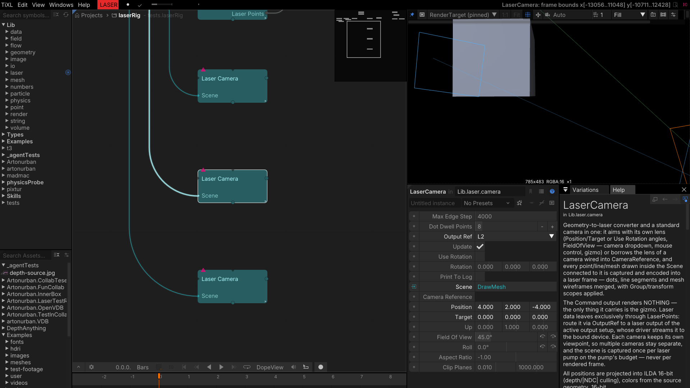
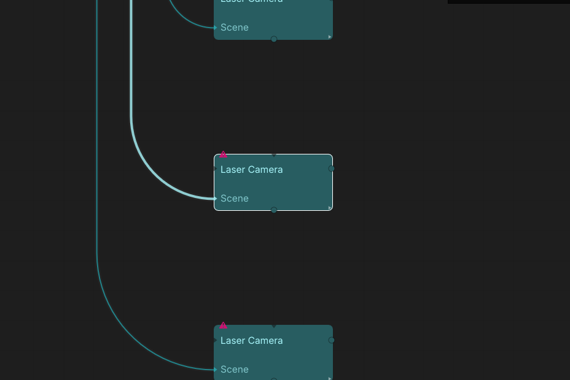
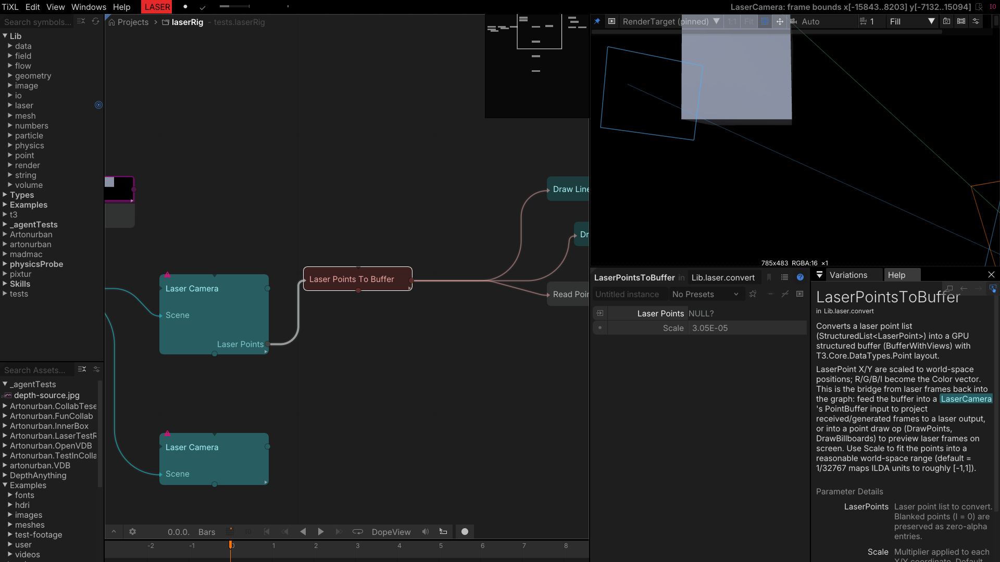
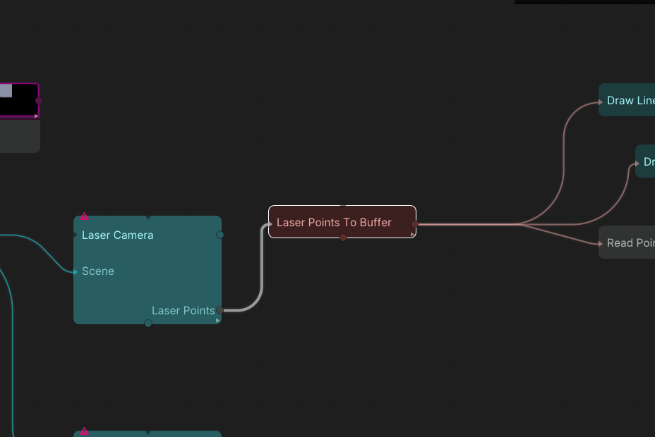
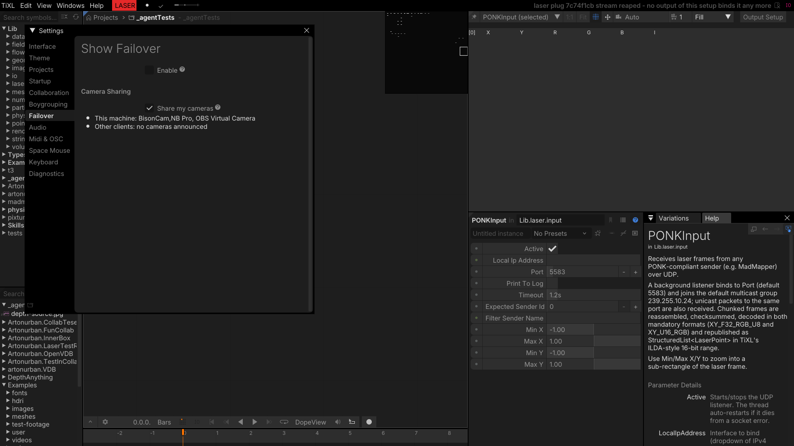
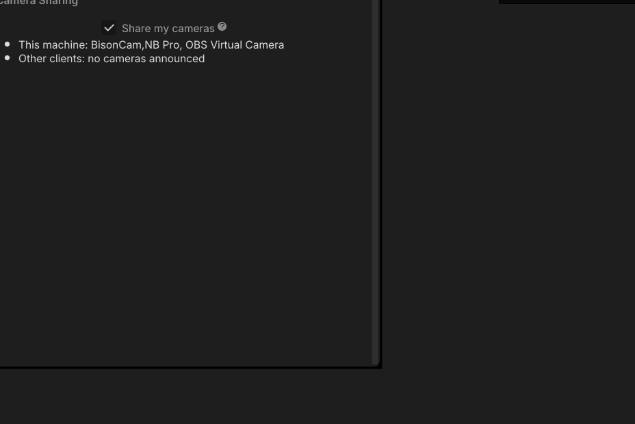

# Laser

Laser content in TiXL is built by drawing ordinary scenes and capturing them: a `LaserCamera` acts
as a normal camera and as a geometry-to-laser converter at the same time, and the resulting point
list is uploaded for the laser driver or received from another application over the network.

Drawing a mesh into a `LaserCamera`'s scene is already the mesh→laser-points path — every point, line
and mesh in the scene is captured and encoded. There is no separate mesh converter operator to add.

## LaserCamera

A universal geometry-to-laser converter and a standard TiXL camera in one. It has its own lens
(selectable in the output window camera dropdown, mouse-drivable, or borrowed from another camera via
`CameraReference`), and every point, line or mesh drawn inside the `Scene` connected to it is captured
and encoded into a laser frame. The draw command renders nothing — the data leaves exclusively
through `LaserPoints`, routed to a laser output via `OutputRef`.

- `Scene` is the draw command whose points/lines/meshes are captured.
- `OutputRef` selects which laser output the frame is routed to.
- `MaxEdgeStep` is the maximum distance between samples along lines and mesh edges; smaller values
  trace smoother curves and cost more points.
- `DotDwellPoints` is how many points an isolated dot gets on the scanner (its dwell time).
- `Update` re-captures each frame; disable it for a still frame.
- `UseRotation` / `Rotation` rotate the captured field.
- `PrintToLog` logs the frame bounds — handy to check whether a scene is inside the field.
- The lens: `Position`, `Target`, `Up`, `FieldOfView`, `Roll`, `AspectRatio`, `ClipPlanes`; the field
  is kept square regardless of the aspect setting.
- `CameraReference` borrows another camera's lens while keeping the square laser field.

**Output:** `LaserPoints` (a `StructuredList` of x/y/intensity samples).

*Tips:* each camera has its own viewpoint, so several cameras can capture different parts of a rig
independently; the scene is captured once per laser pump and the pump budget is shared between
cameras. If the frame bounds are empty, the scene is probably outside the camera's clip planes.

*Lens, output routing and point-encoding parameters, with several cameras in one rig.*

*Each camera captures the scene connected to its `Scene` input.*

## LaserPointsToBuffer

Uploads a laser point list to a GPU structured buffer for the laser driver, and reports the point
count. `Scale` maps the normalized laser field into the driver's coordinate range; the buffer is what
the output setup's driver consumes.

- `LaserPoints` is the captured frame (normally from a `LaserCamera`).
- `Scale` scales the normalized field into driver coordinates.

**Outputs:** `Buffer` (GPU structured buffer), `PointCount`.

*Tip:* keep the point count within the scanner's buffer budget — very dense meshes at a small
`MaxEdgeStep` can produce more points than a frame can hold.

*The buffer upload and its scale.*

*Laser points converted for the laser output.*

## PONKInput

Receives **PONK** laser frames over UDP from a sender on the network. It can filter by expected sender
id or sender name, maps the incoming coordinate range into the laser field, and publishes the points
plus a status message and frame counter — the way to mix external laser content into a TiXL show.

- `Active` enables the receiver.
- `LocalIpAddress` and `Port` bind the socket (the default port is PONK's).
- `Timeout` drops a stalled sender after this many seconds.
- `ExpectedSenderId` / `FilterSenderName` accept only the matching sender (0 / empty = any).
- `MinX`, `MaxX`, `MinY`, `MaxY` map the incoming coordinate range into the field.
- `PrintToLog` logs received frames.

**Outputs:** `LaserPoints`, `StatusMessage`, `FrameCount`, `SenderName`, `SenderId`.

*Network binding, sender filtering and coordinate mapping.*

*The incoming laser-point source.*
