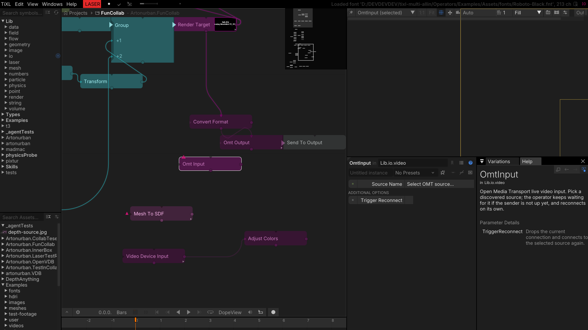
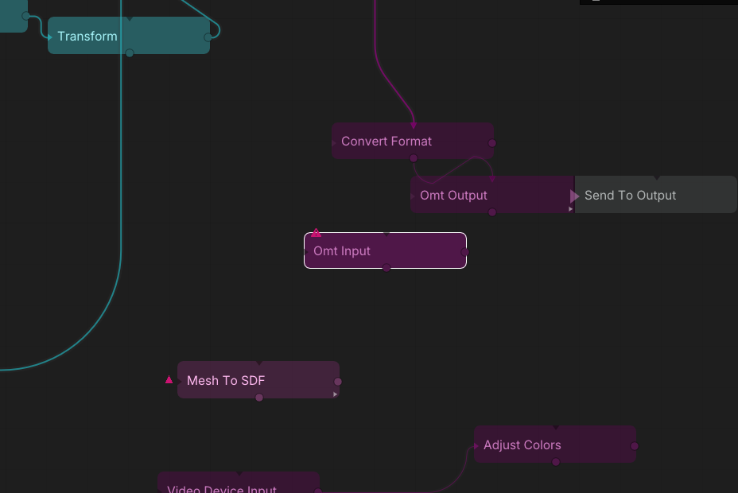
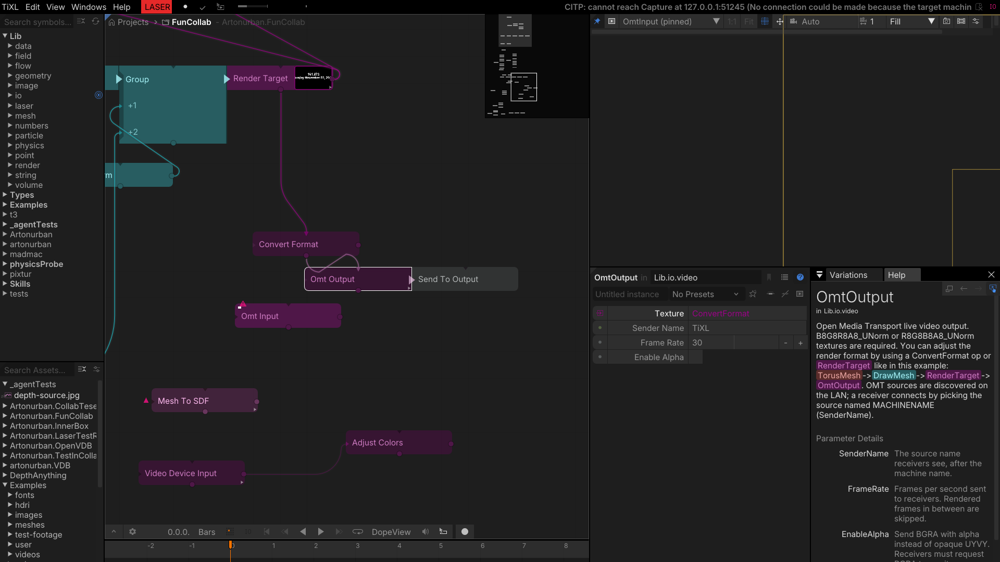
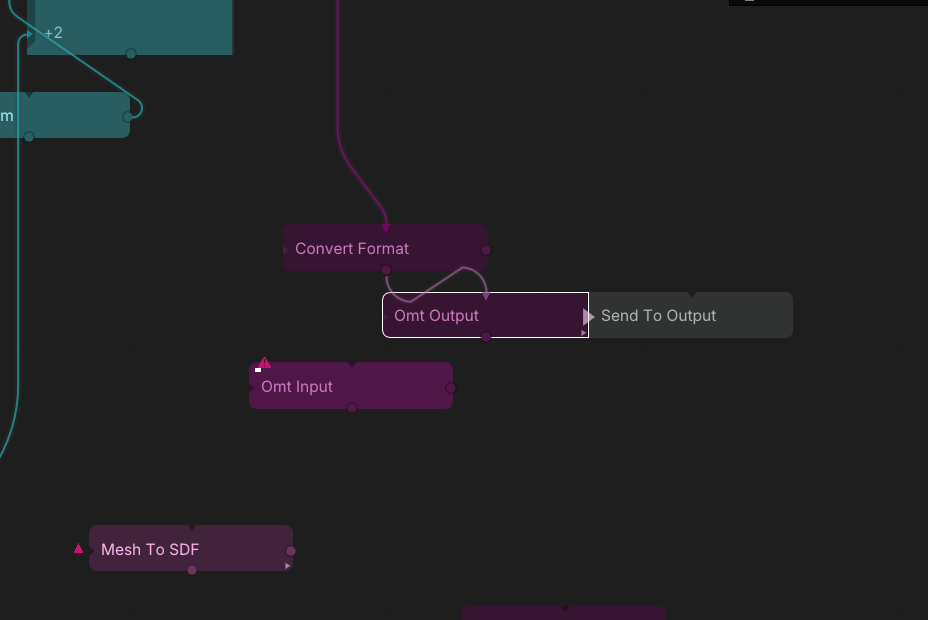

# OMT — Open Media Transport

OMT moves video between applications and machines over the network. `OmtInput` receives one source as
a texture; `OmtOutput` advertises a texture as a sender. Sources and senders are discovered with
DNS-SD, so an application that starts after the operator was set up is picked up without re-wiring.
The OMT native library (including the VMX codec) ships with the package; Linux x64 gets its own
`libvmx` build.

## OmtInput

Receives one **OMT** source and publishes it as a texture. Sources are found through OMT's DNS-SD
discovery, so a sender that starts after the operator was set up is picked up by the library on its
own — the usual case when the OMT sender is another application on the network.

- `SourceName` selects the OMT source; the dropdown lists the sources discovered on the network.
- `TriggerReconnect` re-scans/reconnects on a flank when a sender changed machines or names.

**Output:** `Texture` (the received stream). `Resolution`-style diagnostics are visible in the
operator's status; the texture is null until the first frame arrives.

*Tip:* OMT is a good fit for camera feeds and NDI-like video between machines when the built-in
network interfaces are not available. If a source never appears, check that the sender is on the same
subnet and that mDNS/DNS-SD traffic is not blocked.

*Selecting the OMT source.*

*The received stream feeding the graph.*

## OmtOutput

Sends a texture as an OMT stream with a sender name and frame rate. `TextureOutput` passes the input
through, so the same texture can continue into the graph while it is being streamed; `SourceAddress`
reports the advertised address for diagnostics.

- `Texture` is the frame to send.
- `SenderName` is the name receivers discover (make it unique per machine).
- `FrameRate` caps the send rate; `EnableAlpha` carries the alpha channel.

**Outputs:** `TextureOutput` (passthrough), `SourceAddress` (the advertised address).

*Sender name and frame-rate settings.*

*The outgoing stream in the collaboration test graph.*

*The OMT test pattern (timestamp and date) arriving from the network sender.*
