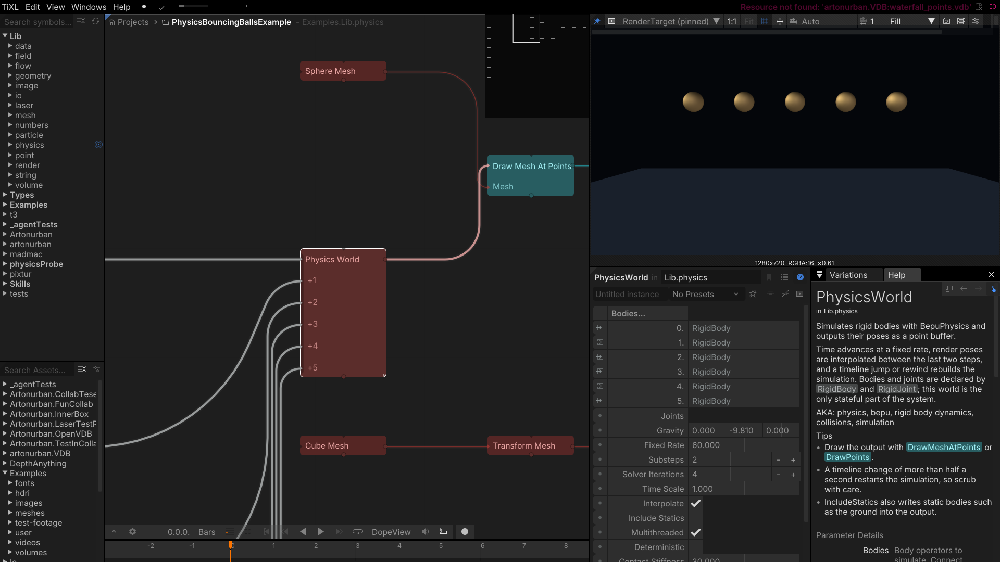
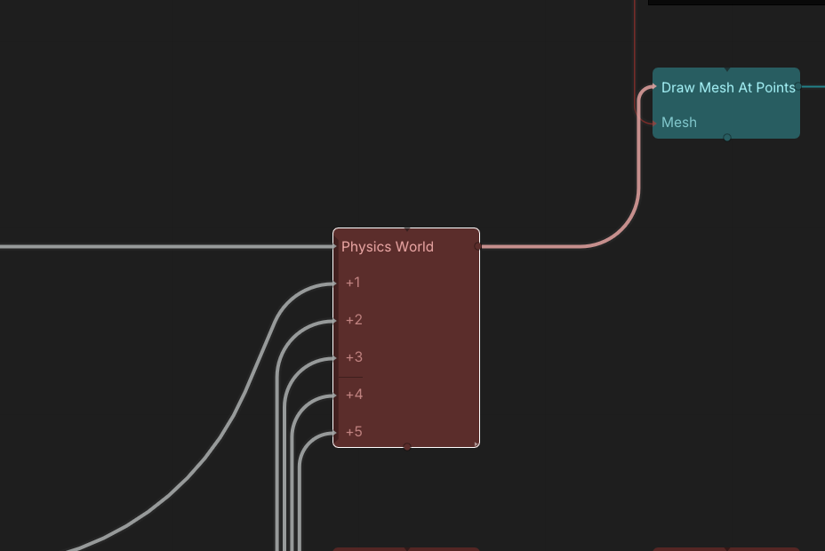
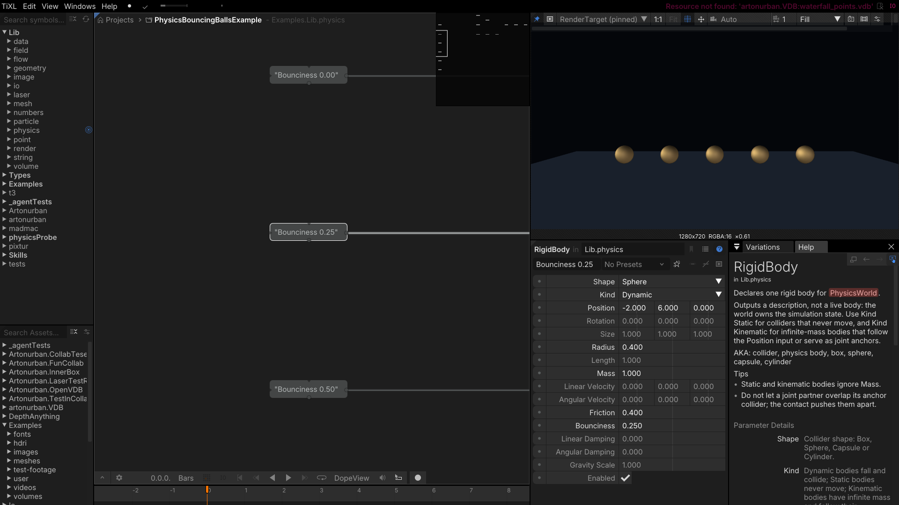
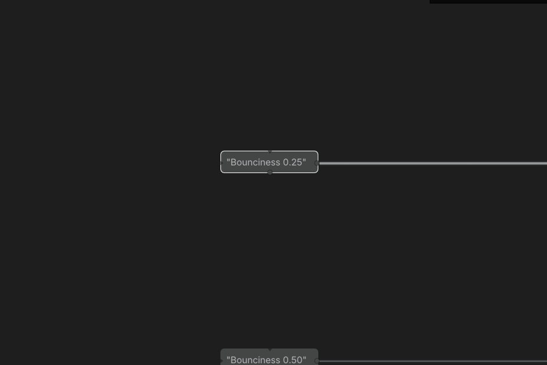
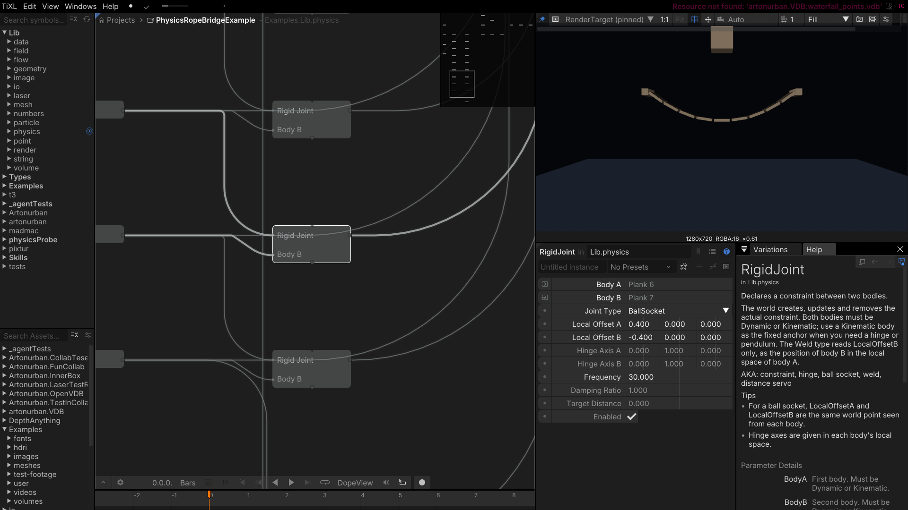
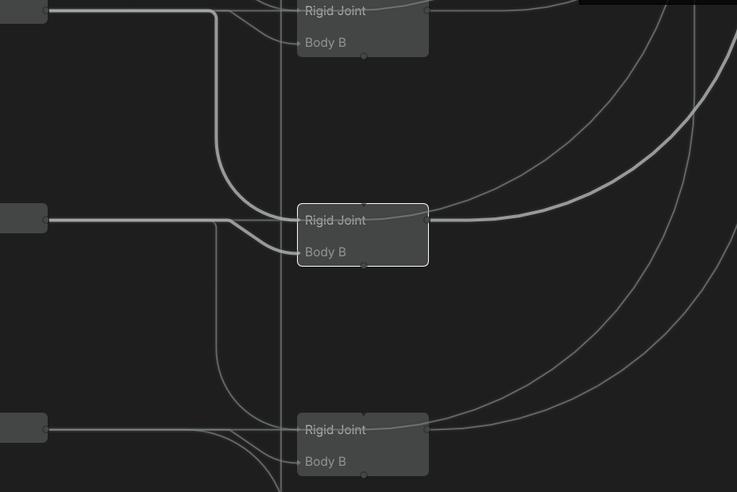
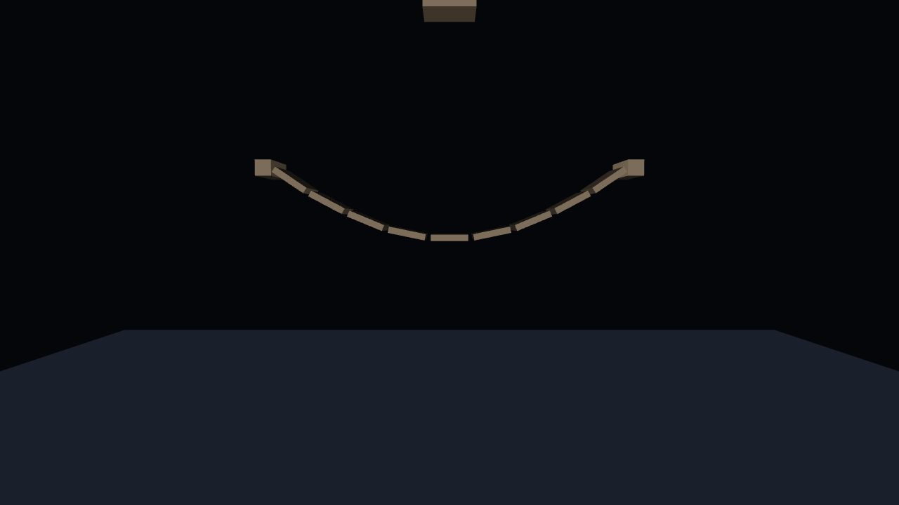

# Physics

The physics package is five operators and nothing else: bodies, joints and forces are **pure data
producers**, one `PhysicsWorld` operator owns the actual Bepu simulation, and `RigidBodyPoints` picks
one description's bodies back out of the world for drawing. The world collects the
descriptions from the surrounding graph, creates/updates/removes the Bepu bodies and constraints,
steps them at a fixed rate, interpolates the poses for rendering and publishes everything as a point
buffer.

That split is why `RigidBody` and `RigidJoint` have no simulation state of their own: a body's id is
fixed for the lifetime of the operator instance, which is how the world recognises the same body
across evaluations and only rebuilds what actually changed. Joints become solver constraints between
two bodies; a static body cannot be a joint anchor, so use a kinematic body as the fixed point
instead. A body is rebuilt only when its shape, kind or mass changes, and a joint whose settings
change is removed and re-added, so a constraint is never duplicated.

## PhysicsWorld

Owns the Bepu simulation for the whole graph. It gathers the `RigidBody` and `RigidJoint`
descriptions, builds or updates the world, advances it at `FixedRate` with optional substepping, and
publishes the resulting poses as a point buffer that `DrawMeshAtPoints` instances can render. `SimTime`
is the simulated seconds since the last rebuild, useful for syncing or debugging.

- `Gravity` is the world gravity vector (default is Earth-like).
- `FixedRate` is the simulation step rate in Hz; `Substeps` splits each step for stability.
- `SolverIterations` trades solver quality against cost.
- `TimeScale` slows or speeds the simulation without changing the graph time.
- `Interpolate` smooths rendered poses between fixed steps.
- `IncludeStatics` includes static bodies in the published buffer.
- `Multithreaded` and `Deterministic` control the solver's threading/determinism.
- `ContactStiffness` tunes contact softness.
- `Reset` rebuilds the simulation state; `Paused` freezes stepping while keeping the graph running.
- `Forces` takes `RigidForce` descriptions.
- `MaxContacts` is the length of the `Contacts` buffer; `ContactSpeed` is the closing speed from
  which an impact is reported.

*Robustness:* a non-finite input from an upstream graph (NaN or Infinity) cannot poison the
simulation — gravity keeps its last valid value, and `FixedRate`, `TimeScale` and `ContactStiffness`
fall back to their defaults before being clamped. An exception inside the world is logged once and
resets the outputs instead of escaping into the evaluator.

**Outputs:** `OutBuffer` (per-body pose data for the mesh renderers), `BodyCount`, `SimTime`,
`Contacts` and `ContactCount`.

Each point of `OutBuffer` carries the body's pose and scale, the color of the point it was spawned
from, and its current speed in `F2`. Bodies appear in connection order, and the bodies of one
instanced `RigidBody` in the order of its points or geometry parts.

`Contacts` holds this frame's impacts as points: position, an orientation whose Z axis follows the
contact normal, and the impact speed in `F1`. The buffer always has `MaxContacts` points, because
consumers read the count from the buffer size; unused points have zero scale and `F1` = 0. An
impact is reported once, in the frame it happens, so it suits emitting sparks or dust.

*Tip:* the simulation advances with `context.Playback.FxTimeInBars`, so it runs while playback is
stopped — pump frames to see motion.

*Gravity, solver and stepping parameters with the live example.*

*The world collects the bodies and feeds the draw operator.*

*Five dynamic bodies above a static floor.*

## RigidBody

Describes Bepu bodies: shape, kind, transform, size, mass and material parameters. On its own it is
one primitive body. Two optional inputs turn it into many:

- `Points` (a CPU point list): one body per point. The point's position, rotation and scale place
  and size the body relative to `Position` and `Rotation`. GPU points go through
  `ReadPointsFromGpu` first. A point that moves teleports its body, like a changed `Position`.
- `Geometry`: the bodies collide as the geometry. Without `Points` every geometry part becomes its
  own body, so `VoronoiFracture` → `RigidBody` is a shattering object. With `Points` the whole
  geometry sits at every point. The published pose is the pose of the part's pivot, which is what
  `GeometryToMeshChunks` and `DrawMeshChunksAtPoints` expect.

Shape `ConvexHull` wraps each piece in a convex hull; `Mesh` uses the exact triangles and is for
static and kinematic bodies (a dynamic `Mesh` body is simulated as its hull). With geometry
connected, a primitive `Shape` picks `ConvexHull` for dynamic and `Mesh` for static bodies. A volume
collides the same way: `VolumeToMesh` → `Geometry`, `Kind` Static.

`CollisionGroup`: bodies with the same non-zero group pass through each other.

Describes one Bepu body in the simplest case: shape, kind, transform, size, mass and material parameters. The operator
publishes the description; `PhysicsWorld` turns it into a Bepu body and keeps it in sync. The body id
is fixed for the lifetime of this instance, so the world recognises the same body across evaluations.

- `Shape` selects box, sphere, capsule, cylinder, convex hull or mesh.
- `Kind` is dynamic, kinematic or static.
- `Position`, `Rotation` place the body; `Size`, `Radius`, `Length` dimension it.
- `Mass` sets the dynamic mass (kinematic/static ignore it).
- `LinearVelocity` / `AngularVelocity` give it an initial push.
- `Friction` and `Bounciness` are the contact material.
- `LinearDamping` / `AngularDamping` bleed off motion.
- `GravityScale` scales gravity for this body (0 = floaty, negative = inverted).
- `Enabled` removes it from the simulation without deleting the operator.

**Output:** `OutBody` — the description consumed by `PhysicsWorld` and by joints.

*Tip:* render the bodies by connecting instances of the same mesh through `TransformMesh` to
`DrawMeshAtPoints`, or draw a single mesh and let the buffer place it per body.

*One of the five ball descriptions.*

*A body wired into `PhysicsWorld`.*

*Bodies rendered at the world's published poses.*

## RigidJoint

Declares a constraint between two bodies: **BallSocket**, **Hinge**, **Weld** or **DistanceServo**.

`Mode` decides what is linked when body A stands for many bodies:

- **Pair** (default): A to B, instance by instance. A single body on one side is shared by all
  instances of the other.
- **Chain**: consecutive instances of A — a rope from a line of points.
- **Nearby**: every two instances of A that start within `LinkDistance` — nets and clumps.
- **World**: every instance of A is held where it starts. With **Weld** its rotation is held too.

Chain, Nearby and World ignore body B and anchor themselves from the starting positions, so the
linked bodies keep their initial arrangement.

`AutoAnchor` (Pair mode) puts the joint at body B's starting position and works out A's anchor and
axis from where the bodies start, so one joint fits every instance of B — four wheels on one chassis.
`HingeAxisB` is then the axis.

`MotorSpeed` (Hinge) drives the pair around the hinge axis, in radians per second. `SwingLimit`
(BallSocket) is the largest angle in degrees between `HingeAxisA` and `HingeAxisB`, which keeps a
limb from folding back.

`InstanceIndex` narrows Pair and World to one instance: World with `InstanceIndex` 0 hangs a rope by
its first link. -1 means every instance, and a number past the end means the last one.

Like `RigidBody` it is pure data — `PhysicsWorld` creates, updates and removes the Bepu constraint.
Both bodies must be dynamic or kinematic; a static body cannot be an anchor, so use a kinematic body
as the fixed point.

- `BodyA` / `BodyB` are the two constrained bodies.
- `JointType` selects the constraint.
- `LocalOffsetA` / `LocalOffsetB` are the anchor points in each body's local space; for a ball socket
  they are the same world point seen from each body.
- `HingeAxisA` / `HingeAxisB` are the hinge axes in each body's local space.
- `Frequency` / `DampingRatio` tune the servo's spring.
- `TargetDistance` is the rest length for the distance servo.
- `Enabled` removes the constraint without deleting the operator.

**Output:** `OutJoint`. Chain several joints to build ropes, bridges, ragdolls and mechanisms.

*A hinge constraint between two bridge planks.*

*Joints linking the bridge segments.*

*The constraint chain holding the sagging bridge.*

## RigidBodyPoints

The world publishes all its bodies in one point buffer, which a draw operator can only draw with one
mesh. `RigidBodyPoints` takes the world's `OutBuffer` and one `RigidBody` and outputs a buffer with
just that description's bodies, static and kinematic ones included. Use one per kind of body: chassis
and wheels, paddle and balls, or each of several fractured objects.

**Outputs:** `Points`, `Count`.

## RigidForce

Describes a force for the world's dynamic bodies. **Directional** pushes along `Direction`,
**Radial** pulls towards `Position` (negative `Strength` pushes away), **Vortex** swirls around the
axis through `Position`, and **Field** samples a connected `VectorField` at each body — for
example the `Vectors` output of `VolumeToField`.

- `Strength` is an acceleration; with `ScaleByMass` heavy bodies react less.
- `Radius` and `Falloff` limit Radial and Vortex forces.
- `IsImpulse` applies the force once each time `Trigger` turns on, as a velocity change.
- `CollisionGroup` restricts the force to bodies of that group.

**Output:** `OutForce`, for the `Forces` input of `PhysicsWorld`.

## SDF fields as colliders

Physics runs on the CPU and the SDF field graph runs on the GPU, so a field reaches physics by being
sampled: `GridPoints` (a 3D grid) → `SampleFieldPoints` → `ReadPointsFromGpu` → `SdfPointsToGeometry`
→ the `Geometry` input of a static `RigidBody`. `SdfPointsToGeometry` (in `Lib.geometry`) extracts the
surface from the distances the points carry. Any field works: `SphereSDF`, a `CombineSDF` of several
shapes, or a volume through `VdbToSdfField`. See `PhysicsSdfFieldExample`.

The point grid sets the detail. The field is sampled when the points are read back, so an animated
field needs `UpdateContinuously` on `ReadPointsFromGpu`, and rebuilds the collider when it changes.

## RigidBodyGeometry

The way back from physics into the geometry operators: the simulated bodies of one `RigidBody` as
geometry. Physics runs on the CPU and so does geometry, so an object needs to be described only once.

- A body made from **geometry** returns that same geometry with every part moved by its body
  (`VoronoiFracture` → `RigidBody` → `PhysicsWorld`, then `RigidBodyGeometry` → `GeometryToMesh`).
  With `Points` connected it returns one copy of the geometry per body.
- A **primitive** body returns a box, sphere, capsule or cylinder of its own size, so it needs no
  separate mesh either.

Every body is one part of the result, and bodies spawned from points carry the point color as a
`Color` part attribute. The result is ordinary geometry, so any geometry operator can follow it.

**Inputs:** `World` (the world's `OutBuffer`), `Body`. **Outputs:** `Result`, `Count`.

*Cost:* the geometry is rebuilt and uploaded every frame. For many identical bodies,
`RigidBodyPoints` with `DrawMeshAtPoints` is cheaper.

## Examples

All of them build the world, feed it bodies and draw the result through `RigidBodyGeometry` → `GeometryToMesh`:
the bodies are drawn as the geometry of their own colliders, so no example keeps a second mesh in step with
its physics shapes. Together they cover every collider shape and joint type.

| Example | Shows |
| --- | --- |
| `PhysicsBouncingBallsExample` | Five spheres with bounciness from 0 to 1 — restitution |
| `PhysicsDominoRunExample` | Fifteen boxes falling in a row — stacking and contact stability |
| `PhysicsNewtonsCradleExample` | Five spheres hung on ball sockets — constrained motion |
| `PhysicsParticlesExample` | 77 spheres raining onto a floor — throughput |
| `PhysicsRopeBridgeExample` | A ten-link bridge held by ball sockets — chains |
| `PhysicsSeesawExample` | A plank on a hinge over a kinematic fulcrum — hinges |
| `MeshPhysicsExample` | Bodies driven along a path by distance servos |
| `PhysicsCapsulesAndCylindersExample` | Capsules and cylinders — the two shapes the others skip |
| `PhysicsWeldedPairsExample` | Balls welded into pairs — weld joints as compound bodies |
| `PhysicsBrickWallExample` | 80 bricks from one `CubeGeometry` and a grid of points, drawn through `RigidBodyGeometry` — one geometry as collider and drawing |
| `PhysicsFractureExample` | A `VoronoiFracture` cube dropped on the floor — one convex body per geometry part |
| `PhysicsPlanetExample` | 200 moons pulled onto a planet with gravity off — radial `RigidForce` |
| `PhysicsRopeExample` | 24 links from a line of points, hung by the first — Chain and World joints, `InstanceIndex` |
| `PhysicsNetExample` | A 14×14 net draped over a sphere — Nearby joints, collision groups |
| `PhysicsVortexExample` | 300 boxes in a whirlwind — vortex, radial and directional forces together |
| `PhysicsContactsExample` | Bouncing balls with a flash at every impact — the `Contacts` output |
| `PhysicsVolumeColliderExample` | Balls raining on a torus made from a volume — `VolumeToMesh` as a static mesh collider |
| `PhysicsCarExample` | A chassis on four motorised wheels driving into boxes — `AutoAnchor`, `MotorSpeed`, `RigidBodyPoints` |
| `PhysicsMotorExample` | A motorised paddle on a kinematic hub sweeping balls away — hinge motor |
| `PhysicsRagdollExample` | Six ragdolls from ten bodies and nine joints — instanced Pair joints with `SwingLimit` |
| `PhysicsVdbColliderExample` | 300 balls on the bunny from `bunny.vdb` — `LoadVdb` → `VolumeResample` → `VolumeToMesh` as a static collider |
| `PhysicsVolumeCsgExample` | A bowl carved from a block with `VolumeCsg` catches the balls — edited volumes as colliders |
| `PhysicsVolumeGravityExample` | A torus volume pulls 300 boxes onto itself — `VolumeToField` vectors into a Field `RigidForce` |
| `PhysicsToVolumeExample` | A falling pile of balls wrapped in one skin — world poses → `VolumeFromPoints` → `VolumeToMesh` |
| `PhysicsSdfFieldExample` | Balls on a shape that is only an SDF field (`BoxSDF` minus `SphereSDF`) — sampled with `SampleFieldPoints`, meshed by `SdfPointsToGeometry` |

The last sixteen are generated by `gen-physics-examples.py`; their set-ups are also simulated headlessly
in `Tests/Lib.Tests/Physics/PhysicsExampleScenesTests.cs`.
