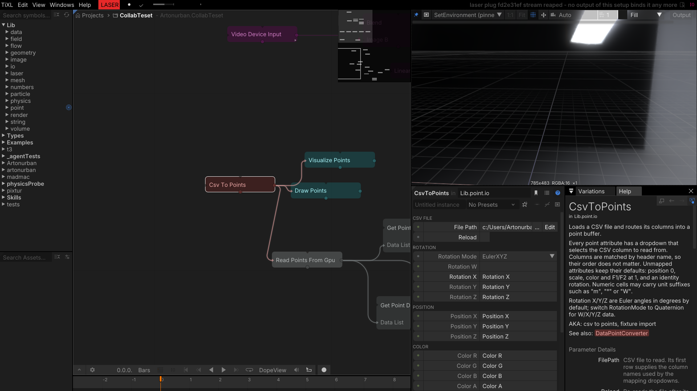
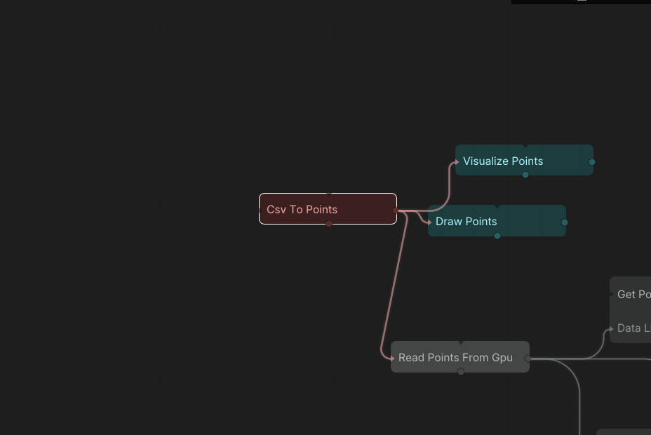
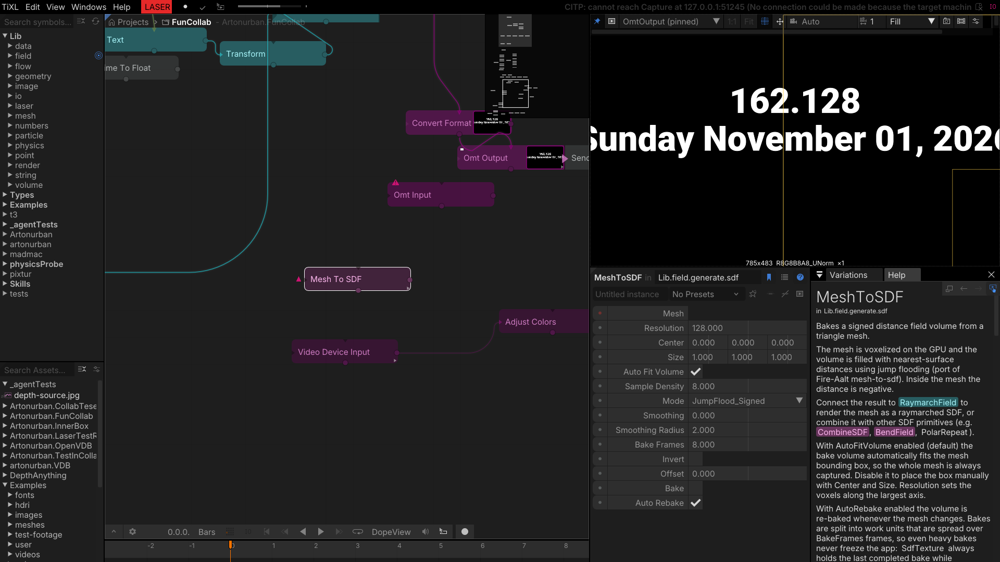
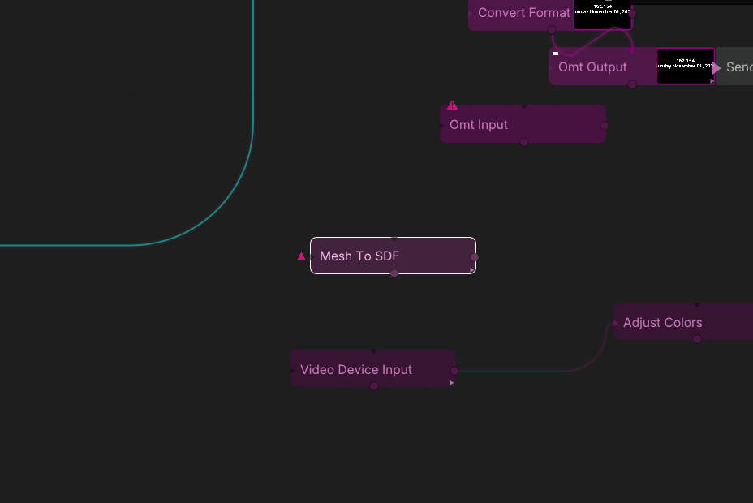

# Utilities

## CsvToPoints

Loads a CSV file and routes its columns into the attributes of a point buffer. Every point attribute
has a dropdown that selects the column to read from; columns are matched by header name, so their
order does not matter and unused columns are ignored. Rotations can be Euler XYZ or quaternion
(`RotationW` …), which makes the operator a fixture import path for lighting desks and a general
bridge from spreadsheets to point/particle graphs.

- `FilePath` is the CSV to read; the first row supplies the column names.
- `Reload` re-reads the file on a flank (the path is cached otherwise).
- `RotationMode` selects Euler XYZ or Quaternion; `RotationW/X/Y/Z` map the rotation columns.
- `PositionX/Y/Z`, `ColorR/G/B/A`, `ScaleX/Y/Z`, `F1`/`F2` map the remaining attributes.
- Columns that are not mapped keep their defaults: position 0, scale 1, color and F1/F2 at 1, identity
  rotation.
- `ColorIs0To255` interprets the color columns as 0–255 instead of 0–1.

**Output:** `Points` — feed the point renderers, `VolumeFromPoints`, or any point operator.

*Tip:* the `F1`/`F2` attributes are free per-point floats (fixture dimmer/strobe, particle lifetime,
custom shader data); the point renderers and shaders can read them.

*Column mapping for rotation, position and color.*

*The parsed points feeding the point renderers.*

## MeshToSDF

Bakes a signed distance field volume from a triangle mesh using GPU compute shaders — voxelization
followed by jump flooding — and exposes it as an SDF shader-graph field that can be raymarched with
`RaymarchField` or combined with other SDF primitives. The bake is asynchronous and split into work
units across `BakeFrames`, so heavy meshes do not freeze the editor; `BakeProgress` and
`BakeInProgress` report the state, and the previous SDF texture stays valid while a rebake runs.

- `Mesh` is the source geometry.
- `Resolution` sets the voxel count along the largest axis; `AutoFitVolume` sizes the bake box to the
  mesh automatically, or place it manually with `Center` / `Size`.
- `SampleDensity` controls the voxelization sampling density.
- `Mode` selects the jump-flood variant (e.g. `JumpFlood_Signed`).
- `Smoothing` / `SmoothingRadius` soften the baked surface.
- `BakeFrames` spreads the bake over several frames.
- `Invert` flips inside/outside; `Offset` shifts the isosurface.
- `Bake` triggers a bake; `AutoRebake` rebakes when the mesh changes.

**Outputs:** `Result` (SDF shader-graph field), `SdfTexture` (the 3D SDF texture), `BakeCount`,
`BakeProgress`, `BakeInProgress`.

*Tip:* connect `Result` to `RaymarchField`, or combine it with `CombineSDF`, `BendField` and
`PolarRepeat` before raymarching.

*The bake resolution and SDF sampling settings.*

*The mesh feeding the SDF bake in the test graph.*
