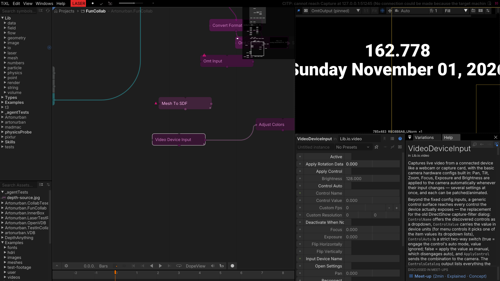
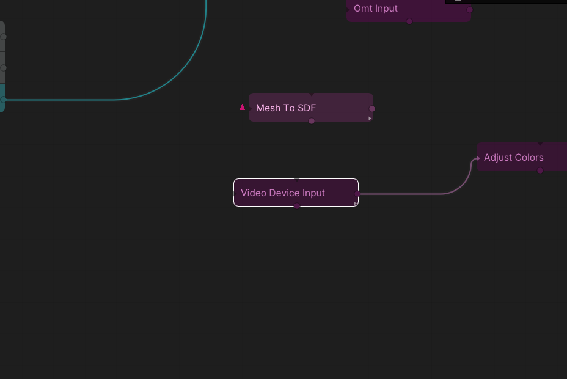

# Video input and peer cameras

## VideoDeviceInput

Captures a webcam or capture card into a texture. Devices are opened through **FFmpeg** — DirectShow
on Windows, V4L2 on Linux, AVFoundation on macOS — with software decode. This replaces the old
OpenCV/DirectShowLib capture, which crashed in OpenCV's native layer.

Beyond the fixed camera controls (Pan, Tilt, Zoom, Focus, Exposure, Brightness), a generic control
surface exposes every control the driver advertises: `ControlName` picks one, `ControlValue` carries
the value (query index for menu controls, the driver's own integer for integer menus), and
`ControlAuto` switches the driver's auto mode. `ControlsCatalog` lists what the device supports, so a
UI can be built without hard-coding a camera model.

**New this week:** the device dropdown also lists **cameras shared by other TiXL clients** in a
collaboration, boygroup or failover session. A render node can therefore capture a camera that is
plugged into a different machine — pair it with the *Share my cameras* switch in the failover panel.

- `Active` opens/keeps the camera running; `DeactivateWhenNotShowing` releases it when nothing shows
  the texture.
- `InputDeviceName` selects the device, including peer cameras from other clients.
- `CustomFps` / `CustomResolution` override the capture format.
- `ApplyRotationData`, `ApplyControl`, `Brightness`, `Focus`, `Exposure`, `ControlAuto`,
  `ControlName`, `ControlValue` drive the camera controls.
- `FlipHorizontally` / `FlipVertically` mirror the image.

**Outputs:** `Texture`, `Resolution`, `ControlsCatalog`, `UpdateCount`.

*Tip:* a camera usually allows only one process to open it. If the texture stays black while another
application is using the camera, close that application or use a peer camera from another TiXL client.

*Device selection and the camera-control parameters.*

*The capture node in a collaboration test graph.*
