# Volumes — OpenVDB and NanoVDB

The volume package builds sparse, OpenVDB-style grids on the CPU and gives them two GPU paths:

- **NanoVDB path** — `VolumeToNanoVdb` flattens the grid into the linear NanoVDB buffer layout, and
  `NanoVdbRender` ray-marches up to three of those buffers (liquid, smoke, fire) in one shader.
- **Field path** — `VolumeToTexture3D` bakes the grid into a dense 3D texture, `VolumeField` exposes
  it as a field, and `RaymarchField` renders it with TiXL's existing field pipeline.

Everything else is the CPU toolset around those paths: generate a grid, modify it, convert it to a
mesh, points or a field, and read or write it on disk.

Two conventions matter throughout. Level sets store **signed distances in world units** (negative
inside, positive outside); fog volumes store density. And the exact values only exist inside a
**narrow band** around the surface (`BandWidth` voxels) — deeper voxels keep only their sign. Smaller
voxels sharpen everything and cost memory quadratically; larger voxels are cheap and soft.

**Generate**

## VolumePrimitive

Builds an analytic primitive — sphere, box, rounded box, torus, capsule, cylinder, cone, octahedron
or plane — directly as a narrow-band level set, the way OpenVDB's `LevelSetSphere` and friends do.
The result is an exact signed distance field near the surface, with no meshing or sampling step
before you combine, noise or mesh it.

- `Shape` selects the primitive; planes and boxes use their full extents.
- `Size` is the full extent in world units — a sphere reads only its X component as the diameter.
- `Center` moves the whole grid, so a primitive's index space is tied to its position.
- `VoxelSize` is the edge length of one voxel; it drives sharpness, memory and simulation cost.
- `BandWidth` is the half-width of the narrow band in voxels (1–64). Values deeper than the band keep
  only their sign, which is enough for meshing and CSG.

**Output:** `Volume` — a level set ready for `VolumeCsg`, `VolumeNoise`, `VolumeMorphology` and
`VolumeToMesh`.

*Tip:* two primitives with different centers live in different index spaces. CSG and resample
convert them into a common grid, which is why combining a coarse and a fine primitive costs a
resample.

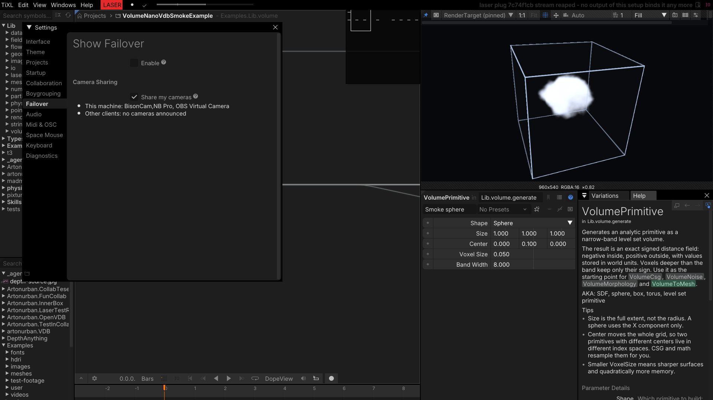
*The parameter window, operator help and the smoke example's live render behind it.*

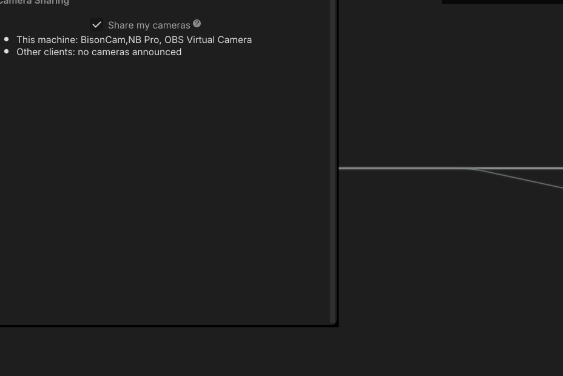
*The sphere primitive feeding `VolumeNoise` and `VolumeToNanoVdb`.*

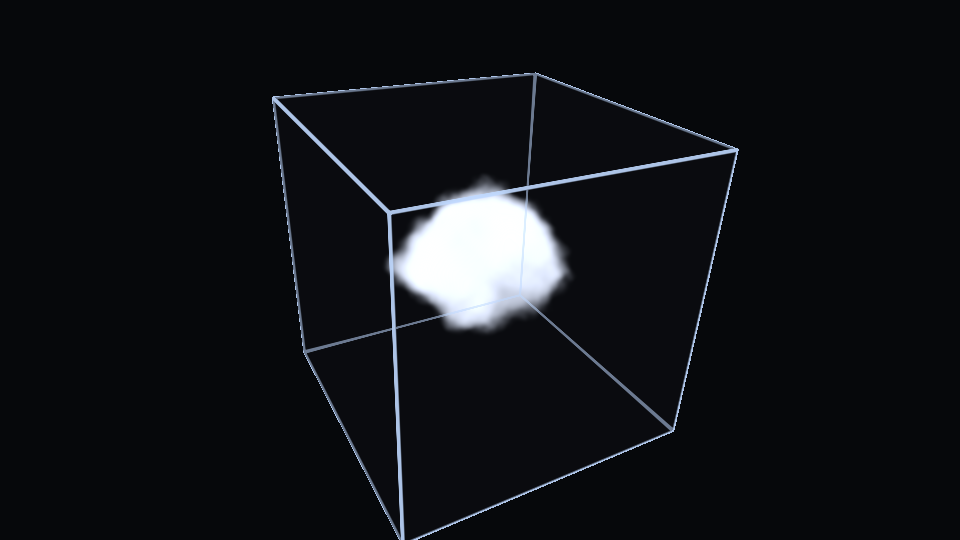
*The example's raymarched result after noise displacement.*

## VolumeFromMesh

Converts a triangle mesh into a sparse volume. Mesh mode produces a **signed distance field**
(negative inside the surface), or a **fog volume** whose density falls off from the surface, depending
on `Mode`. Distances are exact within the narrow band; the interior is only signed.

- `Geometry` is the source mesh (connect `GeometryToMesh` output).
- `VoxelSize` sets the grid resolution; the mesh's smallest feature should be at least a few voxels.
- `BandWidth` controls how far the exact distances extend; increase it for heavy morphology.
- `Mode` switches between surface SDF and fog density.

**Output:** `Volume`. Convert it back with `VolumeToMesh`, raymarch it through `VolumeToTexture3D` +
`VolumeField`, or export it with `SaveVdb`.

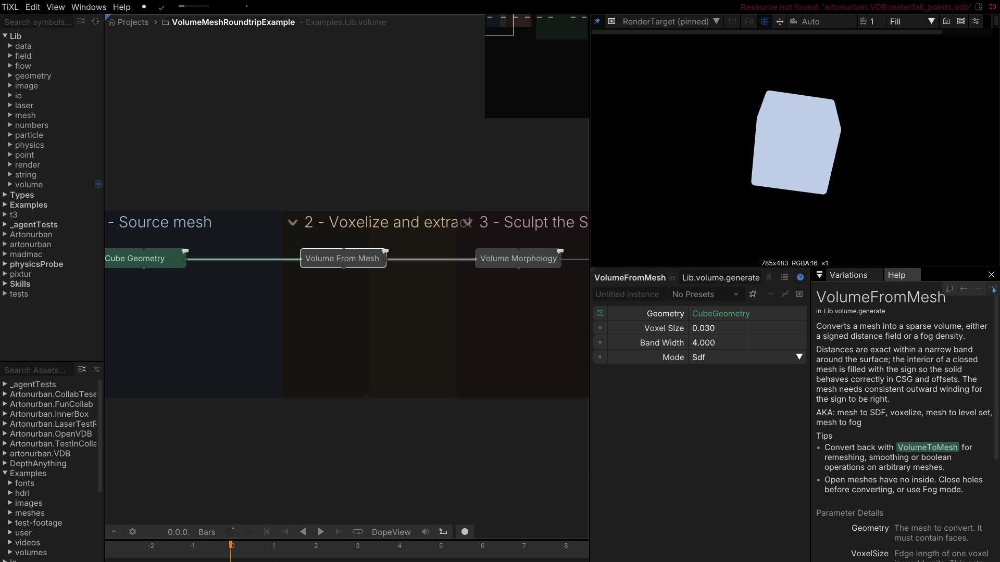
*Mesh → SDF → morphology → mesh roundtrip.*

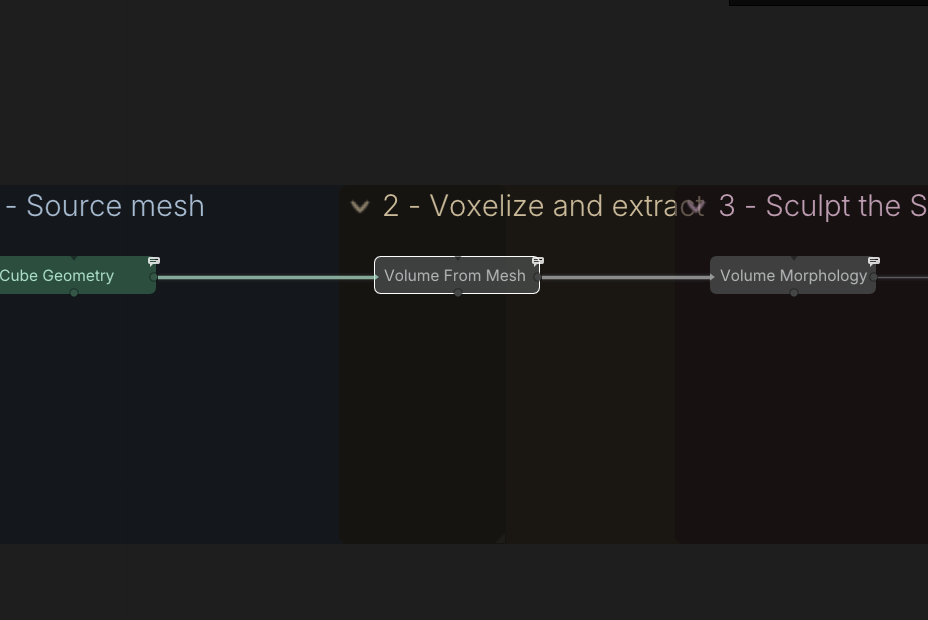
*The cube geometry is converted to a level set, smoothed and meshed again.*

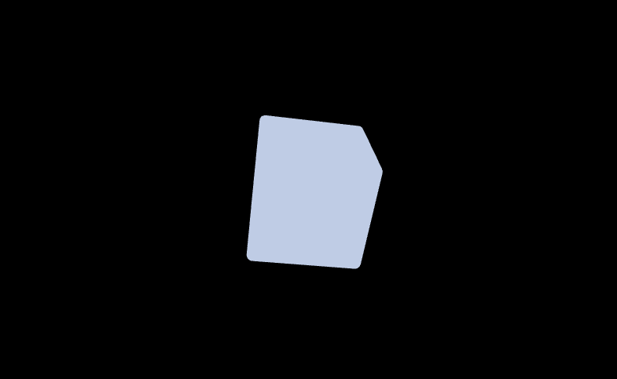
*The extracted isosurface of the converted mesh.*

## VolumeFromPoints

Splats a point list into a sparse density volume — OpenVDB's particles-to-volume. Every point
contributes a normalized falloff kernel over its radius, so the result is a fog volume rather than a
level set. It is the way to volumize particle simulations, point clouds or points scattered from
geometry.

- `Points` accepts a CPU `StructuredList` (the `Points` output of `VolumeToPoints`, `CsvToPoints`, or
  a point/particle buffer).
- `VoxelSize` sets the grid resolution; `Radius` how far each point reaches.
- `Density` scales the accumulated density; `Falloff` selects the kernel shape.

**Output:** `Volume` (density). Feed it to `VolumeToMesh` with a density isovalue, or to the fog/
texture path for clouds.

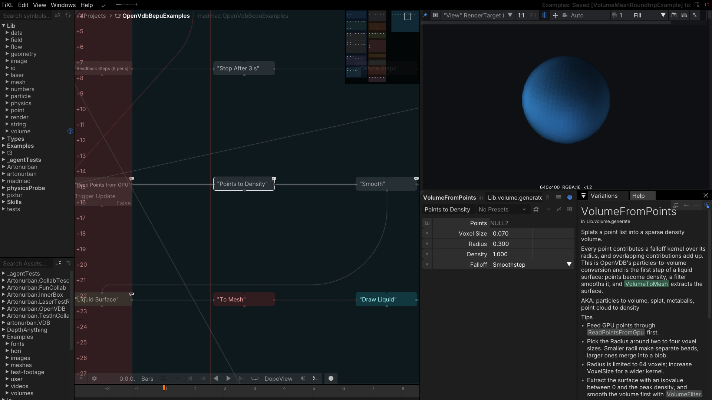
*"Points to Density" in `OpenVdbBepuExamples`.*

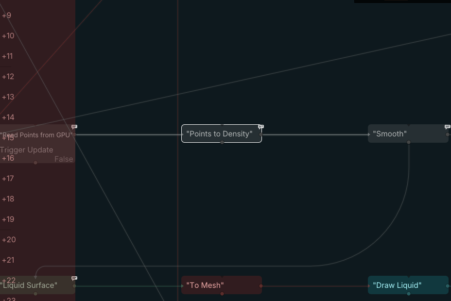
*Points to density feeding the liquid rendering branch.*

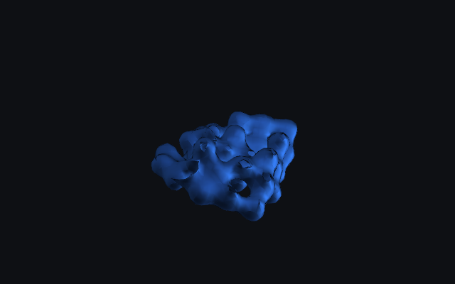
*The density volume turned into a blue liquid surface.*

## FieldToVolume

Samples a CPU scalar field into a sparse grid over a box region — the inverse of `VolumeToField`.
With a signed-distance field you get a valid level set; with any other scalar you get a fog volume.
`CustomScalarField`, noise fields, image-derived fields or a volume wrapped by `VolumeToField` all
work as the source.

- `Field` is the scalar field to sample.
- `Center` and `Size` place the box in world space.
- `VoxelSize` sets the sample spacing; it is the resolution of the resulting grid.
- `Mode` interprets the values as a level set (signed distance) or as density.

**Output:** `Volume`.

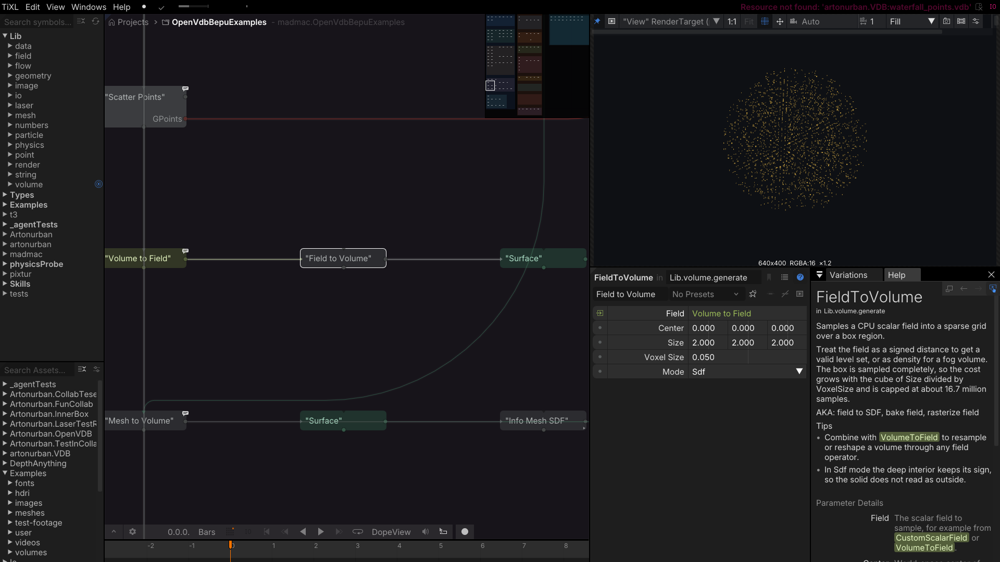
*The field-to-volume half of the volume/field bridge.*

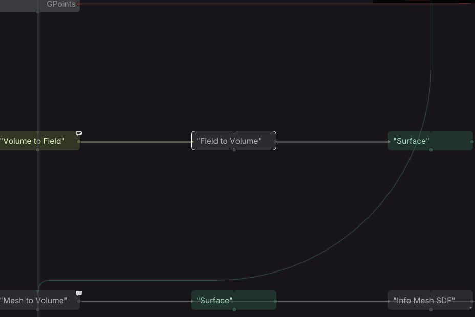
*The inverse of `VolumeToField`, closing the roundtrip.*

**Modify**

## VolumeCsg

Constructive solid geometry on level sets, matching OpenVDB's `csgUnion`, `csgIntersection` and
`csgDifference`. **Union** merges both solids, **Intersection** keeps only the overlap, **Difference**
carves B out of A. The result is a fresh level set, so it can be meshed immediately or fed into
another CSG.

- `VolumeA` is the first operand; for Difference it is the solid that is carved.
- `VolumeB` is the second operand; for Difference it is the tool that is removed.
- `Operation` selects Union, Intersection or Difference.

**Output:** `Volume`. Volumes with different voxel sizes or centers are combined into the finer grid,
so a fine operand makes the result more expensive.

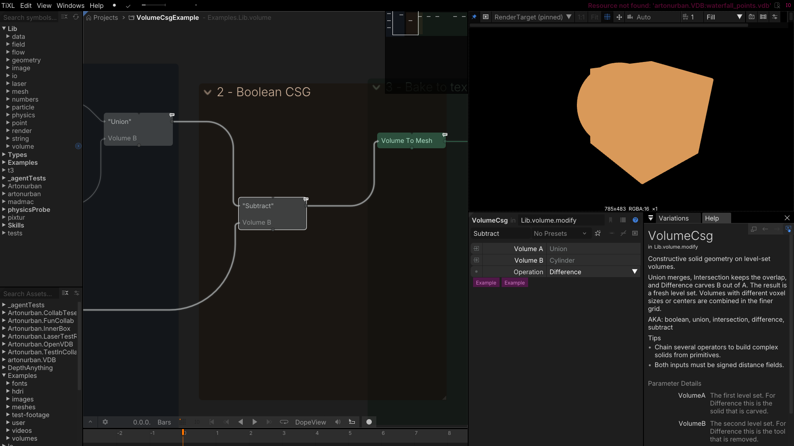
*A sphere with a cutting box subtracted, with the example's live mesh render.*

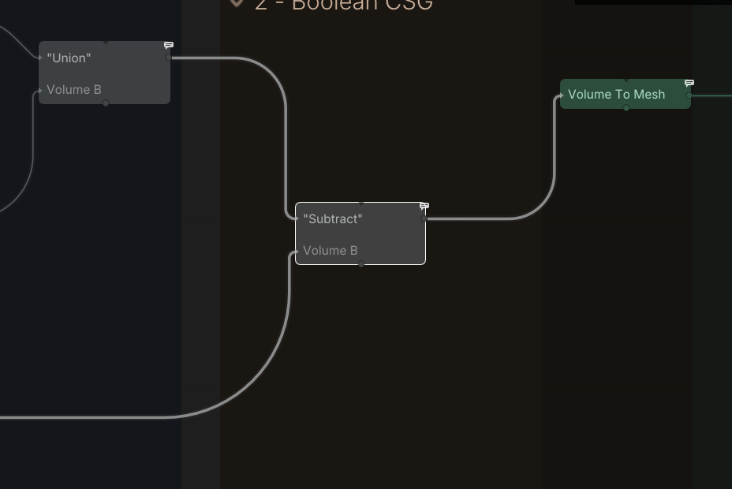
*The two operands and the resulting volume downstream.*

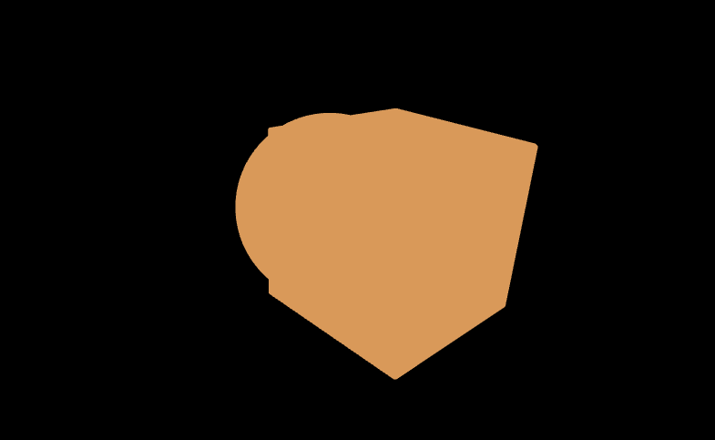
*The example meshes the boolean result and draws it unlit.*

## VolumeFilter

Smooths and adjusts the voxel values themselves — not the extracted surface. **Gaussian** and **Box**
blur noise (the classic cloud/smoke smoothing), **Median** removes outlier voxels, and **Offset**
shifts every value, which moves a level set's surface inward or outward.

- `Volume` is the grid to filter.
- `FilterType` chooses Gaussian, Box, Median or Offset.
- `Radius` is the stencil radius in voxels; larger radii are slower but smoother.
- `Iterations` repeats the filter, compounding the smoothing.
- `Offset` is the value shift for the Offset mode (world units on a level set).

**Output:** `Result`. On level sets the surface moves; on fog volumes the density changes.

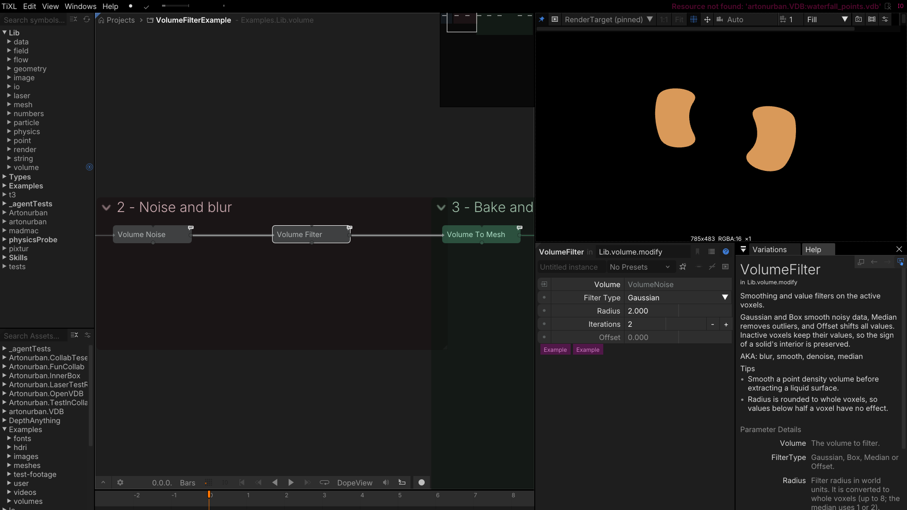
*Smoothing a noisy torus before meshing.*

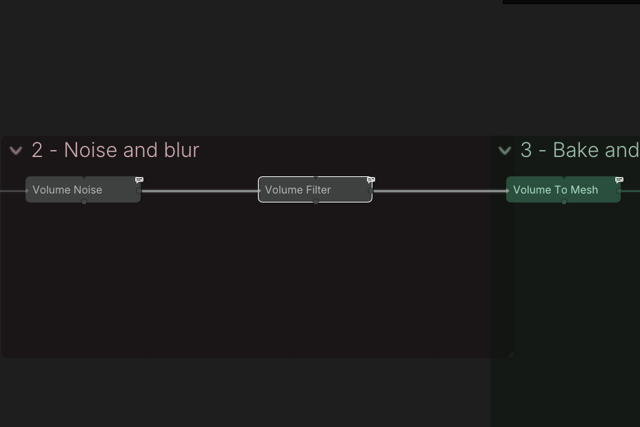
*Noise → filter → mesh → draw.*

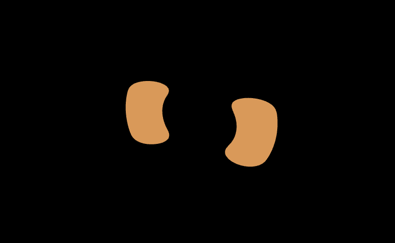
*The smoothed surface extracted from the filtered volume.*

## VolumeMath

Arithmetic between two volumes or between a volume and a constant: **Add**, **Subtract**, **Multiply**,
**Divide**, **Min** and **Max**. With `UseConstant` off, the second operand participates; voxels
missing from either volume read as background, so the operation is sparse-grid aware.

- `VolumeA` / `VolumeB` are the operands.
- `Operation` selects the arithmetic.
- `UseConstant` disables B and uses `Constant` instead.
- `Constant` is the scalar for the constant modes.

**Output:** `Result`. On level sets, adding a constant offsets the isosurface; `Max`/`Min` give
intersection/union-like combinations without a full CSG.

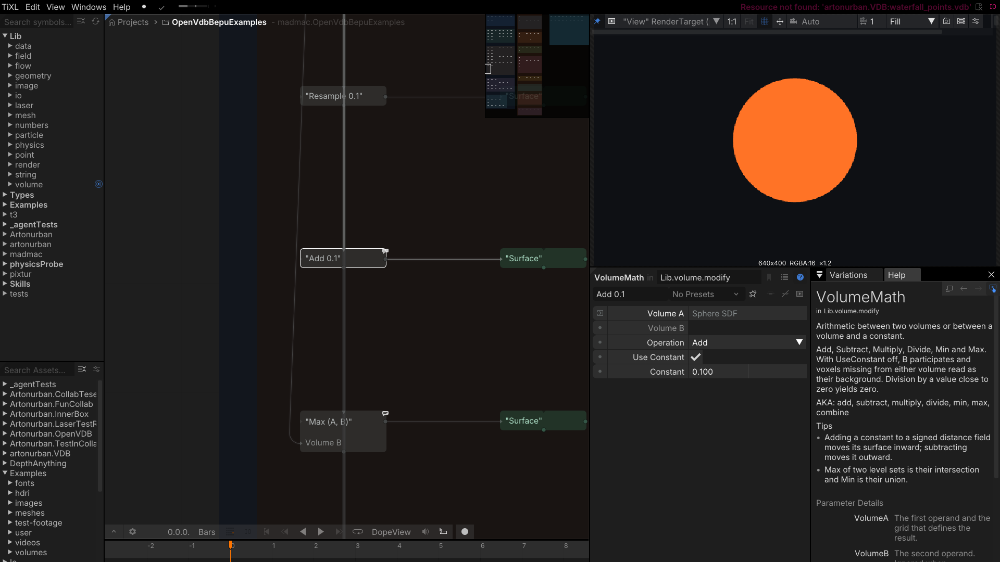
*"Add 0.1" — adding a constant shifts the level-set surface inward or outward.*

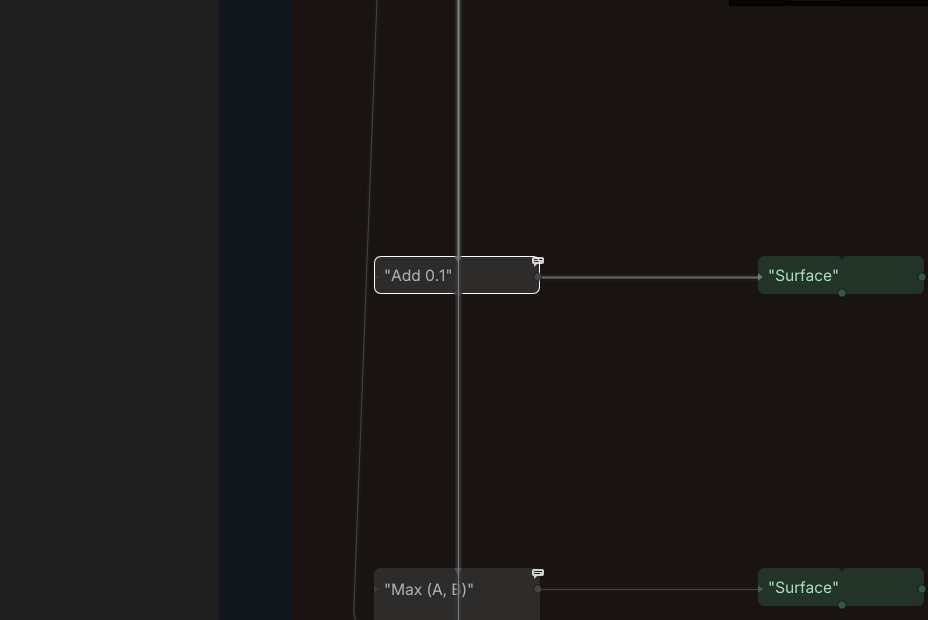
*The arithmetic branch of the test project.*

## VolumeMorphology

Morphological operations on volumes. On level sets, **Dilate** offsets the surface outward and
**Erode** inward; **Open** (erode then dilate) removes small features, **Close** (dilate then erode)
fills pinholes. Fog volumes use min/max stencil filtering instead.

- `Volume` is the grid to modify.
- `Operation` selects Dilate, Erode, Open or Close.
- `Radius` is the distance in voxels for the offset.

**Output:** `Result`. Morphology changes the topology, so you can break a thin shell into pieces or
fuse nearby blobs.

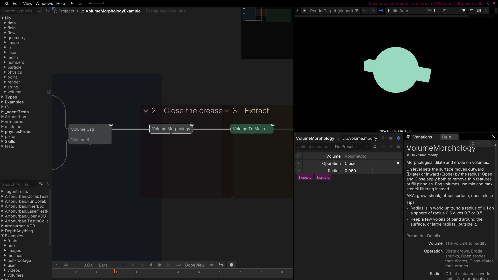
*Growing and shrinking a level set before meshing.*

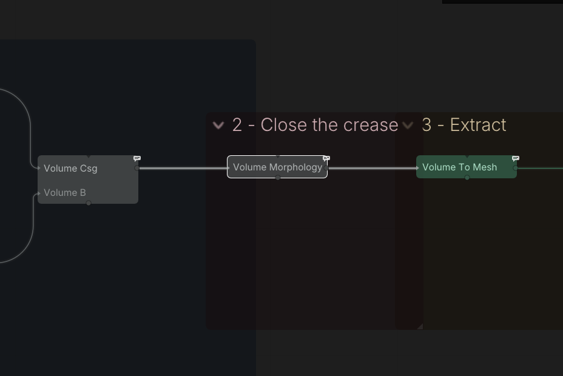
*The morphology step in the example chain.*

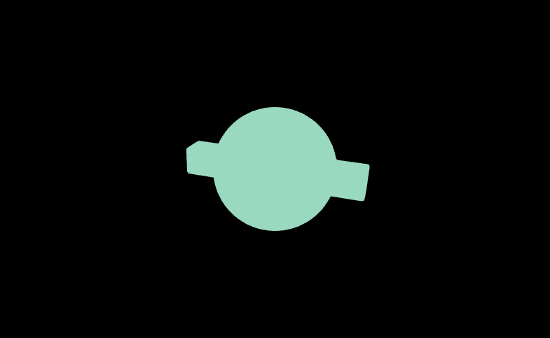
*The modified surface extracted as a mesh.*

## VolumeNoise

Adds procedural fractal noise to a volume. **Perlin**, **Simplex** or **Worley** noise can be
combined with **fBm**, **Ridged** or **Billow** fractals. **Add** and **Multiply** modulate values;
**Replace** overwrites them; **Displace** pushes level-set surfaces along the noise, which is the
organic-shape workhorse.

- `Volume` is the input grid.
- `Seed` makes the pattern repeatable.
- `NoiseType` and `Fractal` choose the base noise and the octave combination.
- `Octaves` is the number of detail layers; `Frequency` the scale in space.
- `Amplitude` is the strength. In Displace mode it is measured in voxels, so an amplitude of 2 moves
  the surface by about two voxels.
- `Offset` shifts the noise field; animate it to make the noise flow.
- `Mode` selects Add, Multiply, Replace or Displace.

**Output:** `Result`.

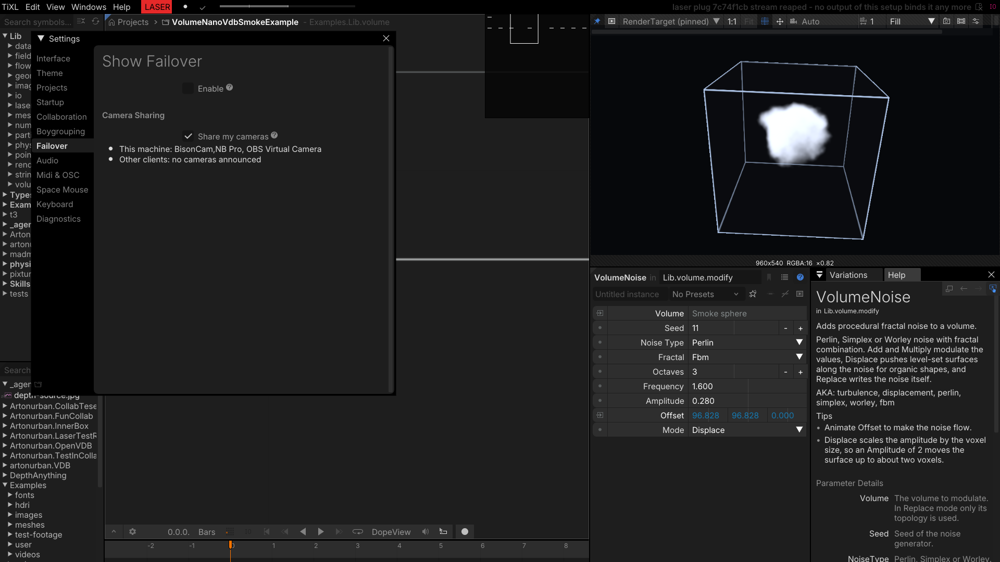
*Noise parameters with the live smoke render.*

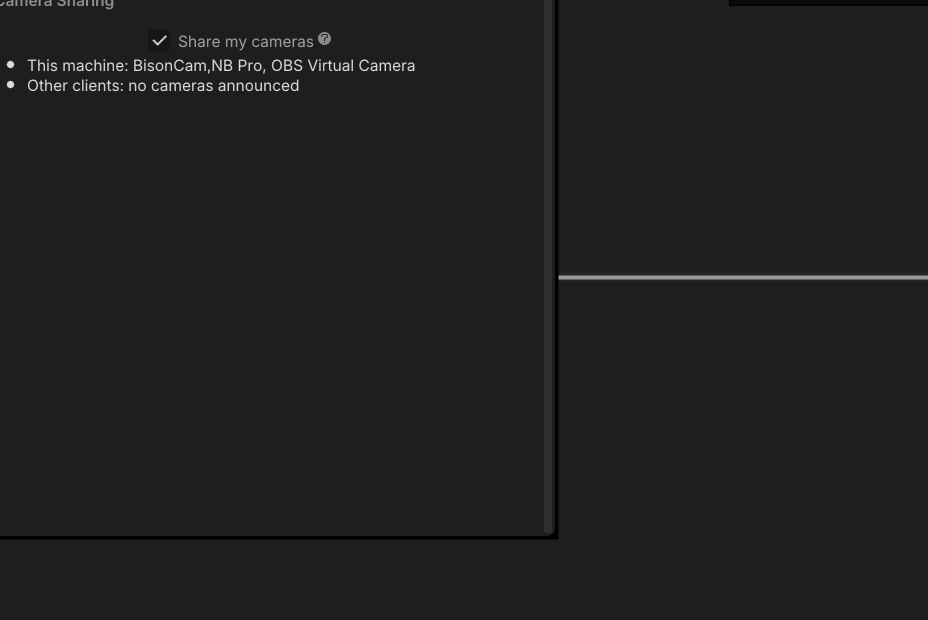
*Animating `Offset` makes the noise flow.*

*Displaced level set rendered through NanoVDB.*

## VolumeResample

Changes a volume's voxel size, resampling the values trilinearly (OpenVDB's `resampleToMatch`).
Smaller voxels add detail and memory; larger voxels are cheaper and smoother. Resampling is also how
volumes with different index spaces are brought into a common grid.

- `Volume` is the source grid.
- `VoxelSize` is the target edge length.

**Output:** `Result`, in the new grid.

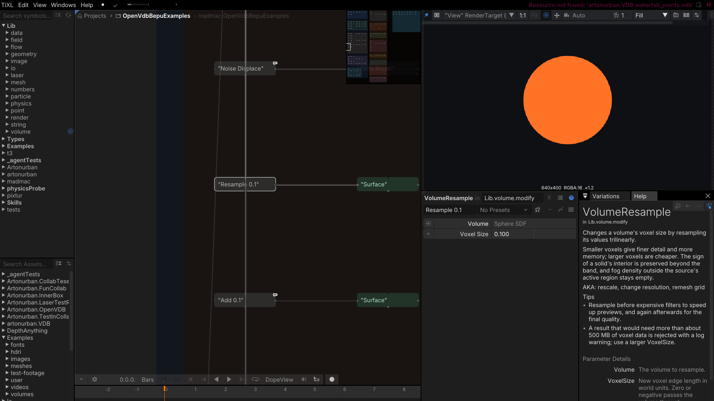
*"Resample 0.1" changing the grid resolution.*

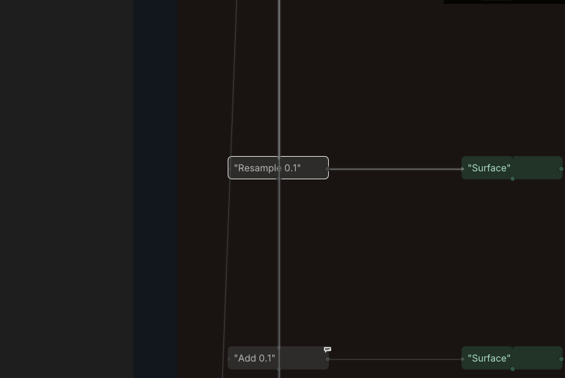
*Resampling before surface extraction.*

**Convert**

## VolumeToMesh

Extracts an isosurface from a volume as a triangle mesh with marching cubes, sharing vertices and
using gradient normals. Isovalue 0 extracts a level set's surface; for fog volumes pick a density
cutoff. The mesh is watertight unless the volume was clipped or corrupted.

- `Volume` is the grid to extract.
- `Isovalue` is the surface value; 0 for level sets, a density threshold for fog.

**Output:** `Geometry` — convert with `GeometryToMesh` and draw with `DrawMesh`/`DrawMeshUnlit`.

*Tip:* small voxels give detailed but heavy meshes; morphology before extraction is cheaper than
extracting at a very fine voxel size.

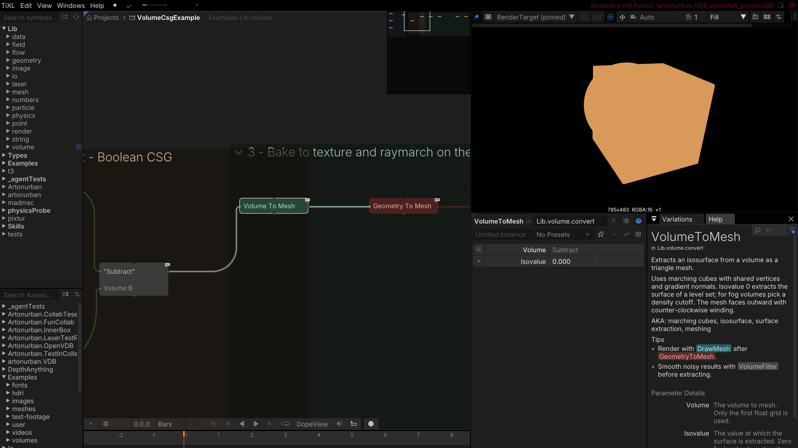
*Surface extraction from a CSG result.*

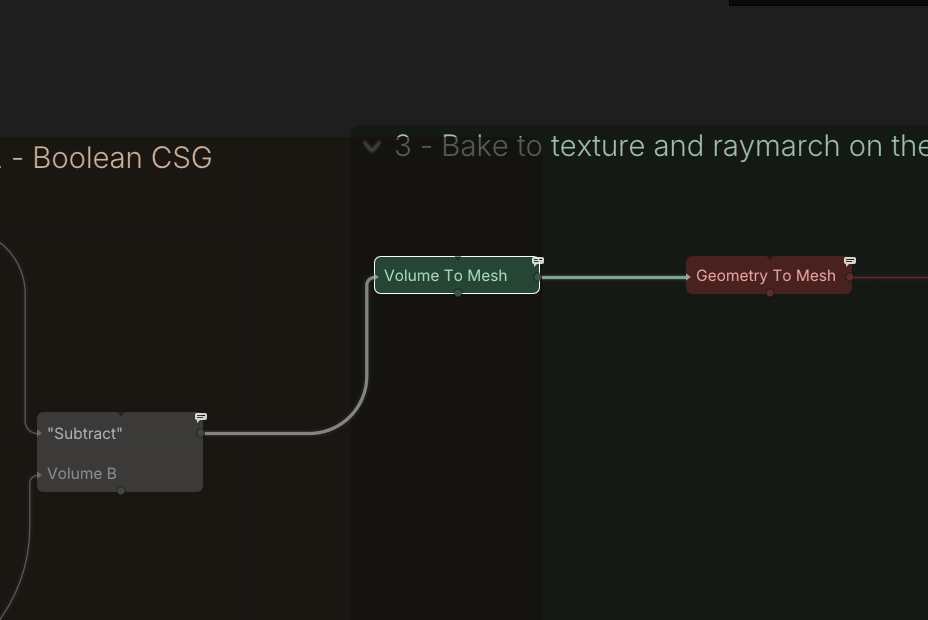
*Mesh → `GeometryToMesh` → `DrawMeshUnlit`.*

*The boolean result meshed and drawn.*

## VolumeToPoints

Converts volume voxels into a point list, either the active voxels above a threshold (highest values
first) or a uniform random subset of them. Points feed the point and particle operators, or
`VolumeFromPoints` again after editing.

- `Volume` is the source grid.
- `Mode` selects thresholded active voxels or random scattering.
- `Isovalue` is the threshold for the thresholded mode.
- `MaxPoints` caps the output; the highest values win.
- `Seed` makes the random subset repeatable.

**Outputs:** `Points` (CPU `StructuredList`) and `GPoints` (the same points on a GPU structured buffer
for point renderers such as `DrawBillboards`).

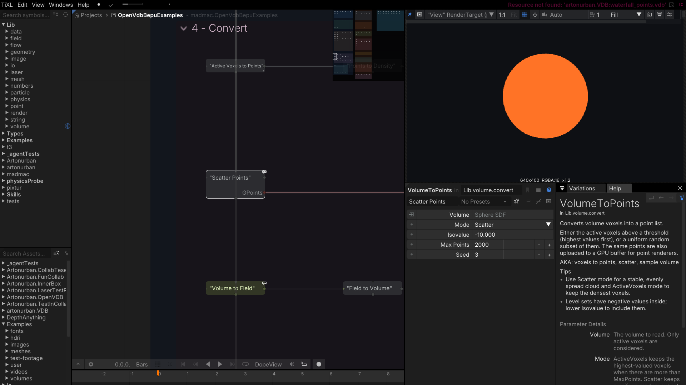
*"Scatter Points" with the point render downstream.*

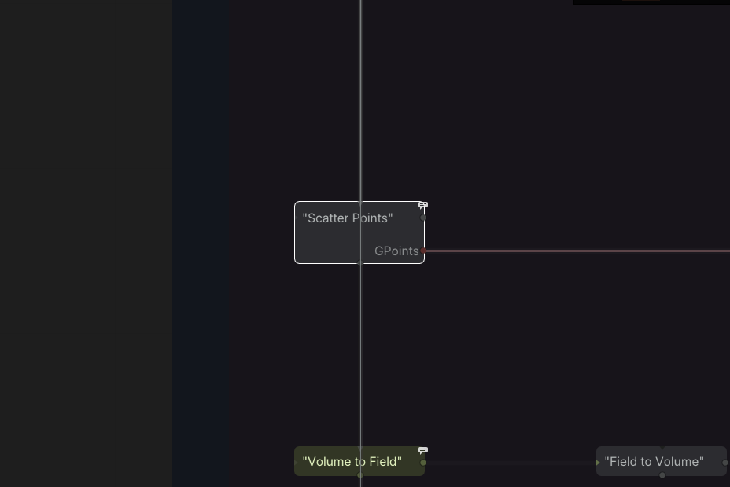
*The point cloud branch of the test project.*

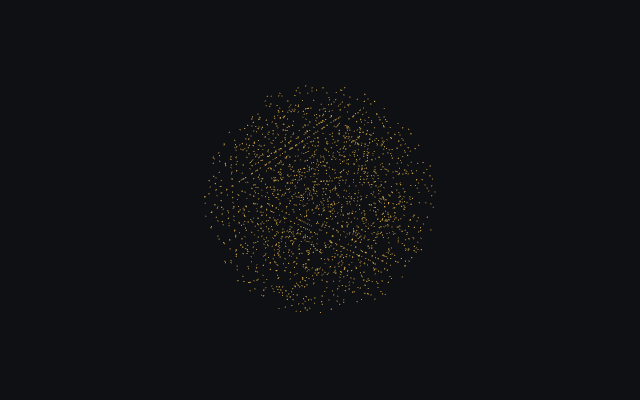
*The active voxels drawn as a point sphere.*

## VolumeToField

Wraps a volume in a CPU scalar field that samples it trilinearly in world space. The field plugs into
everything that consumes scalar fields: `DisplaceGeometry`, `ScatterPointsInVolume` density and field
SDF combinations. This is the bridge from sparse volumes to TiXL's field operators.

- `Volume` is the grid to wrap.
- `Scale` and `Offset` remap the sampled values.
- `OutsideValue` is returned where the volume has no data.

**Output:** `Field`.

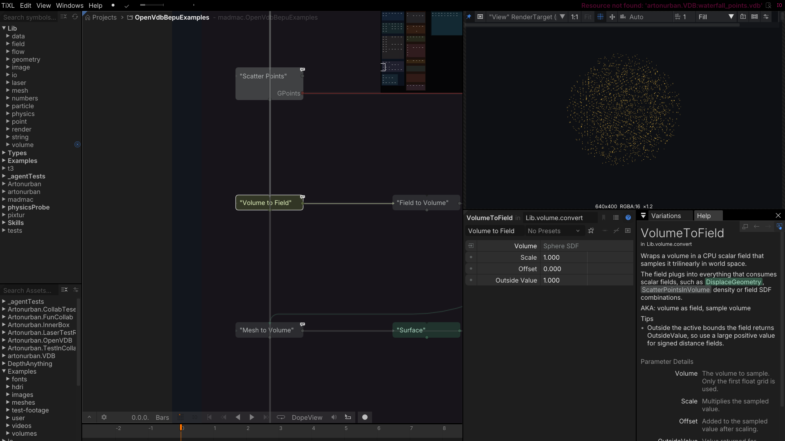
*The volume → field direction of the bridge.*

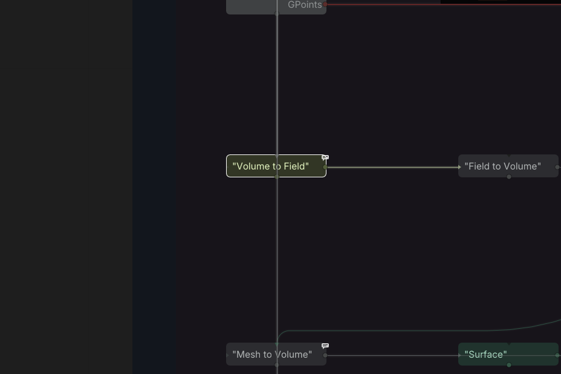
*The field consumed by `FieldToVolume` in the same test branch.*

## VolumeToTexture3D

Bakes a volume into a dense R32Float 3D texture plus its world-space bounds — the GPU bridge for
raymarching. Connect the texture to `VolumeField` and feed that into `RaymarchField`. The bake
density is capped by `MaxResolution`, so huge volumes are downsampled rather than exhausting memory.

- `Volume` is the source grid.
- `MaxResolution` caps the voxel count along the largest axis.

**Outputs:** `Texture`, `BoundsMin`, `BoundsMax`. Pass both bounds outputs 1:1 to `VolumeField`.

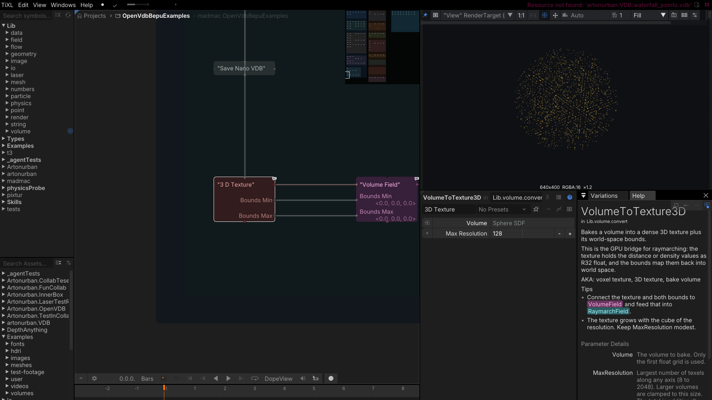
*"3D Texture" baking the volume.*

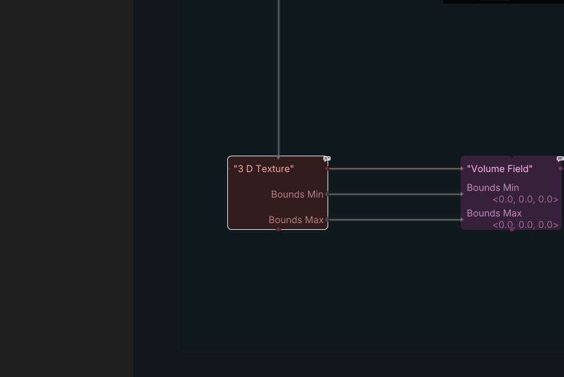
*Texture and bounds feeding `VolumeField` and `RaymarchField`.*

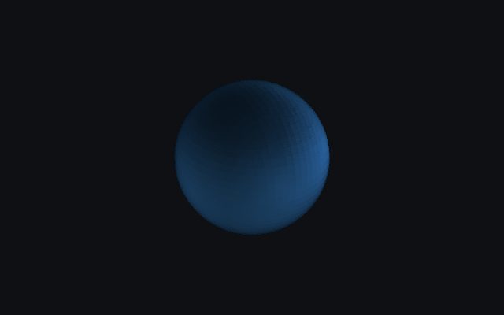
*The blue sphere rendered through the field pipeline.*

## VolumeToNanoVdb

Flattens the volume into a NanoVDB buffer — the GPU-ready linear grid layout — and uploads it as a
structured uint buffer for custom HLSL traversal. `TreeOffsets`, `VoxelCount` and `VoxelSize`
describe the grid; the `ShaderResourceView` is what `NanoVdbRender` samples. The CPU flattening is
the expensive part, so keep voxel sizes moderate for animated volumes.

- `Volume` is the source grid.

**Outputs:** `Buffer`, `ShaderResourceView`, `TreeOffsets`, `VoxelCount`, `VoxelSize`.

*Tip:* `NanoVdbRender` expects all three grid inputs (liquid, smoke, fire) connected so the shader's
register order is stable; use the amount inputs to hide the grids you do not need.

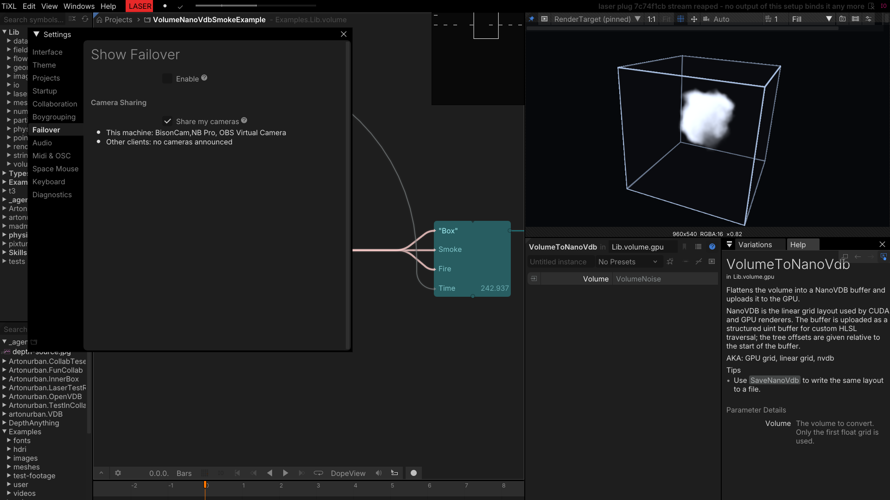
*Liquid, smoke and fire grids uploaded to the GPU.*

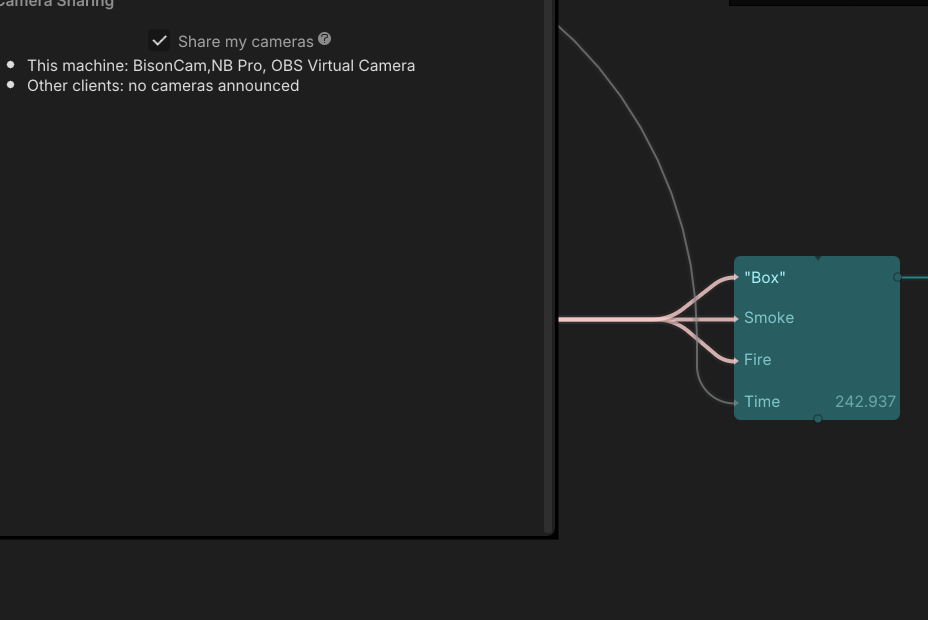
*Three grid inputs on the renderer must be connected so the shader registers stay in order.*

*The NanoVDB buffer raymarched in the example.*

**Render**

## NanoVdbRender

Ray-marches up to three NanoVDB grids — a liquid level set, smoke and fire — inside a glass box,
straight from the GPU buffers of `VolumeToNanoVdb`. The shader treats the liquid grid as a reflective
surface, and the smoke/fire grids as volumes whose density comes from the depth below their zero
level plus a procedural-noise breakup. The output is a draw command; place the operator inside a
camera's scene.

- `Liquid`, `Smoke`, `Fire` take the `ShaderResourceView` of three `VolumeToNanoVdb` ops.
- `LiquidAmount`, `SmokeDensity` and `FireIntensity` switch the contributions on and off.
- `BoxMin` / `BoxMax` define the world-space glass box; rays are clipped to it.
- `StepCount` is the raymarch resolution; `Time` animates the noise.
- `LiquidColor`, `SmokeColor`, `SmokeSoftness`, `FireSoftness`, `NoiseAmount` and `EdgeColor` shape
  the look.
- `LightDirection` lights the liquid and the volume.

**Output:** `DrawCommand`. Then add an `OrbitCamera` or use the scene's camera.

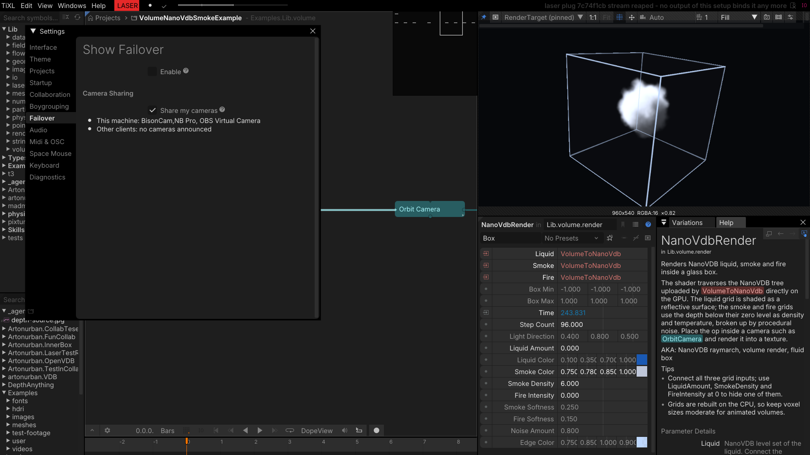
*The three grid inputs, box bounds and shading parameters.*

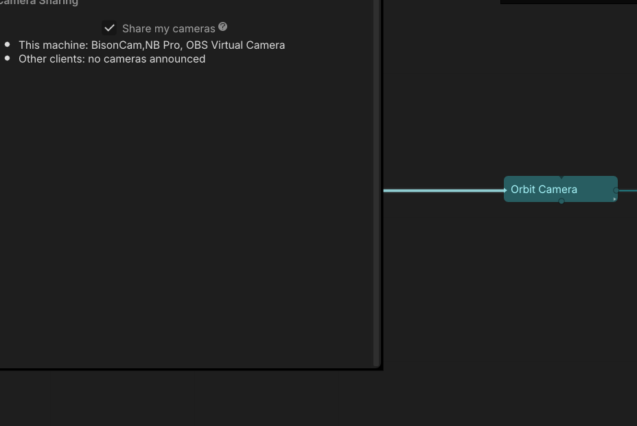
*Liquid, smoke and fire from `VolumeToNanoVdb`.*

*Smoke in the glass box.*

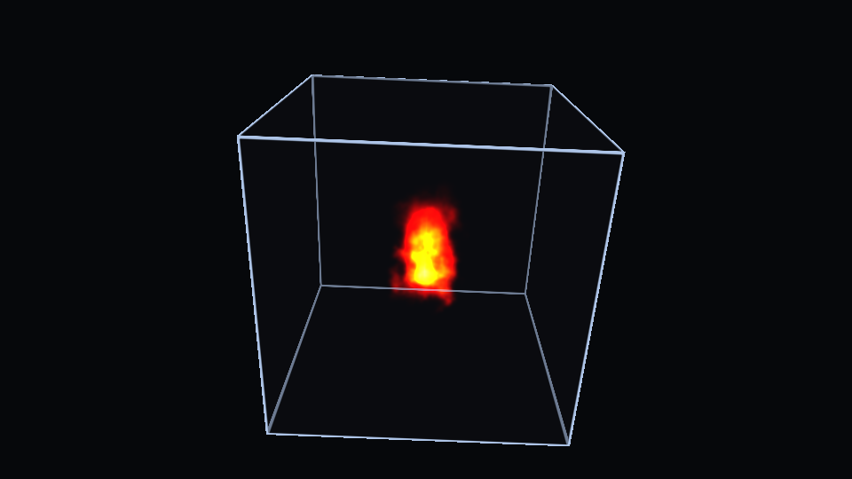
*The same renderer with fire intensity driven up.*

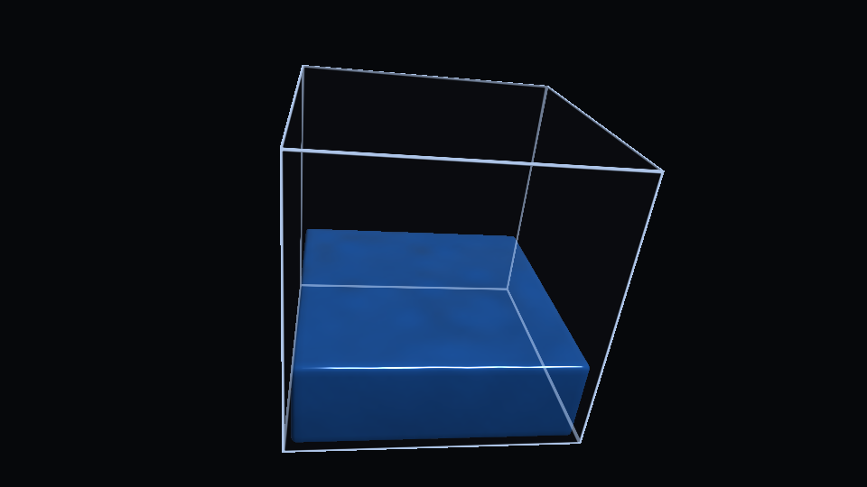
*Liquid mode with a reflective surface.*

## VolumeField

Samples a 3D texture baked from a volume (`VolumeToTexture3D`) as a field for `RaymarchField` — this
is how volumes get raymarched with TiXL's existing field pipeline. Map the bounds outputs 1:1 from
`VolumeToTexture3D`; the field is then a normal field and combines with other SDF fields.

- `Texture` is the baked 3D texture.
- `BoundsMin` / `BoundsMax` are the world-space bounds of the bake.
- `ValueScale` / `ValueOffset` remap the sampled values.
- `OutsideValue` is returned outside the bounds.

**Output:** `Result` (shader-graph field). Feed it into `RaymarchField`.

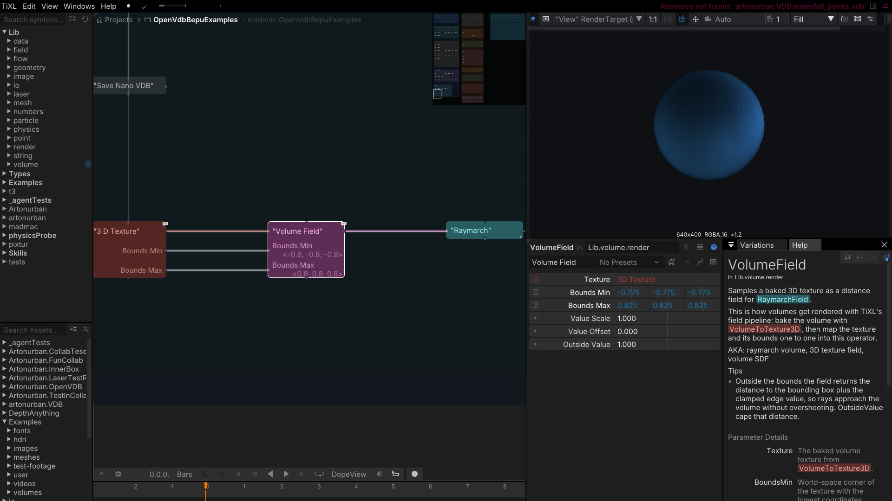
*The field wrapper for the baked 3D texture.*

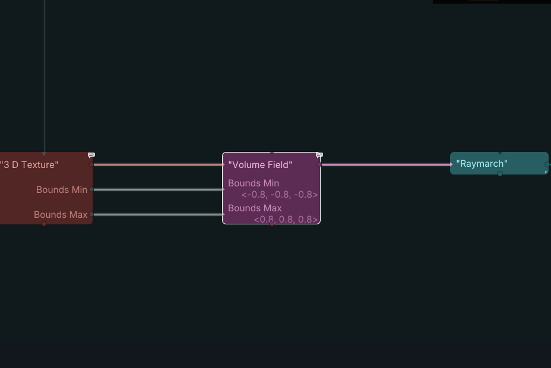
*Texture and bounds wired from `VolumeToTexture3D`.*

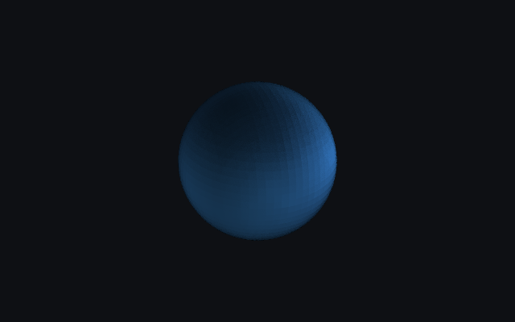
*The volume rendered through the field pipeline.*

**I/O and analysis**

## LoadVdb

Loads grids from an OpenVDB `.vdb` file — uncompressed, zip- or blosc-compressed data as written by
Houdini, Blender, Maya or TiXL. Float grids become the primary volume data; vector grids (velocity,
color) ride along in the same set. The file is watched and reloaded when it changes.

- `Path` is the `.vdb` file.
- `GridName` selects a grid when the file contains several; leave empty for the first.

**Output:** `Volume`.

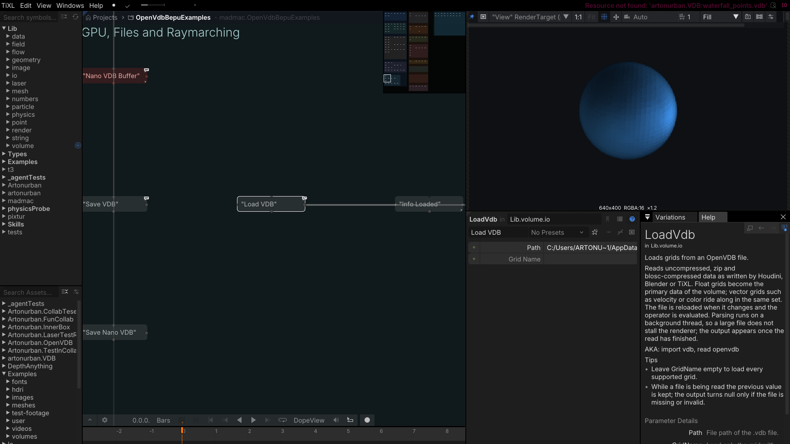
*"Load VDB" with the grid name and file path.*

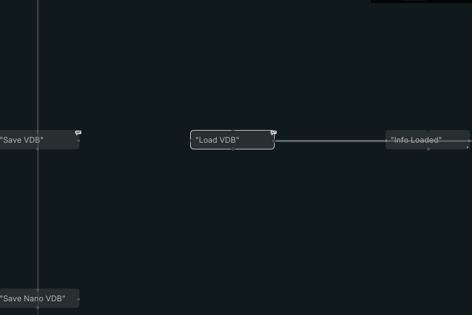
*Loaded volume feeding `VolumeToMesh` and `VolumeInfo`.*

## SaveVdb

Writes the volume's grids to an OpenVDB `.vdb` file readable by Houdini, Blender, Maya and TiXL. It
saves once whenever `Save` switches from off to on, not every frame.

- `Volume` is the grid set to write.
- `Save` is the trigger (false → true).
- `ZipCompression` enables zip compression; blosc check the file size against load time.

**Output:** `Saved` — true after a successful write.

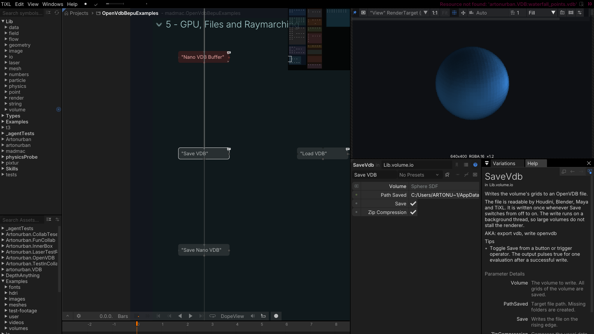
*The save controls and zip-compression option.*

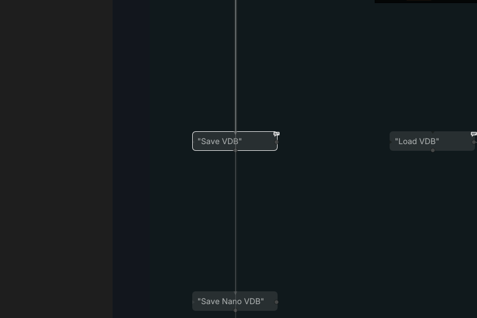
*The file-output branch of the test graph.*

## SaveNanoVdb

Writes the volume as a NanoVDB `.nvdb` file: the GPU-flattened grid format used by CUDA renderers and
the reference NanoVDB library. Like `SaveVdb`, it writes on the off→on flank of `Save`.

- `Volume` is the grid to write.
- `Save` triggers the export.

**Output:** `Saved`.

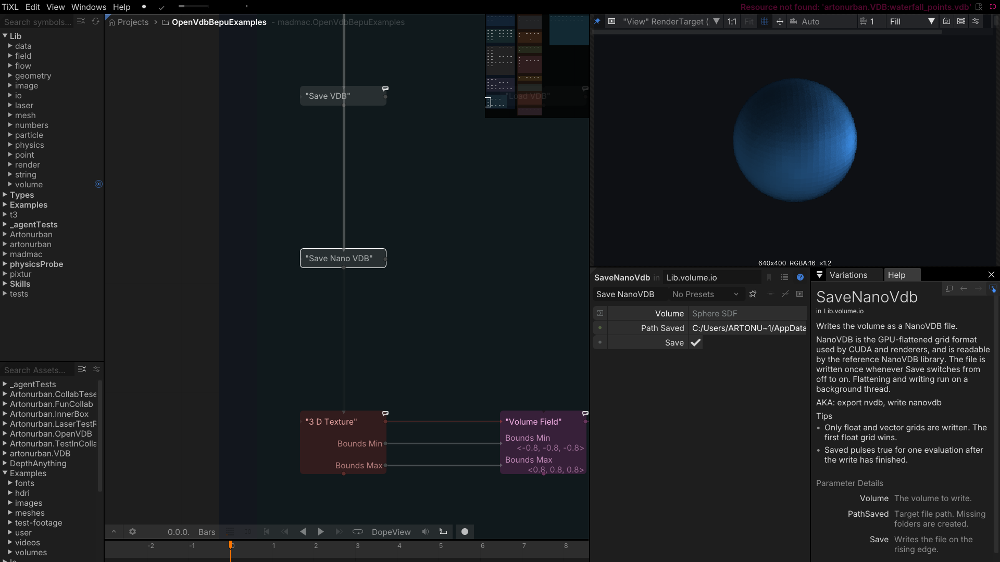
*The NanoVDB export trigger.*

*Exporting the same volume that the GPU renderer uses.*

## VolumeInfo

Reports volume statistics as OpenVDB diagnostics: active voxel count, memory footprint, value range
and NaN/Inf corruption counts. Put it on any branch to catch broken volumes early — a NaN or an
unexpected voxel count usually explains a mesh or render that looks wrong.

- `Volume` is the grid to inspect.
- `LogToConsole` prints the report when enabled.

**Outputs:** `ActiveVoxels`, `MemoryMB`, `HasNaN`, `Min`, `Max`, `Average` — all pullable as values,
so you can drive warnings or clamps from them.

*"Info Union" reporting the statistics of a CSG result.*

*The diagnostics branch of the test graph.*

## Volumes with physics and with SDF fields

Five example graphs show how volumes meet the rest of the library:

| Example | Shows |
| --- | --- |
| `VolumeSdfCombineExample` | A volume wrapped by `VdbToSdfField` and blended with a `SphereSDF` through `CombineSDF` — a volume is one more SDF field |
| `PhysicsVdbColliderExample` | `bunny.vdb` as a static collider: `LoadVdb` → `VolumeResample` → `VolumeToMesh` → `RigidBody` |
| `PhysicsVolumeCsgExample` | A `VolumeCsg` result as a collider |
| `PhysicsVolumeGravityExample` | The `Vectors` output of `VolumeToField` as a force on rigid bodies |
| `PhysicsToVolumeExample` | Rigid-body poses turned into a volume with `VolumeFromPoints` |

`VolumeToField` has a second output, `Vectors`: the volume's vector grid when it has one, otherwise the
gradient of its float grid. It is a CPU `VectorField`, which is what `RigidForce` takes.

For anything that is only rendered, edit the shape with field operators after `VdbToSdfField` instead of
with the volume operators: it needs no rebuild. The volume operators are for results that must exist as
data — a saved file, a mesh, or a physics collider.
